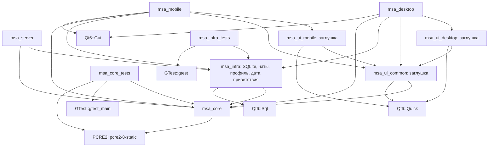
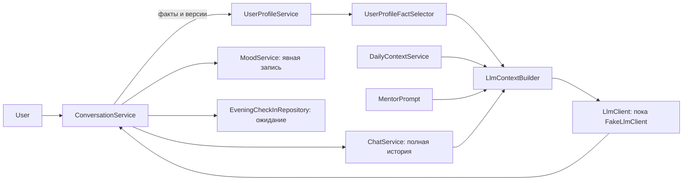

# Архитектура

## Текущее состояние

Проект разделён на статические библиотеки слоёв и три исполняемые цели.
Реальная предметная функциональность находится в `src/core`: парсер команд,
типы планировщика, абстрактные интерфейсы и сервисы напоминаний по времени и месту, календаря, привычек, задач, создания/изменения событий, предупреждений о событиях и ежедневного приветствия. Связки парсера с репозиториями
или приложениями пока нет. `UserProfileService` добавляет факты памяти пользователя,
`DailyContextService` формирует сводку дня для будущего контекста LLM.
`EveningCheckInService` подготавливает вечерний опрос с 20:00 один раз за день.
`MoodService` записывает явно указанное настроение и возвращает историю без удаления
старых записей; вызов из чата реализован через ConversationService с тестовым
LLM-клиентом, анализ настоящей моделью ещё не проверен.
`ChatService` управляет несколькими чатами, восстанавливает текущий выбор, сохраняет
полную переписку и отбирает последние целые сообщения по явному бюджету символов.
`LlmContextBuilder` объединяет готовые инструкции, вопрос, выбранные факты, сводку
и историю по общему бюджету текста; соединения с моделью пока нет.
`UserProfileFactSelector` отбирает полные факты по словам вопроса в тексте и ручных
тегах; alwaysInclude получает приоритет независимо от темы.
`LlmClient` задаёт полный типизированный ответ, общие проверки запроса и результата,
отделяет тон от предложения записи. Реализация пока только тестовая,
HTTP и JSON-разбор отсутствуют.
`ConversationService` связывает эти части, MentorPrompt задаёт согласованные
инструкции. Ожидание вечернего ответа хранится в EveningCheckInRepository.
Предложения фактов сохраняются через UserProfileService автоматически: с ID
источника и дневника, точные повторы пропускаются, исправления создают версии.
Прежние записи остаются, отбор профиля для LLM использует только актуальные версии.
Поток «клиент → сервер → хранилище» не реализован.

`infra` содержит основу SqliteDatabase: открытие нового файла, внешние ключи,
проверку версии и принадлежности, миграции и вложенные транзакции. Базовая версия 1
без предметных таблиц; sqliteMigrations() добавляет версию 2 с чатами, сообщениями
и текущим выбором для SqliteChatRepository, затем версию 3 с фактами профиля,
тегами, источниками и ссылками версий для SqliteUserProfileRepository, затем версию 4
с датой приветствия для SqliteGreetingRepository. Пользователь выбрал пустую базу без
импорта старых данных. Остальные SQLite-репозитории и общие транзакции операций
чата ещё не подключены.

`msa_server` содержит только `return 0` и базу не создаёт. Оба клиента создают
`QGuiApplication` и входят в цикл событий без окна, QML-движка и моделей.
Библиотеки `ui/*` пока содержат только заглушки.

## Слои и зависимости

Стрелки показывают фактические прямые зависимости целей в `target_link_libraries`.
Узлы приложений пока представляют каркас; основа SQLite проверяется тестами отдельно.

- `core` не использует Qt, файлы или сеть. Исключение из правила «только stdlib» —
  приватная зависимость от PCRE2 для Unicode-регулярных выражений (решение 11).
- `infra` зависит от `core` и Qt6::Sql; есть основа SQLite и репозитории чатов, профиля и даты приветствия.
  Остальных SQLite-репозиториев, часов и внешних сервисов пока нет.
- `ui/common` зависит от `core` и Qt Quick; платформенные UI-библиотеки — от
  `ui/common` и Qt Quick. UI и `infra` напрямую не связаны.
- Приложения линкуют нужные слои, но пока не создают и не связывают предметные объекты.
- `tests/core` содержит тестовые реализации интерфейсов; они не входят в приложения.

Qt ищется один раз в корневом CMake; поэтому установленный Qt нужен для конфигурации
всего проекта. `msa_core` с Qt не линкуется; `msa_server` получает Qt Sql
транзитивно через infra по решению 40.
При `ANDROID` подключаются общий и мобильный UI и мобильное приложение.
Иначе подключаются сервер, desktop UI, desktop-приложение и тесты core/infra.
Все библиотеки и приложения требуют C++20. QML-файлов и `qt_add_qml_module` пока нет.

## Модули

| Модуль | Что есть сейчас | Путь |
| --- | --- | --- |
| CommandParser | Разбор UTF-8 текста в `Command`, без выполнения действий | `src/core/include/msa/core/CommandParser.h`, `src/core/src/CommandParser.cpp` |
| LlmContextBuilder | Сборка готовых данных в запрос по общему бюджету текста без изменения источников | `src/core/include/msa/core/LlmContextBuilder.h`, `src/core/src/LlmContextBuilder.cpp` |
| LlmMessage | Сообщение запроса с ролью System/User/Assistant без HTTP или JSON | `src/core/include/msa/core/LlmMessage.h` |
| LlmClient | Контракт полного ответа, общие проверки, тон и предложение записи с исходной заметкой | `src/core/include/msa/core/LlmClient.h`, `src/core/src/LlmClient.cpp` |
| ConversationService | Связка чата, контекста, LLM, явного дневника и ожидания опроса | `src/core/include/msa/core/ConversationService.h`, `src/core/src/ConversationService.cpp` |
| MentorPrompt | Согласованные инструкции ментора, JSON и состояние ожидания | `src/core/include/msa/core/MentorPrompt.h`, `src/core/src/MentorPrompt.cpp` |
| ChatService | Создание и выбор чатов, полная история и отбор последних сообщений по бюджету текста | `src/core/include/msa/core/ChatService.h`, `src/core/src/ChatService.cpp` |
| ChatRepository | Интерфейс хранения чатов, сообщений и выбранного ID | `src/core/include/msa/core/ChatRepository.h`, `src/core/src/ChatRepository.cpp` |
| Chat и ChatMessage | Чат с названием и временем; сообщение с ролью, полным текстом и временем | `src/core/include/msa/core/Chat.h`, `src/core/include/msa/core/ChatMessage.h` |
| DailyContextService | Текст сводки: дата/время, события, пять открытых задач, прогресс привычек | `src/core/include/msa/core/DailyContextService.h`, `src/core/src/DailyContextService.cpp` |
| MoodService | Явная запись настроения с полным текстом и история по календарным дням | `src/core/include/msa/core/MoodService.h`, `src/core/src/MoodService.cpp` |
| MoodRepository | Интерфейс добавления и чтения дневника без очистки по возрасту | `src/core/include/msa/core/MoodRepository.h`, `src/core/src/MoodRepository.cpp` |
| MoodEntry | Запись настроения: ID, время, MoodScore и полный текст | `src/core/include/msa/core/MoodEntry.h` |
| EveningCheckInService | Подготовка вечернего опроса раз за день с 20:00 | `src/core/include/msa/core/EveningCheckInService.h`, `src/core/src/EveningCheckInService.cpp` |
| EveningCheckInRepository | Интерфейс хранения даты последнего подготовленного опроса | `src/core/include/msa/core/EveningCheckInRepository.h`, `src/core/src/EveningCheckInRepository.cpp` |
| EventWarningService | Предупреждения за час, накануне и в день события с отметками выдачи | `src/core/include/msa/core/EventWarningService.h`, `src/core/src/EventWarningService.cpp` |
| EventWarningRepository | Интерфейс отметок ID + дата вхождения + вид предупреждения | `src/core/include/msa/core/EventWarningRepository.h`, `src/core/src/EventWarningRepository.cpp` |
| EventService | Создание и изменение всей серии событий с проверкой ввода | `src/core/include/msa/core/EventService.h`, `src/core/src/EventService.cpp` |
| TaskService | Создание, изменение, завершение и сортировка задач | `src/core/include/msa/core/TaskService.h`, `src/core/src/TaskService.cpp` |
| UserProfileService | Добавление фактов профиля без автоматического удаления старых | `src/core/include/msa/core/UserProfileService.h`, `src/core/src/UserProfileService.cpp` |
| ProfileFactProposal | Предложение нового факта или исправления по ID из контекста | `src/core/include/msa/core/ProfileFactProposal.h` |
| UserProfileFact и ProfileFactSource | Текст, ID, теги, приоритет, ссылки версий и исходного сообщения/дневника | `src/core/include/msa/core/UserProfile.h` |
| UserProfileFactSelector | Локальный поиск по словам и ручным тегам, приоритет alwaysInclude перед тематическими фактами | `src/core/include/msa/core/UserProfileFactSelector.h`, `src/core/src/UserProfileFactSelector.cpp` |
| GreetingService | Приветствие с датой, событиями и пятью задачами | `src/core/include/msa/core/GreetingService.h`, `src/core/src/GreetingService.cpp` |
| GreetingRepository | Интерфейс хранения даты последнего приветствия | `src/core/include/msa/core/GreetingRepository.h`, `src/core/src/GreetingRepository.cpp` |
| HabitService | Создание привычек, отметки и текущий прогресс через Clock и HabitRepository | `src/core/include/msa/core/HabitService.h`, `src/core/src/HabitService.cpp` |
| CalendarService | События дня и дни месяца с учётом повторений | `src/core/include/msa/core/CalendarService.h`, `src/core/src/CalendarService.cpp` |
| ReminderService | Создание, обработка и отсортированный список активных напоминаний по времени и месту | `src/core/include/msa/core/ReminderService.h`, `src/core/src/ReminderService.cpp` |
| Command | Вариант типов результатов разбора, включая `NoCommand` | `src/core/include/msa/core/Command.h` |
| Планировщик: данные | Задача, событие, три вида напоминаний, координаты, привычка, запись прогресса, профиль; без предметной валидации и расчётов | `src/core/include/msa/core/{Task,Event,Reminder,GeoCoordinates,Habit,HabitLogEntry,UserProfile}.h` |
| Репозитории | Абстрактные интерфейсы задач, событий, напоминаний, привычек с журналом и профиля | `src/core/include/msa/core/*Repository.h`, деструкторы в `src/core/src/*Repository.cpp` |
| Clock | Абстрактный источник местного времени с точностью до секунд | `src/core/include/msa/core/Clock.h`, `src/core/src/Clock.cpp` |
| Pcre2Regex | Внутренняя обёртка поиска совпадений PCRE2 с UTF, Unicode-свойствами и без учёта регистра | `src/core/src/Pcre2Regex.h`, `src/core/src/Pcre2Regex.cpp` |
| Utf8Text | Внутренние операции длины, обрезки пробелов Unicode и регистра латиницы/кириллицы | `src/core/src/Utf8Text.h`, `src/core/src/Utf8Text.cpp` |
| PlannerText | Общий для приветствия и сводки формат русской даты и времени HH:MM | `src/core/src/PlannerText.h`, `src/core/src/PlannerText.cpp` |
| Тестовая инфраструктура | `FakeClock`, десять `InMemory*Repository`, общий `InMemoryStore` | `tests/core/` |
| FakeLlmClient | Заданный результат и снимки запросов без сети | `tests/core/FakeLlmClient.h`, `tests/core/FakeLlmClient.cpp` |
| SqliteDatabase и SqliteMigration | Именованное соединение Qt Sql, принадлежность, версия, миграции и вложенные транзакции | `src/infra/include/msa/infra/SqliteDatabase.h`, `SqliteMigration.h`, `src/infra/src/SqliteDatabase.cpp` |
| SqliteSchema | Общий список миграций: 2 — чаты, 3 — профиль, 4 — дата приветствия | `src/infra/include/msa/infra/SqliteSchema.h`, `src/infra/src/SqliteSchema.cpp` |
| SqliteChatRepository | SQLite-реализация ChatRepository с полным текстом и восстановлением выбора | `src/infra/include/msa/infra/SqliteChatRepository.h`, `src/infra/src/SqliteChatRepository.cpp` |
| SqliteUserProfileRepository | SQLite-реализация UserProfileRepository с атомарным снимком, источниками и версиями | `src/infra/include/msa/infra/SqliteUserProfileRepository.h`, `src/infra/src/SqliteUserProfileRepository.cpp` |
| SqliteGreetingRepository | Календарная дата последнего приветствия в SQLite | `src/infra/include/msa/infra/SqliteGreetingRepository.h`, `src/infra/src/SqliteGreetingRepository.cpp` |
| Тесты инфраструктуры | QCoreApplication и временные файловые базы, откат схемы и операций | `tests/infra/` |
| Общий, desktop и mobile UI | Пустые библиотеки, без компонентов и экранов | `src/ui/common/`, `src/ui/desktop/`, `src/ui/mobile/` |
| Приложения | Точки входа сервера и клиентов | `src/apps/server/`, `src/apps/desktop/`, `src/apps/mobile/` |

Контракты репозиториев: поиск возвращает `optional`, списки — независимые копии без
гарантии порядка; обновление и удаление отсутствующей записи возвращают `false`.
Новая запись имеет нулевой ID, `add` возвращает положительный ID.
Удаление привычки удаляет её журнал. Профиль загружается и заменяется целиком.
Технические ошибки по контракту передаются исключениями без Qt-типов.
Тестовые реализации хранят данные только в памяти и не вычисляют предметные правила.

Время представлено `std::chrono` в местной шкале сервера; преобразований часовых поясов нет.
Необязательные даты, время и координаты выражены через `optional`.
Напоминания объединены в `std::variant`. Однократные имеют статус `Pending/Fired/Missed`.
`ReminderService` обновляет репозиторий и возвращает сработавшие записи; при запуске
отдельный вызов пропускает просроченные однократные напоминания. Таймеров и доставки
уведомлений пока нет. Геонапоминания с координатами срабатывают однократно при расстоянии строго меньше 200 м;
текущую позицию передаёт вызывающая сторона, получения геолокации пока нет. Прогресс привычек вычисляет `HabitService`: за сегодня
либо с понедельника по сегодня, без ограничения целью. Подробнее —
[HabitService](modules/HabitService.md).
Подробности — в [ReminderService](modules/ReminderService.md).

## Границы реализации

Нет остальных SQLite-репозиториев предметных данных, сетевого клиента и сервера, сериализации протокола, HTTP-реализации LLM-клиента,
работающего чата с настоящей моделью, аудио, платформенных Android-реализаций и геймификации.
Файл `docs/protocol.md` пока отсутствует: описывать действующий протокол ещё нечего.
Направление дальнейшей работы хранится в [плане переноса](migration-plan.md),
а не является текущей функциональностью.

Сборка и тесты описаны в [README](../README.md), устройство парсера —
в [CommandParser](modules/CommandParser.md). Тесты типов и контрактов находятся
в `tests/core/PlannerTypesTest.cpp` и `tests/core/PlannerRepositoriesTest.cpp`.

Календарь читает `EventRepository` без изменений: повторы начинаются с исходной даты,
ежемесячные события переносятся на последний день короткого месяца. Приложения
пока не вызывают сервис. Подробности — в [CalendarService](modules/CalendarService.md).

`GreetingService` использует `Clock`, `CalendarService`, `TaskRepository` и
`GreetingRepository`: формирует текст и сохраняет дату до возврата. Приветствие
зависит от времени суток и выдаётся раз за местный день. Хранилище даты есть в памяти
для тестов и в SQLite через SqliteGreetingRepository. Отправка клиентам не реализована.
Подробнее — [GreetingService](modules/GreetingService.md) и
[SqliteGreetingRepository](modules/SqliteGreetingRepository.md).

Аудит полноты переноса планировщика приведён в [этапе 1 плана](migration-plan.md).
`ReminderService::activeReminders` возвращает копии Pending и всех повторяющихся:
сначала по сроку, затем геонапоминания (включая записи без координат), при равенстве — ID.
Чтение не меняет хранилище. Пока отсутствуют
подключение контекста к чату с настоящей моделью и доставка опроса клиентам.
Библиотечная обработка ответа реализована в ConversationService. Контракты репозиториев
и тесты существующих сервисов не означают, что эти функции уже реализованы.

`TaskService` использует `Clock` и `TaskRepository`: создаёт незавершённые задачи,
меняет поля и статус, возвращает отсортированные копии всех задач. Прошедший срок
допустим; заголовок содержит минимум одну кодовую точку. Приложения пока не вызывают
сервис. Подробнее — [TaskService](modules/TaskService.md).

`EventService` создаёт события и меняет поля всей серии через `EventRepository`.
Проверяет название, обязательную дату, необязательное время и повтор; прошедшая
дата допустима. Чтение календаря остаётся в `CalendarService`, приложения пока
не вызывают операции. Подробнее — [EventService](modules/EventService.md).

`EventWarningService` использует `Clock`, `CalendarService` и `EventWarningRepository`.
Со временем выдаёт за 0 < срок ≤ 60 минут, без времени — с 08:00 накануне и в день
события, включая повторы. Сохраняет отметку до возврата структурированных данных.
Тестовое хранилище отметок — в памяти, SQLite относится к этапу 3; доставки клиентам
пока нет. Подробнее — [EventWarningService](modules/EventWarningService.md).

`UserProfileService` добавляет факты через `UserProfileRepository`: обрезает
пробельные символы по краям, отклоняет пустой текст и сохраняет все факты в порядке
добавления. Ручные повторы и внутренние переносы строк сохраняются. UserProfileFact хранит
текст, ручные теги, alwaysInclude, постоянный ID, источник и ссылки версий.
Автоматический пакет пропускает точные повторы и создаёт новую версию при явной
замене, не удаляя предыдущую. Сервис пока не
вызывается приложениями. UserProfileFactSelector получает снимок профиля и вопрос,
возвращает копии актуальных полных текстов: сначала alwaysInclude в порядке добавления, затем
совпадения по словам в тексте и тегах по убыванию оценки; при равенстве — по порядку
добавления. Бюджет применяет LlmContextBuilder. Новых связей между слоями нет.
Подробнее — [UserProfileFactSelector](modules/UserProfileFactSelector.md).
Подробнее — [UserProfileService](modules/UserProfileService.md).

`DailyContextService` читает Clock, CalendarService, TaskService и HabitService:
формирует сводку с датой/временем, событиями сегодня, пятью открытыми задачами
и всеми привычками без изменения данных. Профиль в неё не входит; готовую сводку
можно передать в LlmContextBuilder вместе с выбранной памятью и историей. Подробнее —
[DailyContextService](modules/DailyContextService.md).

`EveningCheckInService` использует Clock и EveningCheckInRepository: при первой
проверке с 20:00 до конца дня сохраняет дату и возвращает текст опроса. SQLite
относится к этапу 3; таймер и доставка клиентам пока не реализованы.
Ожидание и обработка предложения записи реализованы через ConversationService.
Подробнее — [EveningCheckInService](modules/EveningCheckInService.md).

`MoodService` зависит от Clock и MoodRepository. По явному вызову сохраняет
Negative/Neutral/Positive, полную заметку и текущее время. История по умолчанию
охватывает 14 календарных дней, включая сегодня, до текущего момента. Период
ограничивает выборку, старые записи сохраняются. Репозиторий пока реализован
только в памяти для тестов; SQLite — этап 3. Типизированное предложение записи
обрабатывает ConversationService. Предложения важных фактов сохраняются в профиль
со ссылкой на сообщение и при наличии дневник. Анализ настоящей моделью ещё
не проверен; переписка автоматически не записывается в дневник. Подробнее —
[MoodService](modules/MoodService.md).

`ChatService` зависит от Clock и ChatRepository. В конструкторе восстанавливает
существующий выбранный чат, иначе выбирает последний по ID или создаёт новый.
Выбор сохраняется в репозиторий до изменения текущего ID сервиса. Полные сообщения
User/Assistant читаются по возрастанию ID через loadMessages. historyMessages
отдельно возвращает последнюю непрерывную часть из целых сообщений в пределах
заданного бюджета кодовых точек Unicode, без изменения хранилища. Этот бюджет
ещё не учитывает токены модели и остальные части будущего запроса LLM.
Репозиторий реализован в памяти для тестов и в SQLite через SqliteChatRepository.
Файловые тесты проверяют восстановление ChatService после повторного открытия базы.
Приложения и сеть не подключены. Подробнее — [ChatService](modules/ChatService.md).

`LlmContextBuilder` принимает снимки данных, не зависит от сервисов или репозиториев.
Резервирует полные инструкции и вопрос, затем расходует оставшийся бюджет на
выбранные факты по приоритету, целую сводку и непрерывную последнюю часть истории.
Возвращает сообщения System/User/Assistant и сведения о невключённых данных.
Согласованный промпт задаёт MentorPrompt; выбор фактов по теме реализован отдельно
в UserProfileFactSelector. Приложения отбор и сборщик не вызывают.
Подробнее — [LlmContextBuilder](modules/LlmContextBuilder.md).

`LlmClient::complete` получает готовые сообщения и признак ожидания опроса,
проверяет их, вызывает одну попытку через requestCompletion и проверяет полный
результат. Для предложения записи подставляет исходный вопрос в заметку.
Клиент не пишет в репозитории и не обращается к MoodService — это ответственность
ConversationService. Настоящего распознавания и вызовов приложений пока нет;
состояние опроса хранится в его репозитории. JSON-разбор будет в infra,
зависимости между слоями не изменились.
Подробнее — [LlmClient](modules/LlmClient.md).

### Данные внутри связки чата

Связка сохраняет User до запроса, проверяет пакет фактов, затем при успехе —
необязательную запись дневника, факты с источником, Assistant и снятие ожидания.
Модель может исправлять только ID актуальных фактов, реально вошедших в бюджет;
метки ID учитываются в тексте контекста. Общей транзакции между операциями пока нет;
после технического сбоя повтор может дублировать запись. Подробности и ограничения —
в [ConversationService](modules/ConversationService.md).

Основа SQLite находится в infra и пока не вызывается приложениями. SqliteDatabase
владеет соединением в одном потоке, обновляет schema user_version и поддерживает
вложенные SAVEPOINT. SqliteChatRepository и SqliteUserProfileRepository получают владельца через конструктор
и используют его соединение; записи участвуют во внешней транзакции. Профиль заменяется
атомарно, включая теги и взаимные ссылки версий. Ссылка на сообщение проверяет
также принадлежность чату; ID дневника пока без внешнего ключа до появления его таблицы. Остальные
репозитории будут использовать то же соединение для общей атомарной операции. Подключение общей
транзакции к ConversationService ещё впереди; core не знает о Qt Sql.
Подробнее — [SqliteDatabase](modules/SqliteDatabase.md) и
[SqliteChatRepository](modules/SqliteChatRepository.md) и
[SqliteUserProfileRepository](modules/SqliteUserProfileRepository.md).
