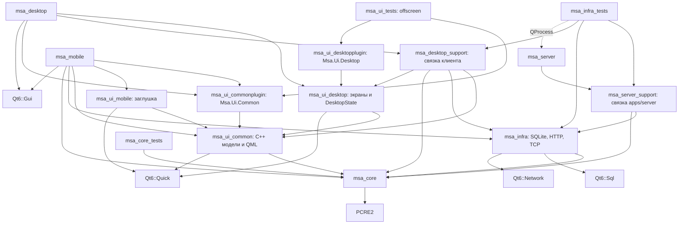
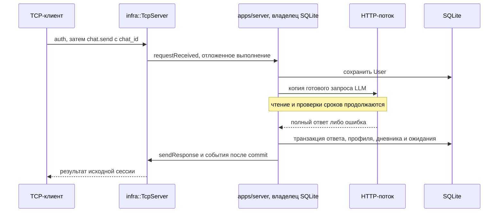

# Архитектура

## Текущее состояние

Слои core/infra/ui собраны отдельными статическими библиотеками. Сервер работает
без окна через QCoreApplication; desktop/mobile пока содержат цикл приложения
без пользовательских окон и экранов. Правила сборки сервера — решение 49.

core содержит типы и сервисы планировщика, чата, ментора, памяти, дневника,
контекста LLM и навигации. Он не использует Qt, файлы или сеть; исключение из
stdlib — приватная вычислительная зависимость PCRE2 (решение 11).
infra реализует SQLite-репозитории, HTTP-адаптеры, JSON-кодек и TCP-транспорт.
TcpClient предоставляет асинхронные клиентские сессии, начальную загрузку и
ограниченный цикл восстановления (решение 50). ClientProtocol в infra разбирает
вложенные результаты в ClientData из core; ClientModels/ClientListModel в ui/common
показывают эти типы через Qt-свойства и роли. DesktopClientController в apps/desktop
соединяет модели с транспортом (решение 51). Проверяемая цель msa_desktop_support
принадлежит приложению; постоянные настройки и окно в main пока не подключены.
apps/server связывает их в ServerRuntime; msa_server_support — проверяемая
библиотека той же связки приложения, не новый архитектурный слой.

Схема SQLite версии 13: чаты/сообщения, профиль с источниками/версиями/тегами,
задачи, серии событий, напоминания, привычки и журнал, дневник, даты приветствия
и опроса, ожидание ответа, отметки предупреждений, история маршрутов и кэш мест.
server_state хранит постоянный ID основного чата. Начинаем с пустой базы без
импорта. Все репозитории используют одно соединение в потоке владельца.

Каждый адресованный запрос создаёт ChatService с явным chat_id, не изменяя
старую chat_selection. User сохраняется перед LLM; профиль, дневник, Assistant
и закрытие ожидания — одной транзакцией после ответа. Успешная текстовая команда
сохраняет изменения, User и подтверждение одной транзакцией. Сеть выполняется
до неё; PreparedRoute отделяет расчёт от записи истории команды.

NetworkServices владеет постоянным рабочим потоком и HTTP-адаптерами. Во время
ожидания результата локальный цикл событий владельца допускает чтение и таймер
сроков; повторные изменяющие/сетевые операции получают busy. SQLite никогда не
передаётся рабочему потоку. Приветствие/опрос откладываются до окончания операции,
напоминания/предупреждения продолжают проверяться. События публикуются после commit.
Приветствие и опрос адресованы основному чату, экран клиента не переключается.

Настройки — строгий JSON через --config, относительный путь БД — от файла
настроек. Личные значения отсутствуют в коде. Реальные модели/сервисы и качество
ментора/памяти ещё предстоит проверить. Сетевые тесты используют локальный HTTP
и TCP, файловые тесты — временные базы. Подробности — [ServerRuntime](modules/ServerRuntime.md).

## Организация исходников

По решению 54 заголовки и реализации разделены во всём собственном C++-коде:
include содержит `.h`, соседний src — `.cpp`. В приложениях заголовки доступны
через `include/msa/desktop/` или `include/msa/server/`, но не через каталог src.
Внутренние заголовки core находятся в `include/msa/core/detail/` и не являются
публичным контрактом. Тестовые помощники имеют свои include и src внутри набора.

В ui/common и ui/desktop C++-модели находятся в `Model/include/msa/ui/` и
`Model/src/`, QML — в `UI/`. SurfaceCard и SectionHeader находятся в
`ui/common/UI/Utils/` как общие элементы вёрстки. UI/Model — организационное
разделение внутри существующих CMake-целей; новый слой или зависимость не добавлены.
Логические QML URI, имена типов и пути ресурсов сохранены через QT_RESOURCE_ALIAS.
Полные правила группировки и стиля — в [AGENTS.md](../AGENTS.md).

## Слои и зависимости

UI зависит только от core и Qt Quick; прямой связи с infra нет. Qt ищется один
раз в корневом CMake и нужен для конфигурации всего проекта. Сервер получает
Qt Core/Sql/Network транзитивно через infra. При ANDROID подключаются mobile
и общий UI, иначе — сервер, desktop и тесты. Все цели требуют C++20.
Общий модуль Msa.Ui.Common создаётся через qt_add_qml_module; статический плагин
линкуется и импортируется в desktop/mobile. Theme.qml хранит визуальные токены,
компоненты отображают свойства и испускают пользовательские действия.
Тестовая галерея отделена от [экранов ПК](modules/DesktopScreens.md):
общая библиотека описана в [CommonQml](modules/CommonQml.md).

## Поток данных сервера

## Модули

| Модуль | Что есть сейчас | Путь |
| --- | --- | --- |
| ClientData | Структуры снимка, коллекций, страниц, чтений и действий без Qt | `src/core/include/msa/core/ClientData.h` |
| ClientProtocol | Строгий JSON-разбор вложенных результатов чтения и кодирование типизированных действий | `src/infra/include/msa/infra/ClientProtocol.h`, `src/infra/src/ClientProtocol.cpp` |
| ClientListModel и ClientModels | Общие QML-модели, локальный выбор, страницы и последние данные без связи | `src/ui/common/Model/include/msa/ui/ClientListModel.h`, `ClientModels.h`, `src/ui/common/Model/src/` |
| DesktopClientController | Соединение транспорта и моделей, обновление данных без повторов записи | `src/apps/desktop/include/msa/desktop/DesktopClientController.h`, `src/apps/desktop/src/DesktopClientController.cpp` |
| TcpClient | Асинхронные auth/get_all, ответы/события и максимум пять попыток восстановления | `src/infra/include/msa/infra/TcpClient.h`, `src/infra/src/TcpClient.cpp` |
| ProtocolTestClient и ServerProcessTest | Независимый TCP/JSON-клиент, запуск настоящего сервера и восстановление после обрывов | `tests/infra/include/ProtocolTestClient.h`, `tests/infra/src/` |
| ServerRuntime | Обработчики протокола, репозитории, транзакции команд и проверки сроков | `src/apps/server/include/msa/server/ServerRuntime.h`, `src/apps/server/src/ServerRuntime.cpp` |
| NetworkServices | Постоянный HTTP-поток без SQLite и защищённое ожидание результата | `src/apps/server/include/msa/server/NetworkServices.h`, `src/apps/server/src/NetworkServices.cpp` |
| ServerSettings | Строгий JSON и относительный путь БД от настроек | `src/apps/server/include/msa/server/ServerSettings.h`, `src/apps/server/src/ServerSettings.cpp` |
| WebSearchProvider | Явная фраза и до трёх типизированных материалов, без доступа к памяти чата | `src/core/include/msa/core/WebSearchProvider.h`, `src/core/src/WebSearchProvider.cpp` |
| SearxngSearchProvider | Один GET SearXNG, разбор JSON и ошибки без скрытого ответа LLM | `src/infra/include/msa/infra/SearxngSearchProvider.h`, `src/infra/src/SearxngSearchProvider.cpp` |
| FakeWebSearchProvider | Заданная выдача и снимки только поисковых фраз без сети | `tests/core/include/FakeWebSearchProvider.h`, `tests/core/src/FakeWebSearchProvider.cpp` |
| RouteHistoryRepository | Полные расчёты маршрутов с прогнозами и признаком приблизительной оценки | `src/core/include/msa/core/RouteHistoryRepository.h` |
| RouteHistoryService | Запись, последние пять и отдельная статистика расчётов | `src/core/include/msa/core/RouteHistoryService.h`, `src/core/src/RouteHistoryService.cpp` |
| GeocodingCacheRepository | Упорядоченные снимки кандидатов по поставщику и запросу | `src/core/include/msa/core/GeocodingCacheRepository.h` |
| CachedGeocoder | Кэш кандидатов с TTL семь дней / час и явными часами | `src/core/include/msa/core/CachedGeocoder.h`, `src/core/src/CachedGeocoder.cpp` |
| PlaceReminderLocationService | Предложение адресов и подтверждение фиксированной точки | `src/core/include/msa/core/PlaceReminderLocationService.h`, `src/core/src/PlaceReminderLocationService.cpp` |
| SqliteRouteHistoryRepository | Постоянная история расчётов, миграция 12 | `src/infra/include/msa/infra/SqliteRouteHistoryRepository.h`, `src/infra/src/SqliteRouteHistoryRepository.cpp` |
| SqliteGeocodingCacheRepository | Атомарные постоянные снимки кандидатов, миграция 12 | `src/infra/include/msa/infra/SqliteGeocodingCacheRepository.h`, `src/infra/src/SqliteGeocodingCacheRepository.cpp` |
| ExternalServiceResult | Типизированные результаты внешних сервисов и понятные ошибки | `src/core/include/msa/core/ExternalServiceResult.h` |
| Geocoder | Проверка названия и кандидатов места | `src/core/include/msa/core/Geocoder.h`, `src/core/src/Geocoder.cpp` |
| RoutePlanner | Маршрут по координатам и режиму, проверки результата | `src/core/include/msa/core/RoutePlanner.h`, `src/core/src/RoutePlanner.cpp` |
| WeatherProvider | Текущая погода и необязательные дневные показатели | `src/core/include/msa/core/WeatherProvider.h`, `src/core/src/WeatherProvider.cpp` |
| NavigationService | Ближайшее место, маршрут, приблизительная оценка и русский текст | `src/core/include/msa/core/NavigationService.h`, `src/core/src/NavigationService.cpp` |
| HttpGetClient | Общий GET с тайм-аутом, ограничением частоты и ошибками без секретов | `src/infra/include/msa/infra/HttpGetClient.h`, `src/infra/src/HttpGetClient.cpp` |
| NominatimGeocoder | Поиск мест и общий интервал не меньше секунды, источник для CachedGeocoder | `src/infra/include/msa/infra/NominatimGeocoder.h`, `src/infra/src/NominatimGeocoder.cpp` |
| OsrmRoutePlanner | Три профиля OSRM и разбор всех манёвров первого маршрута | `src/infra/include/msa/infra/OsrmRoutePlanner.h`, `src/infra/src/OsrmRoutePlanner.cpp` |
| OpenMeteoWeatherProvider | Запрос погоды и проверка текущих/дневных данных | `src/infra/include/msa/infra/OpenMeteoWeatherProvider.h`, `src/infra/src/OpenMeteoWeatherProvider.cpp` |
| CommandParser | Разбор UTF-8 текста в `Command`, без выполнения действий | `src/core/include/msa/core/CommandParser.h`, `src/core/src/CommandParser.cpp` |
| LlmContextBuilder | Сборка готовых данных в запрос по общему бюджету текста без изменения источников | `src/core/include/msa/core/LlmContextBuilder.h`, `src/core/src/LlmContextBuilder.cpp` |
| LlmMessage | Сообщение запроса с ролью System/User/Assistant без HTTP или JSON | `src/core/include/msa/core/LlmMessage.h` |
| LlmClient | Контракт полного ответа, общие проверки, тон и предложение записи с исходной заметкой | `src/core/include/msa/core/LlmClient.h`, `src/core/src/LlmClient.cpp` |
| LlamaClient | HTTP llama-server, полный JSON, общий тайм-аут и ошибки без повторов | `src/infra/include/msa/infra/LlamaClient.h`, `src/infra/src/LlamaClient.cpp` |
| ProtocolCodec и ProtocolPayload | Конверты версии 1, схемы параметров, ограниченный накопитель кадров и JSON предметных объектов | `src/infra/include/msa/infra/ProtocolMessage.h`, `ProtocolCodec.h`, `ProtocolPayload.h`, `src/infra/src/ProtocolCodec.cpp`, `ProtocolPayload.cpp` |
| TcpServer | TCP-сессии, auth, учёт ID, сигнал запроса, ответы и события | `src/infra/include/msa/infra/TcpServer.h`, `src/infra/src/TcpServer.cpp` |
| ConversationService | Связка чата, контекста, LLM, явного дневника и ожидания опроса | `src/core/include/msa/core/ConversationService.h`, `src/core/src/ConversationService.cpp` |
| TransactionRunner | Интерфейс атомарной операции, обязательная зависимость ConversationService; реализован SqliteDatabase и тестовым исполнителем | `src/core/include/msa/core/TransactionRunner.h`, `src/core/src/TransactionRunner.cpp` |
| MentorPrompt | Согласованные инструкции ментора, JSON и состояние ожидания | `src/core/include/msa/core/MentorPrompt.h`, `src/core/src/MentorPrompt.cpp` |
| ChatService | Создание и выбор чатов, полная история и отбор последних сообщений по бюджету текста | `src/core/include/msa/core/ChatService.h`, `src/core/src/ChatService.cpp` |
| ChatRepository | Интерфейс хранения чатов, сообщений и выбранного ID | `src/core/include/msa/core/ChatRepository.h`, `src/core/src/ChatRepository.cpp` |
| Chat и ChatMessage | Чат с названием и временем; сообщение с ролью, полным текстом и временем | `src/core/include/msa/core/Chat.h`, `src/core/include/msa/core/ChatMessage.h` |
| DailyContextService | Текст сводки: дата/время, события, пять открытых задач, прогресс привычек | `src/core/include/msa/core/DailyContextService.h`, `src/core/src/DailyContextService.cpp` |
| MoodService | Явная запись настроения с полным текстом и история по календарным дням | `src/core/include/msa/core/MoodService.h`, `src/core/src/MoodService.cpp` |
| MoodRepository | Интерфейс добавления и чтения дневника без очистки по возрасту | `src/core/include/msa/core/MoodRepository.h`, `src/core/src/MoodRepository.cpp` |
| MoodEntry | Запись настроения: ID, время, MoodScore и полный текст | `src/core/include/msa/core/MoodEntry.h` |
| EveningCheckInService | Подготовка вечернего опроса раз за день с 20:00 | `src/core/include/msa/core/EveningCheckInService.h`, `src/core/src/EveningCheckInService.cpp` |
| EveningCheckInRepository | Интерфейс хранения даты последнего подготовленного опроса | `src/core/include/msa/core/EveningCheckInRepository.h`, `src/core/src/EveningCheckInRepository.cpp` |
| EventWarningService | Предупреждения за час, накануне и в день события с отметками выдачи | `src/core/include/msa/core/EventWarningService.h`, `src/core/src/EventWarningService.cpp` |
| EventWarningRepository | Интерфейс отметок ID + дата вхождения + вид предупреждения | `src/core/include/msa/core/EventWarningRepository.h`, `src/core/src/EventWarningRepository.cpp` |
| EventService | Создание и изменение всей серии событий с проверкой ввода | `src/core/include/msa/core/EventService.h`, `src/core/src/EventService.cpp` |
| TaskService | Создание, изменение, завершение и сортировка задач | `src/core/include/msa/core/TaskService.h`, `src/core/src/TaskService.cpp` |
| UserProfileService | Добавление фактов профиля без автоматического удаления старых | `src/core/include/msa/core/UserProfileService.h`, `src/core/src/UserProfileService.cpp` |
| ProfileFactProposal | Предложение нового факта или исправления по ID из контекста | `src/core/include/msa/core/ProfileFactProposal.h` |
| UserProfileFact и ProfileFactSource | Текст, ID, теги, приоритет, ссылки версий и исходного сообщения/дневника | `src/core/include/msa/core/UserProfile.h` |
| UserProfileFactSelector | Локальный поиск по словам и ручным тегам, приоритет alwaysInclude перед тематическими фактами | `src/core/include/msa/core/UserProfileFactSelector.h`, `src/core/src/UserProfileFactSelector.cpp` |
| GreetingService | Приветствие с датой, событиями и пятью задачами | `src/core/include/msa/core/GreetingService.h`, `src/core/src/GreetingService.cpp` |
| GreetingRepository | Интерфейс хранения даты последнего приветствия | `src/core/include/msa/core/GreetingRepository.h`, `src/core/src/GreetingRepository.cpp` |
| HabitService | Создание привычек, отметки и текущий прогресс через Clock и HabitRepository | `src/core/include/msa/core/HabitService.h`, `src/core/src/HabitService.cpp` |
| CalendarService | События дня и дни месяца с учётом повторений | `src/core/include/msa/core/CalendarService.h`, `src/core/src/CalendarService.cpp` |
| ReminderService | Создание, обработка и отсортированный список активных напоминаний по времени и месту | `src/core/include/msa/core/ReminderService.h`, `src/core/src/ReminderService.cpp` |
| Command | Вариант типов результатов разбора, включая `NoCommand` | `src/core/include/msa/core/Command.h` |
| Планировщик: данные | Задача, событие, три вида напоминаний, координаты, привычка, запись прогресса, профиль; без предметной валидации и расчётов | `src/core/include/msa/core/{Task,Event,Reminder,GeoCoordinates,Habit,HabitLogEntry,UserProfile}.h` |
| Репозитории | Абстрактные интерфейсы задач, событий, напоминаний, привычек с журналом и профиля | `src/core/include/msa/core/*Repository.h`, деструкторы в `src/core/src/*Repository.cpp` |
| Clock | Абстрактный источник местного времени с точностью до секунд | `src/core/include/msa/core/Clock.h`, `src/core/src/Clock.cpp` |
| Pcre2Regex | Внутренняя обёртка поиска совпадений PCRE2 с UTF, Unicode-свойствами и без учёта регистра | `src/core/include/msa/core/detail/Pcre2Regex.h`, `src/core/src/Pcre2Regex.cpp` |
| Utf8Text | Внутренние операции длины, обрезки пробелов Unicode и регистра латиницы/кириллицы | `src/core/include/msa/core/detail/Utf8Text.h`, `src/core/src/Utf8Text.cpp` |
| PlannerText | Общий для приветствия и сводки формат русской даты и времени HH:MM | `src/core/include/msa/core/detail/PlannerText.h`, `src/core/src/PlannerText.cpp` |
| Тестовая инфраструктура | `FakeClock`, десять `InMemory*Repository`, общий `InMemoryStore` | `tests/core/` |
| FakeLlmClient | Заданный результат и снимки запросов без сети | `tests/core/include/FakeLlmClient.h`, `tests/core/src/FakeLlmClient.cpp` |
| SqliteDatabase и SqliteMigration | Именованное соединение Qt Sql, принадлежность, версия, миграции и вложенные транзакции | `src/infra/include/msa/infra/SqliteDatabase.h`, `SqliteMigration.h`, `src/infra/src/SqliteDatabase.cpp` |
| SqliteSchema | Общий список миграций: 2 — чаты, 3 — профиль, 4 — приветствие, 5 — опрос, 6 — предупреждения, 7 — дневник, 8 — задачи, 9 — события, 10 — напоминания, 11 — привычки и журнал | `src/infra/include/msa/infra/SqliteSchema.h`, `src/infra/src/SqliteSchema.cpp` |
| SqliteChatRepository | SQLite-реализация ChatRepository с полным текстом и восстановлением выбора | `src/infra/include/msa/infra/SqliteChatRepository.h`, `src/infra/src/SqliteChatRepository.cpp` |
| SqliteUserProfileRepository | SQLite-реализация UserProfileRepository с атомарным снимком, источниками и версиями | `src/infra/include/msa/infra/SqliteUserProfileRepository.h`, `src/infra/src/SqliteUserProfileRepository.cpp` |
| SqliteGreetingRepository | Календарная дата последнего приветствия в SQLite | `src/infra/include/msa/infra/SqliteGreetingRepository.h`, `src/infra/src/SqliteGreetingRepository.cpp` |
| SqliteEveningCheckInRepository | Независимые дата вечернего опроса и ожидание с привязкой к сообщению/чату в SQLite | `src/infra/include/msa/infra/SqliteEveningCheckInRepository.h`, `src/infra/src/SqliteEveningCheckInRepository.cpp` |
| SqliteEventWarningRepository | Уникальные отметки ID события + дата вхождения + вид в SQLite | `src/infra/include/msa/infra/SqliteEventWarningRepository.h`, `src/infra/src/SqliteEventWarningRepository.cpp` |
| SqliteMoodRepository | Полные записи настроения с постоянными ID в SQLite, источник фактов профиля | `src/infra/include/msa/infra/SqliteMoodRepository.h`, `src/infra/src/SqliteMoodRepository.cpp` |
| SqliteTaskRepository | SQLite-операции создания, чтения, замены и удаления задач со всеми полями | `src/infra/include/msa/infra/SqliteTaskRepository.h`, `src/infra/src/SqliteTaskRepository.cpp` |
| SqliteEventRepository | SQLite-хранилище исходных серий событий со всеми полями | `src/infra/include/msa/infra/SqliteEventRepository.h`, `src/infra/src/SqliteEventRepository.cpp` |
| SqliteReminderRepository | SQLite-хранилище временных, повторяющихся и геонапоминаний с общими ID | `src/infra/include/msa/infra/SqliteReminderRepository.h`, `src/infra/src/SqliteReminderRepository.cpp` |
| SqliteHabitRepository | SQLite-хранилище привычек и журнала с каскадным удалением | `src/infra/include/msa/infra/SqliteHabitRepository.h`, `src/infra/src/SqliteHabitRepository.cpp` |
| Тесты инфраструктуры | QCoreApplication и временные файловые базы, откат схемы и операций | `tests/infra/` |
| Общие QML-компоненты | Тёмная тема, элементы управления, карточки и состояния | `src/ui/common/UI/` |
| Экраны ПК и настройки | Навигация, чат/планы/напоминания, форма JSON-параметров и связка apps | `src/ui/desktop/`, `src/apps/desktop/include/msa/desktop/DesktopPreferencesController.h` |
| PlannerEditor | Метаданные форм, типизированные действия, подтверждение и сохранение черновика при отказе | `src/ui/desktop/Model/include/msa/ui/PlannerEditor.h`, `src/ui/desktop/UI/PlannerDialog.qml` |
| ClientPlannerAction и ClientPlannerProtocol | Типы core и преобразование действий форм в существующие методы JSON | `src/core/include/msa/core/ClientPlannerAction.h`, `src/infra/src/ClientPlannerProtocol.cpp` |
| JsonClientPreferences | Строгий локальный JSON клиента, атомарное сохранение | `src/infra/include/msa/infra/JsonClientPreferences.h` |
| ClientPreferences | Параметры подключения и проверка заполненного набора без Qt | `src/core/include/msa/core/ClientPreferences.h` |
| Mobile UI | Заглушка экранов | `src/ui/mobile/` |
| Приложения | Точки входа сервера и клиентов | `src/apps/server/`, `src/apps/desktop/`, `src/apps/mobile/` |

Контракты репозиториев: поиск возвращает `optional`, списки — независимые копии без
гарантии порядка; обновление и удаление отсутствующей записи возвращают `false`.
Новая запись имеет нулевой ID, `add` возвращает положительный ID.
Удаление привычки удаляет её журнал. Профиль загружается и заменяется целиком.
Технические ошибки по контракту передаются исключениями без Qt-типов.
Тестовые реализации хранят данные только в памяти и не вычисляют предметные правила.

Время core представлено `std::chrono` в местной шкале сервера; ServerClock переводит системный момент по настроенной IANA-зоне.
Необязательные даты, время и координаты выражены через `optional`.
Напоминания объединены в `std::variant`. Однократные имеют статус `Pending/Fired/Missed`.
`ReminderService` обновляет репозиторий и возвращает сработавшие записи; при запуске
отдельный вызов пропускает просроченные однократные напоминания. Таймер сервера и события
уведомлений подключены в ServerRuntime. Геонапоминания с координатами срабатывают однократно при расстоянии строго меньше 200 м;
текущую позицию передаёт вызывающая сторона, получения геолокации пока нет. Прогресс привычек вычисляет `HabitService`: за сегодня
либо с понедельника по сегодня, без ограничения целью. Подробнее —
[HabitService](modules/HabitService.md).
Подробности — в [ReminderService](modules/ReminderService.md).

## Границы реализации

Реализована связка сервера с протоколом версии 1, SQLite и внешними адаптерами.
Интеграционные тесты проверяют реальные локальные TCP/HTTP-сокеты и файловые базы.
ServerProcessTest дополнительно запускает собранный msa_server отдельным процессом
и обращается к нему через независимый ProtocolTestClient без серверного кодека.
Управляемый локальный HTTP-ответ проверяет завершение после обрыва; временные
настройки и база изолируют эти проверки от личного сервера.
Тесты внешних данных также используют подменённый QNetworkAccessManager.
Сведения о конкретных правилах и точках входа находятся в docs/modules;
протокол описан в docs/protocol.md, запуск — в README.md.

Модели ui/common не зависят от infra; запросы/действия передаются типами core.
При обрыве остаются последние данные в памяти с stale=true, серверные действия
отключены. Новая сессия/выбор и порядковый номер чтения защищают от поздних ответов.
Декодер сначала строит весь результат и не допускает частичной замены списков.
Подробнее — [клиентские модели](modules/ClientModels.md).

Экраны ПК, формы планировщика и JSON-настройки готовы библиотечно. Пока отсутствуют
создание окна/клиентской связки в main desktop/mobile, выбор точки в UI геонапоминаний,
геолокация устройства, музыка, голос и Android-уведомления. Прямые координаты
передаются явными параметрами запросов, выбранная точка геонапоминания закрепляется
только подтверждением. UI атрибуции публичных сервисов ещё предстоит подключить.

Настоящие модели и публичные сервисы в связке сервера не проверены. JSON-режим
не гарантирует качество распознавания фактов/настроения или выполнение инструкций.
Отбор памяти пока буквальный, по словам и ручным тегам, без морфологии и синонимов.
Общий бюджет Unicode-текста не заменяет точный бюджет токенов модели.

Приложение обрабатывает одну изменяющую/сетевую операцию за раз; чтение и сроки
не ждут LLM. Транзакции не охватывают HTTP. События не имеют постоянной очереди
доставки, журнал идемпотентности после переподключения отсутствует. Полные снимки
и большие отдельные сообщения ограничены пределом кадра; сообщения не обрезаются.
