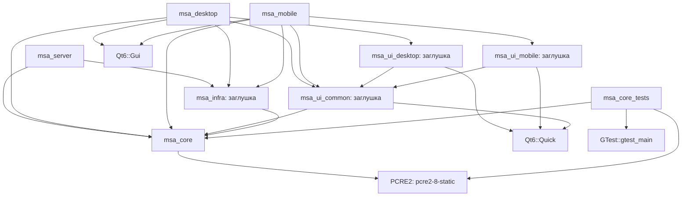

# Архитектура

## Текущее состояние

Проект разделён на статические библиотеки слоёв и три исполняемые цели.
Реальная предметная функциональность находится в `src/core`: парсер команд,
типы планировщика, абстрактные интерфейсы и сервисы напоминаний по времени, календаря, привычек и ежедневного приветствия. Связки парсера с репозиториями
или приложениями пока нет. Поток «клиент → сервер → хранилище» не реализован.

`msa_server` содержит только `return 0`. Оба клиента создают `QGuiApplication`
и входят в цикл событий без окна, QML-движка и моделей. Библиотеки `infra`
и `ui/*` содержат только `placeholder.cpp` с пустым пространством имён.

## Слои и зависимости

Стрелки показывают фактические прямые зависимости целей в `target_link_libraries`.
Узлы приложений и инфраструктуры на схеме пока представляют каркас, а не работающие сервисы.

- `core` не использует Qt, файлы или сеть. Исключение из правила «только stdlib» —
  приватная зависимость от PCRE2 для Unicode-регулярных выражений (решение 11).
- `infra` зависит от `core`; реализаций хранилищ, часов и внешних сервисов здесь ещё нет.
- `ui/common` зависит от `core` и Qt Quick; платформенные UI-библиотеки — от
  `ui/common` и Qt Quick. UI и `infra` напрямую не связаны.
- Приложения линкуют нужные слои, но пока не создают и не связывают предметные объекты.
- `tests/core` содержит тестовые реализации интерфейсов; они не входят в приложения.

Qt ищется один раз в корневом CMake; поэтому установленный Qt нужен для конфигурации
всего проекта, хотя `msa_core` и `msa_server` с Qt не линкуются.
При `ANDROID` подключаются общий и мобильный UI и мобильное приложение.
Иначе подключаются сервер, desktop UI, desktop-приложение и тесты.
Все библиотеки и приложения требуют C++20. QML-файлов и `qt_add_qml_module` пока нет.

## Модули

| Модуль | Что есть сейчас | Путь |
| --- | --- | --- |
| CommandParser | Разбор UTF-8 текста в `Command`, без выполнения действий | `src/core/include/msa/core/CommandParser.h`, `src/core/src/CommandParser.cpp` |
| GreetingService | Приветствие с датой, событиями и пятью задачами | `src/core/include/msa/core/GreetingService.h`, `src/core/src/GreetingService.cpp` |
| GreetingRepository | Интерфейс хранения даты последнего приветствия | `src/core/include/msa/core/GreetingRepository.h`, `src/core/src/GreetingRepository.cpp` |
| HabitService | Создание привычек, отметки и текущий прогресс через Clock и HabitRepository | `src/core/include/msa/core/HabitService.h`, `src/core/src/HabitService.cpp` |
| CalendarService | События дня и дни месяца с учётом повторений | `src/core/include/msa/core/CalendarService.h`, `src/core/src/CalendarService.cpp` |
| ReminderService | Создание и обработка напоминаний по времени через Clock и ReminderRepository | `src/core/include/msa/core/ReminderService.h`, `src/core/src/ReminderService.cpp` |
| Command | Вариант типов результатов разбора, включая `NoCommand` | `src/core/include/msa/core/Command.h` |
| Планировщик: данные | Задача, событие, три вида напоминаний, координаты, привычка, запись прогресса, профиль; без предметной валидации и расчётов | `src/core/include/msa/core/{Task,Event,Reminder,GeoCoordinates,Habit,HabitLogEntry,UserProfile}.h` |
| Репозитории | Абстрактные интерфейсы задач, событий, напоминаний, привычек с журналом и профиля | `src/core/include/msa/core/*Repository.h`, деструкторы в `src/core/src/*Repository.cpp` |
| Clock | Абстрактный источник местного времени с точностью до секунд | `src/core/include/msa/core/Clock.h`, `src/core/src/Clock.cpp` |
| Pcre2Regex | Внутренняя обёртка поиска совпадений PCRE2 с UTF, Unicode-свойствами и без учёта регистра | `src/core/src/Pcre2Regex.h`, `src/core/src/Pcre2Regex.cpp` |
| Utf8Text | Внутренние операции длины в кодовых точках и регистра латиницы/кириллицы | `src/core/src/Utf8Text.h`, `src/core/src/Utf8Text.cpp` |
| Тестовая инфраструктура | `FakeClock`, шесть `InMemory*Repository`, общий `InMemoryStore` | `tests/core/` |
| infra | Пустая библиотека | `src/infra/` |
| Общий, desktop и mobile UI | Пустые библиотеки, без компонентов и экранов | `src/ui/common/`, `src/ui/desktop/`, `src/ui/mobile/` |
| Приложения | Точки входа сервера и клиентов | `src/apps/server/`, `src/apps/desktop/`, `src/apps/mobile/` |

Контракты репозиториев: поиск возвращает `optional`, списки — независимые копии без
гарантии порядка; обновление и удаление отсутствующей записи возвращают `false`.
Новая запись имеет нулевой ID, `add` возвращает положительный ID.
Удаление привычки удаляет её журнал. Профиль загружается и заменяется целиком.
Технические ошибки по контракту передаются исключениями без Qt-типов.
Тестовые реализации хранят данные только в памяти и не вычисляют предметные правила.

Время представлено `std::chrono` в местной шкале сервера; преобразований часовых поясов нет.
Необязательные даты, время и координаты выражены через `optional`.
Напоминания объединены в `std::variant`. Однократные имеют статус `Pending/Fired/Missed`.
`ReminderService` обновляет репозиторий и возвращает сработавшие записи; при запуске
отдельный вызов пропускает просроченные однократные напоминания. Таймеров и доставки
уведомлений пока нет. Геонапоминания ещё не обрабатываются. Прогресс привычек вычисляет `HabitService`: за сегодня
либо с понедельника по сегодня, без ограничения целью. Подробнее —
[HabitService](modules/HabitService.md).
Подробности — в [ReminderService](modules/ReminderService.md).

## Границы реализации

Нет SQLite, сетевого клиента и сервера, сериализации протокола, LLM-клиента,
логики чата и ментора, аудио, платформенных Android-реализаций и геймификации.
Файл `docs/protocol.md` пока отсутствует: описывать действующий протокол ещё нечего.
Направление дальнейшей работы хранится в [плане переноса](migration-plan.md),
а не является текущей функциональностью.

Сборка и тесты описаны в [README](../README.md), устройство парсера —
в [CommandParser](modules/CommandParser.md). Тесты типов и контрактов находятся
в `tests/core/PlannerTypesTest.cpp` и `tests/core/PlannerRepositoriesTest.cpp`.

Календарь читает `EventRepository` без изменений: повторы начинаются с исходной даты,
ежемесячные события переносятся на последний день короткого месяца. Приложения
пока не вызывают сервис. Подробности — в [CalendarService](modules/CalendarService.md).

`GreetingService` использует `Clock`, `CalendarService`, `TaskRepository` и
`GreetingRepository`: формирует текст и сохраняет дату до возврата. Приветствие
зависит от времени суток и выдаётся раз за местный день. Хранилище даты пока есть
только в тестах; SQLite и отправка клиентам не реализованы.
Подробнее — [GreetingService](modules/GreetingService.md).
