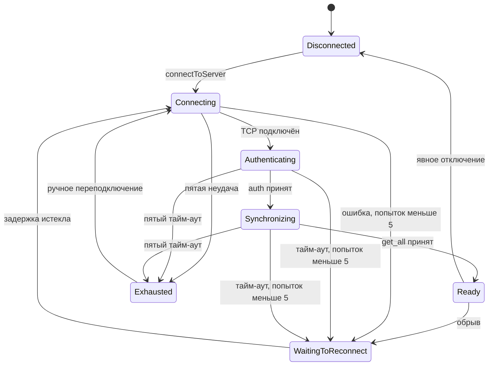

# TcpClient

Асинхронный клиент протокола версии 1 в infra по решению 50. Публичный заголовок —
`src/infra/include/msa/infra/TcpClient.h`, реализация — `src/infra/src/TcpClient.cpp`.
Все методы, сокеты и таймеры работают в потоке создания с циклом Qt.
Блокирующего ожидания и локального QEventLoop внутри клиента нет.

## Точки входа и состояния

Конструктор получает явные host, port, token, connectTimeout и responseTimeout.
Сроки положительны и помещаются в int миллисекунд Qt. Задержки повторов по
умолчанию — 1 секунда и верхний предел 15 секунд; их можно передать конструктору.
Неверные настройки отклоняются без вывода личных значений. Постоянный формат
настроек клиента пока не выбран.

connectToServer начинает цикл из Disconnected/Exhausted и не дублирует активный.
reconnect — явный новый цикл; disconnectFromServer отменяет сокет и все будущие
попытки без завершения приложения. Запросы вне Ready не ставятся в очередь.

Неудачные токен, версия, параметры auth, начальный снимок или протокол останавливают
цикл в Disconnected с connectionError. Исправление требует ручного действия.
Состояние, номер попытки и retryScheduled/retryExhausted доступны будущему UI.
Кнопки переподключения и музыкальный экран в этом модуле не создаются.

## Пять попыток и работа без сервера

На цикл приходится максимум пять попыток всего, включая первую. Задержка после
неудачи возрастает вдвое до указанного предела. При настройках по умолчанию
между попытками начального цикла — 1, 2, 4, 8 секунд. Ready сбрасывает счёт;
следующий обрыв запускает новый ограниченный цикл. После обрыва готовой сессии
первая автоматическая попытка также ждёт начальную задержку.

В Exhausted больше нет таймера подключения. Появление сервера само по себе
не возобновляет попытки: нужен reconnect/connectToServer по действию пользователя.
Это позволяет оставить приложение открытым для локальных функций без сервера.
Явное отключение отменяет даже уже запланированный повтор.

## Авторизация, снимок и обмен

Каждая новая сессия автоматически передаёт auth, затем get_all. Проверяются
версия, предел кадра 1 048 576 байт, непустой server_instance_id, IANA-зона и
местный формат времени. Ready наступает только после проверки обязательных
полей снимка, main_chat_id, зоны и массивов объектов. Вложенные предметные поля
и result поддержанных методов проверяет ClientProtocol для моделей;
транспорт не превращает произвольный JSON результата в объекты core.

sendRequest назначает ID, который не переиспользуется за жизнь экземпляра.
Кодек проверяет метод, параметры и размер до передачи в сокет. Локальный отказ
приходит отложенным requestFailed, чтобы вызывающий код сначала получил ID.
Ответы сопоставляются только ожидающим запросам; неизвестный/повторный ID не
завершает другой запрос. Предметные ProtocolFailure сохраняют серверные effect
и user_message_id. Типы сигналов зарегистрированы для queued-соединений Qt.

События допустимы после auth, включая Synchronizing. instance_id должен
совпадать с текущей сессией; повтор event_id в ней игнорируется. Обработчик
приложения учитывает фазу загрузки снимка перед обновлением своих моделей.
Событие не подтверждает исход изменяющего запроса.

## Обрыв, сроки и сохранность

Накопитель работает с байтами до LF, не декодируя часть UTF-8 отдельно. Полные
кадры, уже доступные при закрытии, обрабатываются; хвост не исполняется и не
переносится в новый сокет. Каждый сокет имеет поколение: старые callback не
меняют новую сессию. Сессия очищает метаданные, начальный снимок и временные
предложения через sessionReset; постоянный кэш данных принадлежит приложению.

Ожидавшие записи после обрыва/тайм-аута получают unknown. Ожидавшее чтение и
локальные отказы до отправки — none. Тайм-аут предметного запроса закрывает
сессию, чтобы поздний ответ не смешивался с новым циклом. Дедлайны запросов
монотонные, один таймер обслуживает ближайший срок.

Ни запись, ни прежнее чтение автоматически не пересылаются. Новый цикл выполняет
только подключение, auth и get_all. Для user_saved нужен явный chat.retry с ID
после чтения истории; клиент сам его не вызывает. Личные адреса, токен и системные
тексты сокета не попадают в локальные ошибки. Уничтожение клиента не вызывает
внешних сигналов из деструктора.

## Проверки и границы

`tests/infra/TcpClientTest.cpp` использует независимый локальный TCP-узел:
состояния, начальная загрузка, отложенные отказы, корреляция и queued-сигналы,
события, UTF-8/EOF, ошибки/тайм-ауты, ограничение задержки, пять попыток,
ручное восстановление и отмена повторов. Проверяется отсутствие повторной записи
и свежие ID после обрыва. `tests/infra/ServerRuntimeTest.cpp` дополнительно
проверяет auth/get_all, запись задачи и обновление снимка настоящим клиентом
после ручного переподключения к ServerRuntime. Команды — в [README](../../README.md).

Это транспортная библиотека. [ClientProtocol](ClientProtocol.md) разбирает данные,
[ClientModels](ClientModels.md) отображают их, DesktopClientController связывает
объекты в apps без зависимости UI от infra. Постоянные клиентские настройки,
создание связки в main desktop/mobile, кнопка и экраны остаются следующими шагами.

