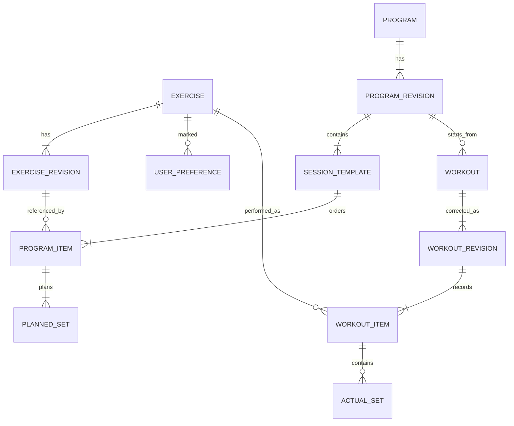

# Спорт — UX, данные и этапы MVP

Дата: 2026-11-22. Статус: **пользовательские требования зафиксированы;
концептуальная модель библиотеки согласована; содержание и порядок реализации
дорабатываются**. Согласование модели не разрешает писать код.

Основание: решения 68–70 в [журнале решений](../decisions.md).
[Передача контекста](redesign-next-chat.md) описывает исходное состояние;
[TZ.md](../../TZ.md) остаётся ТЗ Stage 1. 1A–1C реализованы и проверены ранее.
Лама отложена, перенос приостановлен. Разрешена только работа с документацией.

## 1. Полный пользовательский сценарий

### 1.1. Подготовить программу

Пользователь открывает «Спорт → Программы», просматривает небольшую готовую
библиотеку или создаёт собственную программу из доступных упражнений.
Силовые занятия дома используют гантели, штангу и собственный вес.
Другие виды активности — будущее расширение, их поля сейчас не проектируются.

Предлагаемый простой редактор: название программы → занятия внутри программы →
упражнения в нужном порядке → плановые подходы, повторения и вес.
Готовую программу предлагается копировать в собственную перед изменениями.
Выбор программы сам по себе не начинает занятие и не создаёт историю.
Автоматическое расписание и назначение следующей нагрузки не нужны в MVP.

Из состава программы открывается подробная текстовая карточка упражнения:
техника, мышцы, оборудование, ошибки и ограничения. Там же доступны независимые
отметки «Избранное» и «Хочу прогрессировать». Вторая отметка сохраняет предпочтение
для будущего подбора, но сейчас не меняет нагрузку и порядок занятий.
При подборе упражнения в редакторе нужен небольшой список с поиском и фильтром
избранного. Большой самостоятельный каталог в основной навигации не требуется.

### 1.2. Открыть и начать занятие

В «Обзоре» пользователь открывает занятие выбранной программы или продолжает
уже начатое на этом устройстве. До начала видны состав и плановые значения.
Пользователь может указать самочувствие и усталость по шкалам 1–5, боль 0–10,
одну или несколько областей боли, комментарий и индивидуальные ограничения.
Поля необязательные, независимые; неуказанная боль не означает 0 баллов.

При начале создаётся отдельный экземпляр тренировки с исходным составом и
планом. Последующее редактирование программы не переписывает этот экземпляр.
Утверждена одна незавершённая тренировка на устройстве: перед новой нужно
продолжить, завершить или явно отбросить прежнюю. Это не блокировка на всех
устройствах: такой механизм возможен только после проектирования синхронизации.

### 1.3. Записать выполнение, пропуск или замену

Активная тренировка открывается отдельным экраном. Для упражнения рядом видны
план и факт по подходам. План не считается выполненным автоматически.
Пользователь вводит фактические повторения и вес, явно отмечает выполненный
подход, при необходимости добавляет подход или отмечает пропуск.

Предлагается различать «ещё не заполнено», «выполнено» и «пропущено».
При пропуске упражнения отмечаются оставшиеся незавершённые подходы;
ранее выполненные сохраняются. Причина пропуска необязательна.
Пропуск не даёт штрафа и не превращается в нулевой спортивный результат.

Для замены пользователь выбирает другое упражнение из доступного списка.
Показываются исходное и выбранное упражнения; фактические данные относятся
к выбранному. Новый план пользователь подтверждает сам: вес исходного
упражнения не переносится автоматически. Уже выполненные подходы остаются
у исходного упражнения; замена применяется к оставшейся части и сохраняет связь
с исходным пунктом. Подробная карточка доступна и здесь без потери ввода/позиции.

Ввод сохраняется локально в ходе занятия. Работа не требует постоянной связи.
Переключение раздела, сворачивание и закрытие приложения не завершают тренировку.
После запуска предлагается восстановить локально сохранённое состояние.
Неуспешная запись на устройство показывается явно и не выдаётся за сохранение.

### 1.4. Проверить итог и завершить

Пользователь открывает итог: дата, продолжительность, состав, фактические подходы,
пропуски, замены, самочувствие до/после и необязательные заметки.
Незаполненные подходы предлагается исправить или явно отметить пропущенными;
частично выполненную тренировку можно завершить без наказания.
Полностью пропущенное занятие можно сохранить в истории. Оно не считается
выполненным и не влияет на спортивную динамику; его подходы не становятся нулями
на графике. Это отдельная отметка результата, а не ошибка сохранения.

**Утверждено:** завершение доступно без сервера и создаёт локальный результат.
Он доступен в истории и учитывается в локальном прогрессе с подписью
«Сохранено на устройстве», ожидает будущей синхронизации. Серверного подтверждения
эта подпись не означает. После подтверждения сервером — «Синхронизировано».
При ошибке локальной записи итог остаётся открытым, данные не очищаются.

### 1.5. Найти результат и посмотреть прогресс

В истории пользователь открывает состав и результаты конкретного занятия,
сопоставляет план с фактом, видит пропуски, замены, самочувствие и заметки.
Исторический состав остаётся понятным после изменения исходной программы.

В прогрессе выбирается конкретное упражнение. Видны его результаты по датам
и ссылки на соответствующие занятия истории. Подходы заменившего упражнения
учитываются у него, а не у исходного. Локальные завершённые результаты
показываются на этом устройстве с явной маркировкой их статуса;
черновики и пропуски в динамику не входят.

После будущей синхронизации тот же результат получает серверное подтверждение,
а не превращается во вторую тренировку. Продолжение занятия на другом устройстве
не входит в первоначальное локальное сохранение и требует отдельного решения.

### 1.6. Исправить завершённый результат

Пользователь открывает результат → «Исправить», меняет упражнения, подходы,
повторения, вес, продолжительность или заметки и сохраняет исправления.
Это та же тренировка с новой редакцией, не новое занятие. Локальный прогресс
пересчитывается по последней успешно сохранённой редакции; старые значения
не продолжают участвовать в динамике. При замене упражнения исправление
убирает прежний вклад и добавляет новый к соответствующему упражнению.

Предлагаемый UX: до сохранения исправлений история/прогресс используют прежнюю
редакцию; отмена возвращает её. Ошибка записи сохраняет редактор и введённое,
но не подменяет сохранённый результат. Исходный план не переписывается под факт.
Ручная длительность не меняет исходные временные отметки.

После успешной правки синхронизированного результата новая редакция отображается
как «Сохранено на устройстве — есть изменения для синхронизации». Подтверждение
прежней редакции не подтверждает новую. При одновременных правках на двух
устройствах нужен явный конфликт; молчаливая перезапись запрещена.

## 2. Поля данных для согласования

Это концептуальная модель, **не схема SQLite, классы C++ или TCP-контракт**.
Имена типов, формат файлов, способ генерации идентификаторов и механизм миграций
не выбираются этим документом. Связи библиотеки из раздела 10.8 согласованы;
детали полей сверх решений 68–70 остаются предложением.

| Объект | Поля и назначение |
|---|---|
| Упражнение | Устойчивая идентичность, название, вид активности; подробная текстовая техника по шагам; основные/дополнительные мышцы; необходимое оборудование; распространённые ошибки; ограничения; вариант выполнения и смысл веса; источник текста и версия содержимого |
| Предпочтение упражнения | Идентичность упражнения; независимые признаки «Избранное» и «Хочу прогрессировать»; время изменения. Отметки принадлежат пользователю, не определению упражнения |
| Индивидуальные ограничения | Необязательная текстовая запись пользователя; время изменения. Не диагноз и не автоматически вычисленный допуск к нагрузке |
| Программа | Идентичность, название, описание, происхождение «готовая/собственная», версия, упорядоченные шаблоны занятий; для готовой — источник и условия использования |
| Шаблон занятия | Идентичность, название, упорядоченные пункты упражнений, необязательные заметки |
| Пункт программы | Идентичность пункта и упражнения, порядок, список плановых подходов, необязательные указания. Повтор одного упражнения в занятии допустим как отдельный пункт |
| Плановый подход | Порядок, плановые повторения, нагрузка по правилам раздела 2.1. Число плановых подходов следует из списка и не хранится как независимое противоречащее число |
| Экземпляр тренировки | Устойчивая идентичность на всём пути локально → сервер и при исправлениях; редакция; вид активности; ссылка на программу/шаблон и их версии; снимок названия, состава и плана; дата; исходные начало/окончание с зоной или смещением, интервалы активности/пауз; раздельные общее/активное время и ручная длительность; состояние занятия; самочувствие до/после; заметки; снимок ограничений |
| Упражнение в тренировке | Идентичность пункта, ссылка и исторические сведения упражнения, порядок, исходный план, фактические подходы; пропуск и необязательная причина; связь с исходным пунктом при замене |
| Фактический подход | Собственная идентичность; связь с плановым подходом либо признак добавленного; порядок; фактические повторения и нагрузка по разделу 2.1; состояние выполнения; необязательная причина пропуска |
| Самочувствие до/после | Две отдельные записи: необязательные самочувствие 1–5, усталость 1–5, боль 0–10, список областей боли с «Другой областью» и текстом, независимая отметка «Новая боль», свободный комментарий. Пустая боль отличается от 0 |
| Сведения о сохранении | Время последней успешной локальной записи; версия локального изменения; результат записи/ошибка; отдельно — состояние передачи и серверное подтверждение конкретной версии, когда синхронизация появится |

Для начатого занятия хранится исторический план, для результата — план и факт.
Ссылка на актуальную программу или карточку не заменяет исторические сведения.
Полную копию техники в каждом результате хранить не обязательно: объём снимка
нужно согласовать; минимум — название, вариант, оборудование и смысл измерений.

### 2.1. Правила ввода и единицы

- Повторения — целые числа; вес — неотрицательное конечное число. Плановые
  повторения положительные; точные пределы и разминочные подходы ещё обсуждаются.
- Основная единица — кг; пустое значение отличается от нуля.
- Гантели: масса одной гантели и количество гантелей — отдельные поля.
  Количество не означает число повторений или число выполненных сторон.
- Штанга: полный вес вместе с грифом. Массу грифа не добавлять повторно.
- Собственный вес: отдельный режим, необязательное дополнительное отягощение
  и необязательный противовес. Не кодировать противовес отрицательным весом
  и не заменять режим фиктивным «0 кг». Масса тела не подставляется автоматически.
- Предложение структуры нагрузки: режим и применимые к нему поля
  «масса одной гантели / количество», «полный вес штанги», «отягощение / противовес».
  В плане и факте используется одинаковый смысл полей; неприменимые поля пусты.
  В MVP дополнительное отягощение и противовес взаимоисключающие. При переключении
  не переносить скрытое значение второго режима в сохранённую нагрузку.
- Плановые значения не заполняют факт без явного действия пользователя.
  Число фактических подходов выводится из записей, выполненные и пропущенные
  считаются отдельно. Лишний выполненный подход допустим как добавленный.
- Заполненный черновик подхода и подтверждённое выполнение различаются.
  Для выполненного подхода нужны согласованные обязательные поля; неверный ввод
  сохраняется как редактируемый черновик, но не попадает в расчёт прогресса.
- Сохраняется порядок, пропуски и связь замен. Несопоставимые варианты упражнения
  и разные значения смысла веса нельзя молча объединять в динамике.
- Начальная дата фиксируется по местному времени устройства при старте;
  ручное исправление доступно в итоге. Переход через полночь её не меняет.
  Исходные временные отметки сохраняются независимо от исправленной даты.
- Универсальный общий поднятый вес для несопоставимых упражнений не вычисляется.
  Разные варианты, количество гантелей и режимы нагрузки не сливаются в одну серию.

### 2.2. Таймер и ручная длительность — утверждённое поведение

Таймер поддерживает паузу и продолжение. Различаются:

- Общее время занятия: от исходного старта до исходного завершения, включая паузы.
- Время активности: сумма интервалов, когда таймер не на паузе.
- Ручная скорректированная длительность: отдельное необязательное значение,
  которое пользователь может изменить до завершения и при правке результата.

Ручная корректировка не меняет исходные начало, конец и интервалы таймера.
Предложение: основная подпись «Длительность» использует ручное значение, если оно
задано, иначе активное; рядом доступно общее время. В истории видна пометка
«Скорректировано вручную» и доступны исходные значения. Пауза не завершает занятие.
Поля чисел хранятся отдельно от текста форматирования; время не хранится
единственной строкой «45 минут».

После восстановления приложение предлагает, считать ли интервал отсутствия
активностью или паузой. До выбора он не добавляется к активному времени;
интервал и необходимость решения сохраняются при повторном закрытии. Предложение:
завершение тренировки требует разрешить такой интервал; повторный выбор не должен
удваивать время. Общее прошедшее время и исходные отметки не переписываются.
Способ обнаружения границы отсутствия и обработки изменения часов ещё обсуждается.

### 2.3. Самочувствие и будущая персонализация

В MVP сведения вводятся вручную до и после занятия и сохраняются раздельно.
Самочувствие 1–5, усталость 1–5, боль 0–10, несколько областей боли и свободный
комментарий — все поля необязательны. Предлагаемые подписи шкал: самочувствие
от «очень плохое» до «очень хорошее», усталость от «минимальная» до «очень сильная»,
боль от «нет боли» до «максимальная по собственной оценке». Пустые поля не заполняются
средним баллом и не трактуются как отсутствие боли/усталости.
Утверждены несколько областей боли, вариант «Другая область» с текстом
и независимая отметка «Новая боль». Она не вычисляется только по отсутствию
прошлых записей и не выводится автоматически из числовой выраженности.
Поля доступны независимо; правила подсказок при противоречивом вводе ещё обсуждаются.
Индивидуальные ограничения доступны до начала и из активного занятия.

Предпочтение «Хочу прогрессировать» не разрешает игнорировать ограничения.
В MVP автоматического назначения или увеличения нагрузки нет. Для будущего
подбора зафиксировано требование: выраженная или новая боль, ухудшение состояния
не должны приводить к автоматическому увеличению нагрузки. Нет данных —
не означает благополучное состояние. Пороговые значения, алгоритмы и медицинские
выводы в этом ТЗ не определяются.

## 3. Состояния занятия и сохранения

Не смешивать три независимых признака: ход занятия, запись на устройстве
и подтверждение сервером. Офлайн не является ошибкой локального сохранения.

| Измерение | Предлагаемые состояния |
|---|---|
| Ход занятия | Черновик: таймер идёт или на паузе / Завершено; явное отбрасывание локального черновика с подтверждением |
| Локальная запись | Есть несохранённые изменения / Сохраняется на устройстве / Локальная копия записана / Ошибка локальной записи. Применимо и к черновику; не подменяет статус завершённого результата |
| Серверная запись, поздний этап | Не отправлено / Ожидается ответ / Подтверждена указанная версия / Известный отказ / Исход неизвестен / Конфликт версий |

Утверждённые пользовательские статусы:

- **Черновик** — занятие продолжается, в том числе на паузе. Отдельно видны
  успешность локальной записи и время её последнего завершения.
- **Сохранено на устройстве** — завершённая текущая редакция локально сохранена,
  ожидает синхронизации. Работает в локальной истории и прогрессе.
- **Синхронизировано** — сервер подтвердил именно текущую редакцию результата.

«Сохраняется», ошибка и конфликт — дополнительные состояния/пояснения, а не
ложный переход в один из трёх основных статусов. Во время правки показываются
несохранённые изменения; успешная запись правки возвращает локальный статус.

В локальном MVP серверная запись ещё не поддерживается: нельзя называть результат
«синхронизированным» или показывать работающую кнопку отправки.
Будущая серверная отметка относится к конкретной версии: после локальной правки
прежнее подтверждение не подтверждает новые изменения.

| Ситуация | Ожидаемое поведение |
|---|---|
| Ввод/изменение подхода | Локальное автосохранение; статус обновляется после фактической записи, а не после изменения поля |
| Уход в другой раздел или карточку | Ввод и позиция сохраняются, занятие остаётся активным |
| Закрытие и повторный запуск | Восстановление последней успешной записи, включая подходы, пропуски, замены и поля самочувствия; видна точка продолжения |
| Ошибка записи, например недоступно хранилище | Ввод остаётся в памяти, видна ошибка и явный повтор локальной записи; завершение не объявляется сохранённым |
| Назад/закрытие при ошибке записи | Предупреждение о несохранённых изменениях, возможность остаться; отбрасывание только явное. ОС может принудительно завершить процесс, поэтому нужно частое сохранение в ходе ввода |
| Повреждённое сохранение | Явная ошибка восстановления; не молчаливый пустой старт и не перезапись единственной копии. Способ безопасного восстановления проектируется отдельно |
| Завершение офлайн | Сначала успешная локальная запись результата, затем локальная история и прогресс; при сбое остаётся редактируемый итог |
| Исправление завершённого результата | Та же идентичность, новая редакция; после локальной записи пересчёт прогресса, отметка ожидания синхронизации; отмена/ошибка не подменяют прежнюю редакцию |
| Будущий обрыв после отправки | Локальная копия сохраняется, исход помечается неизвестным; восстановление выясняет судьбу той же записи, а не создаёт новую |
| Будущий конфликт устройств | Не перезаписывать чужую версию молча; показать конфликт. Правило разрешения — отдельное решение |

**Гарантия для проектирования:** статус «Сохранено на устройстве» означает
возможность восстановить отмеченную версию после обычного закрытия/перезапуска.
Новые изменения до успешной записи этой гарантии ещё не имеют. Частота записи,
атомарность и восстановление после аварии — предмет технического плана и тестов,
а не повод обещать сохранность произвольного ещё не записанного нажатия клавиши.

### 3.1. Граница отдельного проектирования синхронизации

До серверной реализации нужно согласовать:

- Одну идентичность результата, сохраняемую при повторных попытках передачи,
  перезапуске и получении серверного подтверждения; отдельно версии изменений.
- Защиту от дублирования, действующую и после потери ответа/переподключения.
  Нынешних правил TCP и черновиков в памяти для этой гарантии недостаточно.
- Сверку неизвестного исхода до повторной записи. Поздний ответ не должен
  подтверждать другую версию или закрывать новое занятие.
- Объединение локального результата с его серверным подтверждением в одну строку
  истории и одно событие динамики. Два независимо начатых похожих занятия
  не склеиваются по дате и названию.
- Передачу программ, предпочтений и ограничений: они также локально изменяемы,
  а не только результатов. Политику офлайн-доступности библиотечного содержания.
- Конфликты, удаления, редактирование подтверждённого результата и возможную
  передачу незавершённого занятия между устройствами.
- Привязку локальных записей к пользователю/серверу, смену endpoint и недопущение
  отправки старых записей в другой профиль без явного решения.

Эти требования не выбирают очередь, формат идентификаторов, новые таблицы или
сетевые методы. Синхронизация согласуется и реализуется отдельно от локального MVP.

## 4. Структура экранов Desktop и Android

**Утверждено: Обзор / Программы / История / Прогресс.**
Основная навигация 1B/1C сохраняется. Активная тренировка — отдельный экран.
Детали упражнения открываются из программы и активной тренировки.

| Экран | Desktop | Android |
|---|---|---|
| Обзор | Продолжение локального занятия, выбранная программа, последний результат и статус его сохранения | Одна главная точка продолжения/старта, ниже программа и последний результат |
| Программы | Готовые/собственные, список и состав рядом; на минимальном окне последовательный просмотр | Список → программа → занятие; простой редактор по шагам |
| Подбор упражнения | Поиск по небольшой библиотеке, избранное, открытие карточки | Поиск, фильтр избранного и крупные строки выбора |
| Карточка упражнения | Прокручиваемый текст техники, мышц, оборудования, ошибок и ограничений; две отдельные отметки | Вложенный экран с теми же сведениями и возвратом к исходному месту |
| Активная тренировка | Порядок упражнений, план/факт подходов рядом; понятные пропуск и замена | Текущее упражнение, крупные числовые поля, список подходов, доступ к общему составу; минимум ввода |
| Итог | Проверка результатов и правка даты/времени, самочувствие после, заметки | Короткие последовательные блоки, явное завершение и локальный статус |
| История | Список занятий и подробности выбранного результата | Список → результат → подробности упражнения |
| Прогресс | Выбор упражнения, динамика и связанные результаты | Одно упражнение/показатель за раз и переход к занятиям |
| Индивидуальные ограничения | Доступны из обзора и до начала, без изменения общей страницы настроек | Доступны из обзора и подготовки/активного занятия |

Внутреннее переключение — короткая полоса, на узком экране может прокручиваться.
Четыре раздела не превращаются в одну длинную страницу. На Android Назад
сначала скрывает IME, затем закрывает детали/подтверждение, затем возвращает
из вложенного экрана; активное занятие при этом сохраняется локально.
Действие «Отбросить тренировку» отдельное и требует подтверждения.

Тема графитовая с лавандой; progressAccent для спортивной динамики. Без отдельной
темы, обязательной геймификации, штрафов, вымышленных показателей и достижений.
На Desktop мини-плеер не перекрывает поля. На Android учитываются SafeArea,
adjustResize, баннеры и доступность действий с открытой клавиатурой.

## 5. История и минимальный прогресс

История хранит каждый результат со снимком состава и фактом, включая частичные
занятия. Локальный статус виден в списке и подробностях. Только открытие карточки
или выбор программы не создают занятия в истории.

**Предложение по первому прогрессу:** результаты выбранного упражнения по датам:
число выполненных подходов, фактические повторения и вес каждого подхода.
Таблица результатов обязательна, простой график добавляется после выбора
однозначного показателя. Расчёт максимума, тоннажа, рейтинга и процентов улучшения
не включается автоматически. Для собственного веса сначала достаточно повторений
при одинаковом варианте выполнения; дополнительный вес показывается отдельно.

Из точки/строки можно открыть исходное занятие. До двух сопоставимых результатов
показываются доступные данные и пояснение, что динамики ещё недостаточно.
Отсутствие записи и пропуски не заполняются нулями. «Хочу прогрессировать» помогает
найти выбранные упражнения, но не ограничивает просмотр остальной истории.

Редактирование завершённого результата входит в MVP: упражнения, подходы,
повторения, нагрузка, продолжительность и заметки. После сохранения исправления
прогресс пересчитывается по текущей редакции той же тренировки. Повторная правка
не создаёт дополнительную строку истории и не удваивает вклад в динамику.

## 6. Состав локального MVP и небольшие этапы

Все этапы ниже — **предлагаемый порядок, не разрешение писать код**.
Сразу согласован весь пользовательский объём: и готовые, и собственные программы,
подробные текстовые упражнения, предпочтения, локальное восстановление,
самочувствие, история и динамика. Деление на этапы не исключает эти требования.

| Этап | Результат | Проверяемая граница готовности |
|---|---|---|
| 2A. UX и модель данных | Этот документ, ответы на вопросы раздела 9 и макеты ключевой цепочки на обеих платформах | Базовые правила офлайн/веса/шкал/таймера утверждены; согласованы модель библиотеки, оставшиеся детали и порядок |
| 2B. Небольшая библиотека и карточка | Согласованный набор упражнений и готовых программ; техника, мышцы, оборудование, ошибки, ограничения; избранное и «Хочу прогрессировать»; запись индивидуальных ограничений | Карточка и предпочтения доступны офлайн, предпочтения/ограничения восстанавливаются после перезапуска. Источник/права и состав контента утверждены до включения |
| 2C. Собственные программы | Простой редактор из упражнений, плановые подходы/повторения/вес, порядок, сохранение собственной программы | Программа восстанавливается локально; готовая доступна для просмотра и копирования; валидация не теряет ввод |
| 2D. Активное занятие | Начало из программы, снимок плана, факт, пропуски/замены, дата, таймер с паузами, самочувствие до, локальное автосохранение | Без сервера восстанавливаются данные и таймер; проверены ошибка записи, замена после выполненного подхода и неизменность исходного плана |
| 2E. Завершение и история | Самочувствие после, три значения времени, заметки, итог; завершение офлайн, история и исправление результата | Результат восстанавливается; правка сохраняет идентичность и исходные отметки времени; повтор не создаёт дубль, ошибка не теряет ввод |
| 2F. Прогресс | Динамика конкретных упражнений и переход к исходному результату, пересчёт после правки | Только завершённый факт актуальной редакции; корректны замены, режимы нагрузки и малое число данных; исправление не удваивает результат |
| S1. Отдельное проектирование синхронизации | Идентичность/версии, подтверждения, неизвестный исход, конфликты, профиль, локальная и серверная история | Согласован отдельный документ и план, затем отдельно разрешаются сервер/SQLite/TCP и реализация |

Локальный MVP завершён после 2B–2F. Серверное подтверждение и обмен двух устройств — следующий отдельно
согласованный объём. S1 можно обсуждать раньше, чтобы проверить модель, но это
не разрешение автоматически строить сетевой backend или постоянную очередь.

До 2B необходим отдельный технический план локального хранения: размещение
по существующим слоям, формат, версии, атомарная запись, ошибки/восстановление,
проверки. Конкретная технология и новые зависимости сейчас не выбираются.
В каждом этапе — обе платформы с разными компоновками и общим поведением.
Точный список файлов кода предлагается только после утверждения этого плана.

## 7. Аудит и повторное использование

WorkoutsScreen.qml и MobileSportScreen.qml пока содержат только заголовок
и EmptyState. В core/infra/ui/apps спортивных моделей, сервисов и каталога
не найдено. Упоминания тренировки в календарном парсере не являются спорт-модулем.
Существующие данные не обеспечивают новый сценарий одной заменой QML.

Переиспользуются Theme, AppButton, AppIcon, AppTextField/AppTextArea, SurfaceCard,
SectionHeader, EmptyState, ErrorBanner и ConnectionBanner. Подходы PlannerEditor
к dirty/pending полезны как образец, но его предметные сущности не используются
для тренировок. HabitProgress не является моделью спортивных результатов.

Сохраняются именованная навигация DesktopState/MobileState, QML URI, музыка
Desktop с единственным проигрывателем, черновик чата, формы и Android adjustResize.
Ранее просмотрены сохранённые рендеры Desktop 1000×720 и Mobile 360 px;
это не новая проверка устройства и не приёмка будущих экранов.

## 8. Приёмка будущей реализации

- Полный путь готовая/собственная программа → карточка упражнения → тренировка
  → восстановление → итог → история → динамика конкретного упражнения.
- Сохраняются все подходы, план/факт, пропуски, замены после частичного выполнения,
  самочувствие, ограничения, заметки, дата и продолжительность.
- Гантели сохраняют массу одной и количество, собственный вес — отягощение
  и противовес; несовместимые значения не превращаются в общий тоннаж.
- После правки результата динамика пересчитывается один раз; прежняя редакция
  не учитывается дополнительно. Проверены отмена правки и ошибка её сохранения.
- Таймер восстанавливает паузы/продолжение; ручная корректировка не меняет
  исходные отметки, общее и активное время. Шкалы допускают отсутствие значения,
  боль 0 отличается от отсутствия записи; сохраняется несколько областей боли.
- Проверены обычное закрытие, принудительное завершение после подтверждённой
  локальной записи, ошибка записи и повреждённое сохранение. Нельзя показывать
  локальную или серверную сохранность, которой фактически нет.
- Завершение и повторный запуск не дублируют историю и динамику. Проверены
  частичное/полностью пропущенное занятие, нулевой/неуказанный вес и разные варианты.
- Изменение программы не меняет ранее начатое занятие/историю. Прогресс ведёт
  к исходным данным; черновики не считаются завершёнными результатами.
- Проверены IME, Назад, переключения разделов и сохранение места ввода.
  Desktop: 1000×720, 1280×800, 1600×900; Android: 360/412 px и регрессия 320 px.
- После изменения кода — штатные конфигурация, сборка и CTest по AGENTS.md;
  mobile дополнительно требует APK и проверки устройства. Новые компоновки
  проверяются свежими рендерами с Overlay, затем IME/Назад на A55.
- Серверные гарантии проверяются отдельным этапом: потеря ответа, повтор,
  перезапуск и конфликт не создают вторую копию результата.

## 9. Осталось согласовать после решения 70

Концептуальная модель 10.8 и UX-решения 68–70 приняты. Собственные программы,
копирование готовых, локальный поиск/фильтры повторно не согласовывать.
На обсуждении:

1. Предложенные 22 упражнения, условия доступных опор и направления P1–P4.
   Рекомендация по первой поставке — P1 + P3, остальные на выбор.
2. Учёт сторон и условий выполнения из 10.4, точные плановые подходы/повторения,
   авторство и полнота текстов. Веса и индивидуальную нагрузку не назначать.
3. Технические границы числового ввода, отдельно предложенные в разделе 11.
4. Подпись основной длительности; обнаружение интервала отсутствия и изменение
   часов устройства. Обязательный выбор «активность/пауза» уже утверждён.

Техническое проектирование локального хранения начинается после утверждения
содержания библиотеки. Согласование модели не является разрешением реализации.

За пределами MVP: другие виды активности, большой каталог, изображения/видео,
автоподбор нагрузки, рекомендации Ламы, датчики/часы, Health Connect, калории,
автоматическое расписание, интеграция с календарём и обязательная геймификация.
Техническая расширяемость на другие активности учитывается при согласовании
модели, но не означает построение универсального движка тренировок заранее.

## 10. Библиотека упражнений и программ — подробное предложение

**Статус раздела:** концептуальная модель 10.8, собственные программы,
копирование готовых, локальный поиск и фильтрация согласованы решением 70.
Конкретное содержание, числовые ограничения и порядок реализации ещё согласуются.
Прежние 11 упражнений и две программы A/B не утверждены; ниже предложена замена.
Техническое проектирование локального хранения — только после утверждения контента.

### 10.1. Границы библиотеки и точки входа

Небольшая библиотека поставляется с приложением и доступна без сервера.
Это предложение о доступности контента, не выбор формата упаковки.
В MVP собственные программы составляются из этого набора; создание пользователем
новых определений упражнений и импорт чужих баз предлагается отложить.

Точки входа: «Программы → Готовые / Мои», «Добавить упражнение» в редакторе,
«Заменить» в тренировке и карточка выбранного упражнения. Небольшой браузер
упражнений доступен также из «Программ», без пятой постоянной вкладки спорта.
В нём доступны поиск, избранное и предпочтение прогресса.

Две кнопки отметок не объединяются: упражнение можно сохранить в избранное,
не выбирая его для прогресса, и наоборот. Они доступны в полной карточке
и через отдельные действия строки списка; изменение не выбирает упражнение
в программу случайным нажатием. Отметки работают офлайн и переживают перезапуск.
Снятие отметки не удаляет упражнение из программ и не меняет историю.
«Хочу прогрессировать» не начинает программу, не повышает вес, не назначает занятие.

### 10.2. Структура текстовой карточки упражнения

| Блок | Содержание и поведение |
|---|---|
| Заголовок | Название конкретного варианта, краткая цель движения, оборудование; отдельные «Избранное» и «Хочу прогрессировать» |
| Мышцы | Основные и дополнительные мышцы без вымышленных процентов нагрузки |
| Подготовка | Требуемый инвентарь, опоры/пространство, исходное положение и способ взять/положить инвентарь |
| Выполнение | Нумерованные шаги: старт → движение → контролируемый возврат → что считается одним повторением; понятные ориентиры корпуса/конечностей |
| Дыхание и контроль | Короткие текстовые ориентиры, относящиеся к конкретному упражнению, без обязательного универсального правила для всех движений |
| Частые ошибки | Несколько конкретных ошибок и способ заметить/исправить каждую; не общая фраза «соблюдайте технику» |
| Ограничения и условия | Ограничения варианта, требования к опоре/инвентарю и контролю движения; не автоматический медицинский допуск по анкете |
| Как записывать | Смысл повторения и веса: одна гантель/количество, полный вес штанги, свой вес/отягощение/противовес |
| Другие варианты | Явные ссылки на отдельные упражнения-варианты; не автоматическая равноценная замена |
| Источник | Авторский текст, ссылки на проверочные материалы, дата проверки и версия; служебный статус подготовки не показывается как готовый контент |
| Действие в контексте | «Добавить в занятие» в редакторе, «Выбрать заменой» при замене, «Вернуться к тренировке» при просмотре |

Во время занятия показывается краткая техника: исходное положение, 2–4 ключевых
ориентира и смысл одного повторения. Полная инструкция открывается отдельно
с сохранением текущего подхода, ввода и таймера. Краткий текст — самостоятельное
содержательное поле редакции, а не автоматически обрезанное начало полного текста.
Переход к связанному варианту открывает его карточку; замена требует отдельного
подтверждения и не переносит нагрузку автоматически.

Техника, ошибки и ограничения должны быть содержательно заполнены у каждого
упражнения до его публикации. Заголовок с единственной строкой описания не проходит
приёмку. Ключевые шаги видны сразу; длинные дополнительные сведения могут
сворачиваться, но доступны офлайн. Карточка возвращает пользователя к тому же
упражнению, подходу и позиции прокрутки без сброса ввода и таймера.

Для текста предлагается несколько именованных блоков вместо единственной
неструктурированной строки: это позволяет одинаково показывать карточку на двух
платформах, проверять полноту и искать по нужным полям. HTML из внешних источников
не исполняется; конкретный формат содержимого определяется техническим планом.

### 10.3. Пример подробной техники

**Пример наполнения для проверки формата: «Отжимание с колен»**.
Не назначение личной нагрузки и не утверждённая карточка поставки.

- Оборудование: собственный вес, пол; коврик необязателен.
- Мышечные группы: грудь, плечевой пояс, руки; детализация требует проверки.
- Подготовка: опуститься на колени, поставить ладони примерно на ширине плеч;
  перенести корпус так, чтобы плечи находились над кистями.
- Исходное положение: вытянуть корпус от головы до колен, напрячь мышцы корпуса;
  таз не должен оставаться согнутым относительно этой линии.
- Шаг 1: медленно согнуть руки и опустить корпус, сохраняя положение головы
  относительно спины и линию корпуса.
- Шаг 2: не проваливать поясницу и не поднимать таз; локти держать рядом с корпусом
  или слегка отвести в стороны.
- Шаг 3: оттолкнуться ладонями и вернуться в исходное положение, не меняя линию
  корпуса. Полный цикл вниз и обратно считается одним повторением.
- Ошибки: провисание поясницы, подъём таза, отдельное движение головой вместо
  опускания корпуса. Проверять, что корпус движется как единое целое.
- Ограничение: опора на кисти. Вариант опоры указывается явно.
- Учёт: повторения, режим «Собственный вес»; отдельная от обычных отжиманий динамика.

Шаги выше — краткий пересказ материала [ACE: Bent-Knee Push-Up](https://www.acefitness.org/resources/everyone/exercise-library/13/bent-knee-push-up/).
Материал используется для проверки содержания, а не как готовая лицензированная
база. Тексты для поставки создаются отдельно; массовое копирование и загрузка
изображений/видео не предлагаются. Полный набор инструкций, включая дыхание,
подготовку инвентаря и ограничения, — отдельный результат этапа контента.

### 10.4. Улучшенный первый набор: 22 варианта на согласование

Этот перечень заменяет прежнее предложение из 11 упражнений. Состав ещё
**не утверждён**. Он расширяет выбор опор и оборудования, а не обещает,
что каждому пользователю нужны все варианты. Штанга или даже пустой гриф
не считаются «минимальной нагрузкой» по умолчанию.

Номера ниже — только ссылки внутри ТЗ, не будущие идентификаторы данных.
«Основные мышцы» — краткий ориентир; работа стабилизаторов не исключается.
«Альтернатива» означает доступный ручной выбор по характеру движения/задаче,
а не равноценную нагрузку, лечение или автоматическую замену по симптомам.

#### Ноги и таз

| № | Упражнение | Оборудование | Основные мышцы | Особенность выполнения | Возможные альтернативы |
|---|---|---|---|---|---|
| 01 | Вставание со стула | Устойчивый стул без колёс | Квадрицепсы, ягодичные | Контролируемые подъём и посадка; высота сиденья указана в карточке | 02 — опора руками стоя; 03 — без сиденья |
| 02 | Неглубокое приседание с опорой руками | Закреплённая опора или устойчивый стул | Квадрицепсы, ягодичные | Опора для равновесия, ограниченная пользователем амплитуда; не висеть на стуле | 01 — посадка на сиденье; 03 — без опоры |
| 03 | Приседание без отягощения | Не требуется | Квадрицепсы, ягодичные | Контроль стоп и коленей, без прыжка; амплитуда описана отдельно | 01/02 — с опорой; 04/05 — внешнее отягощение |
| 04 | Приседание с одной гантелью у груди | Одна гантель | Квадрицепсы, ягодичные | Гантель удерживается двумя руками перед грудью; количество гантелей — 1 | 03 — без веса; 05 — две гантели у плеч |
| 05 | Фронтальное приседание с двумя гантелями | Две гантели | Квадрицепсы, ягодичные | Гантели у плеч, контроль корпуса; масса одной и количество — раздельно | 04 — одна гантель; 03 — без отягощения |
| 06 | Ягодичный мост на полу | Пол, коврик по желанию | Ягодичные, задняя поверхность бедра | Подъём таза без замены движения прогибом поясницы; нужно лечь на пол | 22 — разгибание бедра стоя с опорой, другое положение и амплитуда |
| 07 | Румынская тяга с двумя гантелями | Две гантели | Задняя поверхность бедра, ягодичные | Отведение таза назад, гантели близко к ногам, без требования достать пол | 08 — штанга; 06 — разгибание таза лёжа, другой характер нагрузки |
| 08 | Румынская тяга со штангой | Штанга, диски при необходимости | Задняя поверхность бедра, ягодичные | Полный вес включает гриф; отдельно описать взятие и возврат инвентаря | 07 — две гантели; 06 — без внешнего отягощения, не равная замена |

Вставание и приседание с опорой сверены по [NHS: Strength exercises](https://www.nhs.uk/live-well/exercise/strength-exercises/).
Для вариантов с отягощением: [NASM: Dumbbell Front Squat](https://www.nasm.org/resource-center/exercise-library/dumbbell-front-squat),
[NASM: Dumbbell Romanian Deadlift](https://www.nasm.org/resource-center/exercise-library/dumbbell-romanian-deadlift),
[NASM: Romanian Deadlift Barbell](https://www.nasm.org/resource-center/exercise-library/romanian-deadlift-barbell).
Мост: [NASM: Floor Bridge](https://www.nasm.org/resource-center/exercise-library/floor-bridge).
Объединение вариантов в библиотеку и связи альтернатив — предложение проекта.

#### Жимовые движения

| № | Упражнение | Оборудование | Основные мышцы | Особенность выполнения | Возможные альтернативы |
|---|---|---|---|---|---|
| 09 | Отжимание от стены | Стена | Грудные, трицепсы, передняя часть плеч | Стоя; положение стоп и угол корпуса влияют на сложность, нет выхода на пол | 10 — более низкая опора; 11 — пол и колени |
| 10 | Отжимание от высокой устойчивой опоры | Неподвижная прочная поверхность | Грудные, трицепсы, передняя часть плеч | Высота опоры задаёт вариант; обычный подвижный стул не считать подходящей опорой | 09 — стена; 11/12 — пол |
| 11 | Отжимание с колен | Пол, коврик по желанию | Грудные, трицепсы, передняя часть плеч | Линия корпуса от головы до колен, контроль таза | 09/10 — опора выше; 12 — опора на стопы |
| 12 | Обычное отжимание | Пол | Грудные, трицепсы, передняя часть плеч | Корпус движется единым блоком; отдельный вариант от отжимания с колен | 10/11 — иной рычаг и опора |

Стена: [NHS: Strength exercises](https://www.nhs.uk/live-well/exercise/strength-exercises/).
Варианты опоры и рычага: [ACE: Perfecting the Push-up for All Levels](https://www.acefitness.org/resources/pros/expert-articles/7265/perfecting-the-push-up-for-all-levels/),
[ACE: Bent-Knee Push-Up](https://www.acefitness.org/resources/everyone/exercise-library/13/bent-knee-push-up/).
Эти варианты не получают общий числовой «эквивалент веса».

#### Тяги и руки

| № | Упражнение | Оборудование | Основные мышцы | Особенность выполнения | Возможные альтернативы |
|---|---|---|---|---|---|
| 13 | Тяга одной гантели с опорой | Одна гантель и устойчивая скамья для руки/колена | Широчайшие, ромбовидные, средняя трапеция; сгибатели локтя помогают | Каждая сторона отдельно; корпус не разворачивается вслед за гантелью. Наличие скамьи нужно подтвердить | 14 — две гантели без опоры; 15 — штанга, другая нагрузка на удержание корпуса |
| 14 | Тяга двух гантелей в наклоне | Две гантели | Широчайшие, ромбовидные, средняя трапеция | Удержание наклона без опоры; контролируемое движение локтей | 13 — по сторонам с опорой; 15 — штанга |
| 15 | Тяга штанги в наклоне | Штанга | Широчайшие, ромбовидные, средняя трапеция | Стабильное положение корпуса, без подброса штанги; полный вес с грифом | 13/14 — гантели и другой способ опоры |
| 16 | Одновременное сгибание рук с гантелями | Две гантели | Бицепсы, плечевая мышца | Локти без раскачивания корпуса; один цикл обеих рук — одно повторение | 17 — штанга; пользователь может задать меньшую массу гантелей |
| 17 | Сгибание рук со штангой | Штанга | Бицепсы, плечевая мышца | Сгибание локтей с контролем корпуса; форма грифа указывается в полном описании | 16 — независимые гантели, иной хват |

Опорная тяга: [ACE: Single-arm Row](https://www.acefitness.org/resources/everyone/exercise-library/126/single-arm-row/).
Тяга в наклоне: [ACE: Bent-Over Row](https://www.acefitness.org/resources/everyone/exercise-library/12/bent-over-row/),
[ACE: Total-body Dumbbell Workout](https://www.acefitness.org/resources/pros/expert-articles/3718/total-body-dumbbell-workout/).
Сгибание рук: [NASM: Barbell Bicep Curl](https://www.nasm.org/resource-center/exercise-library/barbell-bicep-curl).
Тяги нельзя подменять сгибаниями рук только из-за участия бицепса.

#### Опора, корпус и движения без внешнего отягощения

| № | Упражнение | Оборудование | Основные мышцы | Особенность выполнения | Возможные альтернативы |
|---|---|---|---|---|---|
| 18 | Подъём на носки с опорой | Неподвижная опора | Икроножные, камбаловидные | Обе ноги одновременно, контролируемый подъём/опускание пяток | Тот же вариант без дополнительного веса; отдельный вариант без опоры можно добавить позже |
| 19 | Отведение ноги в сторону стоя с опорой | Неподвижная опора | Средняя и малая ягодичные | Каждая сторона отдельно; без наклона корпуса вслед за ногой | 06 — иная задача ягодичных, не прямая замена; вариант лёжа можно добавить позднее |
| 20 | «Птица-собака» | Пол, коврик по желанию | Мышцы корпуса и разгибатели спины; ягодичные участвуют | Противоположные рука и нога, без разворота таза; чередование сторон | 21 — контроль корпуса лёжа на спине, другая задача |
| 21 | «Мёртвый жук» | Пол, коврик по желанию | Прямая и поперечная мышцы живота, косые | Попеременное движение противоположных конечностей с контролем поясницы | 20 — четвереньки; сокращение амплитуды внутри заданного варианта требует фиксации |
| 22 | Отведение прямой ноги назад стоя с опорой | Неподвижная опора | Ягодичные, задняя поверхность бедра | Каждая сторона отдельно; движение в тазобедренном суставе без прогиба поясницы | 06 — лёжа на полу; 07 — внешний вес, не прямая замена |

Опорные движения: [NHS: Strength exercises](https://www.nhs.uk/live-well/exercise/strength-exercises/).
Контроль корпуса: [NASM: Bird Dog](https://www.nasm.org/resource-center/exercise-library/bird-dog)
и [NASM: Dead Bug](https://www.nasm.org/resource-center/exercise-library/dead-bug).
Названия «без отягощения»/«с опорой» описывают условия, а не гарантированную
безболезненность или медицинскую пригодность. Автоподбора по диагнозу нет.

**Что изменилось:** появились стоячие варианты без выхода на пол, опорные
движения, разные уровни рычага отжиманий и упражнения контроля корпуса.
Скамья, высокая опора и стул — разные условия; их нельзя считать одним
доступным предметом. Инвентарь нужно подтвердить фильтром/выбором пользователя.
Упражнения с противовесом пока не предлагаются: соответствующее оборудование
не подтверждено. Его учёт сохраняется в согласованной модели.

Для каждого включённого варианта отдельно готовятся краткая техника,
полная пошаговая инструкция, ошибки, ограничения, источники и правило учёта.
Эта таблица — предложение состава, а не замена подробных карточек.

#### Учёт сторон и условий — предложение к согласованию

Для 13, 19, 20, 21 и 22 предлагается указание стороны в фактическом подходе:
левая/правая, а для чередующихся движений — какая диагональ. В плане видна
подпись «на каждую сторону», в факте можно записать разное число для сторон.
Например, план «8 на сторону» — только пример интерфейса, не назначение:
сохраняются левый и правый результаты, а не одна запись «16» без расшифровки.
Количество гантелей не подменяет сторону. Сам факт движения обеими сторонами
не удваивает число подходов автоматически.

Высота опоры в 10 и существенное изменение амплитуды должны быть видны в записи;
предложение — контекст выполнения при подходе/занятии. Изменение такого условия
помечается в истории, а динамика не трактует его как доказанное улучшение силы.
Это уточнения полей, а не пересмотр согласованной модели сущностей.

### 10.5. Варианты готовых программ и различия

Ни прежние A/B, ни составы ниже пока не утверждены. Предлагается выбрать
из **четырёх направлений**, а не одновременно публиковать все комбинации.
Это шаблоны состава для ручного выбора, не назначение персональной нагрузки.
Веса, подходы/повторения, частота, длительность отдыха и прогрессия не назначены.

| Направление | Пример занятия A: порядок | Пример занятия B: порядок | Отличие и необходимые условия |
|---|---|---|---|
| P1. С опорой, без внешнего отягощения | 01 вставание со стула → 09 стена → 18 носки с опорой → 19 нога в сторону | 02 неглубокое приседание с опорой → 09 стена → 22 нога назад → 18 носки | Стоя/со стулом, без выхода на пол; нужна неподвижная опора. Нет тяги для верхней части спины: программа не заявляется полной заменой силовых с инвентарём |
| P2. Собственный вес и пол | 03 приседание → 11 отжимание с колен → 06 мост → 20 птица-собака | 03 приседание → 12 обычное отжимание → 06 мост → 21 мёртвый жук | Без внешних весов, нужны переходы на пол и контроль корпуса. У отжиманий доступен ручной выбор 09/10/11/12; здесь также нет полноценной тяги верхом |
| P3. Гантели и собственный вес | 04 приседание с одной гантелью → 14 тяга двух гантелей → 11 отжимание с колен → 06 мост | 07 румынская тяга с гантелями → 05 фронтальное приседание → 11 отжимание с колен → 16 сгибание рук → 21 мёртвый жук | Есть приседание, разгибание таза, жим и тяга; не требует скамьи. Если подтверждена скамья, 13 — ручная опорная альтернатива 14 с раздельным учётом сторон |
| P4. Штанга, гантели и собственный вес | 05 фронтальное приседание с гантелями → 15 тяга штанги → 11 отжимание с колен → 06 мост | 08 румынская тяга со штангой → 14 тяга гантелей → 12 отжимание → 17 сгибание рук → 21 мёртвый жук | Другое оборудование и способ удержания веса, не «следующий уровень» по умолчанию. Взятие/возврат штанги описывается отдельно; приседания и жимы со штангой со стоек не включаются |

Для первой поставки предлагаю **P1 + P3**, а P2/P4 оставить вариантами для выбора
или следующего наполнения. P1 добавляет стоячий сценарий без внешнего веса,
P3 использует домашние гантели и даёт тяговые движения. Если приоритет — именно
занятия со штангой, P4 можно выбрать вместо P3 или добавить после проверки карточек.
Это предпочтение по объёму разработки, а не решение за пользователя.

Альтернативы показываются рядом с исходным пунктом и выбираются вручную.
У них нет общего эквивалентного рабочего веса; исходные показатели не переносятся.
Менять состав можно в собственной копии программы или в конкретном занятии.
Выбор другого упражнения в одном занятии не переписывает готовую программу.

Перед публикацией готовой программы нужно отдельно согласовать её название,
цель, оборудование, состав/порядок, плановые подходы/повторения и авторство.
Стартовые веса и индивидуальная нагрузка не назначаются. Предложение по UX:
неуказанный вес обозначается «Не задан», пользователь вводит его вручную
при подготовке; пустое поле не означает 0 кг. Календарной привязки, суперсетов
и автоповышения нагрузки нет. Пропущенный день не создаёт штраф или запись сам.

Готовая программа редактируется через «Создать свою копию». Собственная копия
независима от последующих редакций исходника и хранит происхождение/версию.
Подробные тексты для поставки пишутся отдельно по проверенным источникам;
эти последовательности — авторское предложение проекта, а не программы NHS/ACE/NASM.

### 10.6. Создание собственной программы

1. «Мои → Создать программу»: название и необязательное описание.
2. Добавить именованное занятие; минимум одно для готовой к запуску программы.
3. «Добавить упражнение»: поиск/фильтры → карточка → подтверждение добавления.
   Сам просмотр или отметка избранного не добавляют упражнение.
4. Указать плановые подходы, повторения и применимые поля нагрузки. Подходы
   редактируются по отдельности; одинаковые можно явно скопировать.
5. Изменить порядок упражнений и занятий; на телефоне доступны кнопки перемещения,
   чтобы перетаскивание не было единственным способом.
6. При необходимости скопировать занятие или удалить пункт с подтверждением.
   Два одинаковых упражнения допустимы как разные пункты со своими подходами.
7. Сохранить программу локально. Черновой редактор переживает перезапуск;
   форма с незаполненными обязательными полями остаётся черновиком, а не
   отображается как готовая программа. Ошибка записи не закрывает форму.
8. В просмотре проверить состав и выбрать занятие для подготовки/старта.

Предлагаемая валидация готовности: непустое название, хотя бы одно занятие,
в каждом хотя бы один доступный пункт, в пункте хотя бы один плановый подход
с допустимыми повторениями. Незаданный вес различается с нулём и запрашивается
до выполнения соответствующего подхода. Точные пределы полей согласуются отдельно.

Удаление пункта из программы не удаляет упражнение, отметки и старые результаты.
Архивацию собственных программ предлагается использовать вместо необратимого
удаления из пользовательского списка; физическое удаление и его синхронизация
не проектируются в этом подшаге. Архивная программа не предлагается для нового
старта, история и уже начатое занятие сохраняют состав. Это правило на согласовании.

### 10.7. Поиск и фильтрация

Поиск и фильтры работают локально по доступному набору. Без сетевого поиска,
Ламы, рекомендаций и нечёткого семантического подбора в MVP.

| Элемент | Предлагаемое правило |
|---|---|
| Поисковая строка | Название, альтернативные названия и небольшие редакционные теги; без учёта регистра, пробелы нормализуются, е/ё эквивалентны |
| Несколько слов | Все слова должны находиться в индексируемых полях упражнения; порядок слов не важен. Это правило поиска, не предметный алгоритм тренировок |
| Оборудование | Фильтр «Доступный инвентарь»: все обязательные позиции упражнения должны входить в выбранный набор; отсутствие выбора не скрывает всю библиотеку |
| Условия выполнения, предложение для расширенного набора | «Без внешнего отягощения», «С опорой», «Без выхода на пол». Условия явно описаны в карточке; это не фильтр медицинской допустимости или числовая оценка лёгкости |
| Мышцы | Совпадение хотя бы одной выбранной группы; основные и дополнительные отмечены в карточке |
| Избранное | Только упражнения с пользовательской отметкой |
| Хочу прогрессировать | Независимый фильтр, работает и без избранного |
| Сочетание фильтров | Между группами — И; внутри группы мышц — ИЛИ. Оба переключателя вместе требуют обе отметки |
| Порядок | По имени, стабильный для одинаковых названий; избранное не меняет порядок молча. Сортировку по частоте выполнения отложить |
| Нет совпадений | Показать текущие фильтры, «Сбросить фильтры» и возможность очистить запрос; не подставлять неподходящие упражнения |

Доступный инвентарь — фильтр, не доказательство физической возможности выполнения.
Название мышцы ищется через контролируемые теги, а не совпадение случайного слова
в длинном тексте ограничений. Фильтр по диагнозу/боли не добавляется.

Поиск программ: название/краткое описание, готовые или собственные, оборудование.
Оборудование программы выводится из обязательного инвентаря её пунктов.
Поиск/фильтры сохраняются при возврате из карточки в текущем сеансе. На Android
фильтры открываются компактной панелью; видны активные фильтры и число результатов.

### 10.8. Концептуальная модель библиотеки и связи — согласовано

Сущности, их концептуальные поля и связи согласованы решением 70, включая
редакции, исторические снимки и независимые предпочтения. Это не имена будущих
классов, таблиц или протокольных ключей и не выбор технологии локального хранения.
Уточнения учёта сторон/условий из 10.4 и числовые пределы раздела 11 — предложения.

| Сущность | Существенные поля/связи |
|---|---|
| Упражнение | Идентичность конкретного варианта, вид активности, активная редакция; ссылки на связанные варианты. Изменение техники не создаёт новое движение, смена смысла выполнения может требовать нового варианта |
| Редакция упражнения | Номер/идентичность редакции, названия/синонимы/теги, краткая и полная техника по блокам, ошибки, ограничения, оборудование, мышцы, режим нагрузки, правило повторения, источники, статус подготовки и дата проверки |
| Оборудование и мышцы | Небольшие справочники устойчивых значений. Связь упражнения с мышцей содержит роль «основная/дополнительная»; оборудование содержит требуемое количество, если оно существенно |
| Предпочтение пользователя | Пара «владелец + упражнение», два независимых признака, редакция/время изменения. Обновление текста упражнения не сбрасывает отметки |
| Программа | Идентичность, владелец для собственной, происхождение, активная редакция, состояние «черновая/доступная/архивная»; ссылка на исходную программу/редакцию при копировании |
| Редакция программы | Название, описание, цель, применимость, источники/авторство; упорядоченные шаблоны занятий. Опубликованная редакция готовой программы не меняется молча |
| Шаблон занятия | Идентичность, принадлежность редакции программы, название, порядок, заметки; содержит пункты |
| Пункт занятия | Собственная идентичность, порядок, ссылка на вариант/редакцию упражнения, примечание; содержит плановые подходы. Повтор упражнения — новый пункт, не новая карточка |
| Плановый подход | Идентичность, порядок, повторения и структурированная нагрузка; принадлежит пункту, не карточке упражнения |
| Тренировка/результат | Ссылка на исходную редакцию программы и снимок плана; свои фактические записи. Правка факта меняет редакцию результата, не редакцию программы |

Предпочтение относится к устойчивой идентичности упражнения, а не его текстовой
редакции и не вхождению в программу. Варианты «с колен» и «обычное отжимание»
имеют собственные отметки и динамику. Нужность общего семейства вариантов
обсуждается позже; оно не склеивает результаты автоматически.

Схема показывает готовую программу/результат. В редакторском черновике допускаются
пустые занятия и списки. На каждой связи «содержит» нужен явный порядок.
План тренировки хранится снимком; ссылки на источник нужны для происхождения,
а не для динамического пересчёта старого плана. Пустые подходы/пропуски не создают
выполненные записи. При прогрессе выбирается только последняя сохранённая
редакция результата. Способ хранить прежние редакции технически ещё не выбран.

Обновление поставляемой библиотеки не перезаписывает собственные программы
и исторические снимки. Если редакция недоступна, карточка не ломает просмотр
сохранённого результата: исторические сведения остаются. Модель владельца
до синхронизации не означает добавление новой системы аккаунтов.

### 10.9. Последовательность реализации библиотеки

Подэтапы уточняют 2B–2C. Модель уже согласована; следующий рубеж — утверждение
содержания библиотеки, затем отдельный технический план локального хранения.
Код не разрешён; новые зависимости по умолчанию не добавляются.

| Шаг | Конкретный результат | Проверка готовности |
|---|---|---|
| L0. Контент и правила — текущий шаг | Выбран набор из 22 кандидатов и направления P1–P4; утверждены состав, подходы/повторения, источники, краткая/полная техника, учёт сторон; макеты Desktop/Android | Нет неявного инвентаря, пустой техники, назначения стартовых весов или скопированных текстов без основания; после этого разрешено обсуждать техническое хранение |
| L1. Чтение библиотеки и карточка | Определения упражнений/редакций и офлайн-чтение, карточка в двух компоновках | Все карточки полны, текст читаем и прокручивается, детали открываются и возвращаются без сброса контекста |
| L2. Отметки, поиск и фильтры | Локальные предпочтения и понятный браузер выбора | Отметки независимы, сохраняются после запуска; фильтры сочетаются по описанным правилам, пустой результат объяснён |
| L3. Готовые программы | Просмотр состава/плана, источники, проверка оборудования, подготовка локальной копии/занятия | Программа использует существующие карточки и плановые поля; при неготовом ещё запуске нет активной фиктивной кнопки |
| L4. Собственный редактор | Создание с нуля и копирование готовой, занятия/пункты/подходы, порядок, черновик, локальная запись | Копия независима, повторные пункты различаются; перезапуск/ошибка не теряют ввод; неполная программа остаётся черновиком |
| L5. Связь с тренировкой | Подключение к этапу 2D: снимок плана и карточки при выполнении/замене | Изменение программы не меняет начатое занятие, замена не меняет шаблон и не смешивает факт |

L1–L4 дают библиотеку и редактор, но ещё не полный спортивный MVP. Полный сценарий
требует 2D–2F: восстановления занятия, локального завершения, исправления истории
и пересчёта прогресса. Синхронизация остаётся отдельным S1.

До начала L1 требуется утвердить контент и технический план локальных данных; модель
на концептуальном уровне уже утверждена. Этот документ
не вводит локальную SQLite, новый сервис, сетевой API или очередь синхронизации.
Подробный список C++/QML-файлов и тестов составляется после этого согласования.

## 11. Числовой ввод — отдельное предложение, ещё не утверждено

Это технические границы формы и проверок, **не рекомендации по нагрузке**.
Ни один предел не используется как стартовое значение, цель или медицинский
порог. Шкалы самочувствия уже утверждены; прочие границы ниже можно изменить
до реализации без изменения согласованных связей сущностей.

| Поле | Предлагаемые границы/точность | Обработка пустого и особых случаев |
|---|---|---|
| Плановые повторения | Целое 1–1000 | Пусто допускается в черновике программы; готовый план требует значения |
| Фактические повторения выполненного подхода | Целое 1–1000 | Пусто/0 не подтверждает выполнение; для пропуска отдельный статус, не подстановка 0 |
| Число плановых подходов в пункте | 1–100 | Выводится из списка; до готовности программы список может быть пустым |
| Масса одной гантели | Более 0 и до 1000 кг, максимум 2 знака после разделителя | Пусто — не задано; масса не умножается на количество при отображении поля |
| Количество гантелей | 1 или 2 для первого набора | Отдельно от повторений/сторон; несоответствие карточке требует исправить выбор варианта/поля |
| Полный вес штанги | Более 0 и до 1000 кг, максимум 2 знака | Включает гриф; пусто — не задано, без автоматического прибавления массы грифа |
| Отягощение или противовес | 0–1000 кг, максимум 2 знака | Выбирается только один режим или «без дополнения»; нулевое дополнение не подменяет массу тела, пусто — не указано |
| Ручная длительность | От 1 секунды до 7 суток | Пусто — использовать активное время по предлагаемому правилу; исходные отметки не ограничивать/не обрезать этим полем |
| Самочувствие и усталость | Целые 1–5, независимо | Пусто разрешено, значения по умолчанию не выбираются |
| Боль | Целое 0–10 | Пусто отлично от 0; области и новая боль сохраняются отдельно |

Десятичный разделитель — точка или запятая, без неоднозначного разделения тысяч.
Не принимать NaN/Infinity, экспоненту, дробные повторения, отрицательные массу
и продолжительность. Значение за границей сопровождается текстом ошибки,
не обрезается и не округляется молча. При вводе сохраняется черновой текст,
включая промежуточное «1,», а подтверждение подхода проверяет разобранное значение.

Ограничение списка подходов — защита интерфейса; дополнительные фактические
подходы допустимы по ранее принятому сценарию. Для них предлагается тот же
технический максимум 100 на пункт, с явным сообщением при достижении, без потери
уже введённого. Научной нормы «100 подходов» это не устанавливает.
