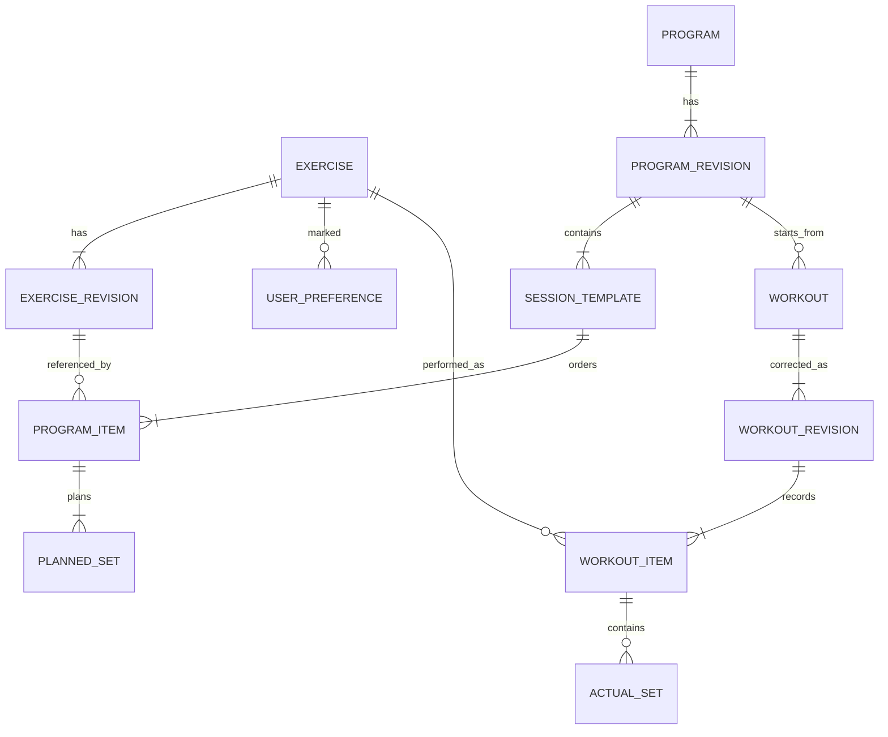
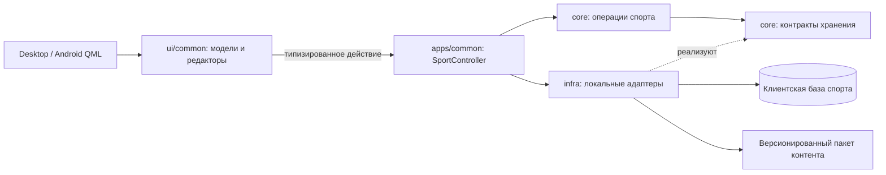

# Спорт — UX, данные и этапы MVP

Создано: 2026-11-22. Обновлено: 2026-11-24.
Статус: **пользовательские требования зафиксированы;
концептуальная модель и 22 упражнения согласованы; выбраны направления P1/P3.
H1/H2 и локальная цепочка программ → занятие → история/динамика подключены
на Desktop/Android; офлайн-библиотека доступна независимо от сервера.
Опубликованы 6 проверенных карточек из 22; содержание P1/P3 и остальные
карточки ещё не готовы. Фактический результат — разделы 15–16**.
Решением 73 разрешена последовательная реализация H1 → H2 → офлайн-библиотека
с проверками каждого блока, без повторных согласований внутри утверждённого объёма.

Основание: решения 68–74 в [журнале решений](../decisions.md).
[Передача контекста](redesign-next-chat.md) описывает исходное состояние;
[TZ.md](../../TZ.md) остаётся ТЗ Stage 1. 1A–1C реализованы и проверены ранее.
Лама отложена, перенос приостановлен. Текущие границы реализации — решения 73–74.

## 1. Полный пользовательский сценарий

### 1.1. Подготовить программу

Пользователь открывает «Спорт → Программы», просматривает небольшую готовую
библиотеку или создаёт собственную программу из доступных упражнений.
Силовые занятия дома используют гантели, штангу и собственный вес.
Другие виды активности — будущее расширение, их поля сейчас не проектируются.

Предлагаемый простой редактор: название программы → занятия внутри программы →
упражнения в нужном порядке → плановые подходы, повторения и вес.
Готовую программу предлагается копировать в собственную перед изменениями.
Выбор программы сам по себе не начинает занятие и не создаёт историю.
Автоматическое расписание и назначение следующей нагрузки не нужны в MVP.

Из состава программы открывается подробная текстовая карточка упражнения:
техника, мышцы, оборудование, ошибки и ограничения. Там же доступны независимые
отметки «Избранное» и «Хочу прогрессировать». Вторая отметка сохраняет предпочтение
для будущего подбора, но сейчас не меняет нагрузку и порядок занятий.
При подборе упражнения в редакторе нужен небольшой список с поиском и фильтром
избранного. Большой самостоятельный каталог в основной навигации не требуется.

### 1.2. Открыть и начать занятие

В «Обзоре» пользователь открывает занятие выбранной программы или продолжает
уже начатое на этом устройстве. До начала видны состав и плановые значения.
Пользователь может указать самочувствие и усталость по шкалам 1–5, боль 0–10,
одну или несколько областей боли, комментарий и индивидуальные ограничения.
Поля необязательные, независимые; неуказанная боль не означает 0 баллов.

При начале создаётся отдельный экземпляр тренировки с исходным составом и
планом. Последующее редактирование программы не переписывает этот экземпляр.
Утверждена одна незавершённая тренировка на устройстве: перед новой нужно
продолжить, завершить или явно отбросить прежнюю. Это не блокировка на всех
устройствах: такой механизм возможен только после проектирования синхронизации.

### 1.3. Записать выполнение, пропуск или замену

Активная тренировка открывается отдельным экраном. Для упражнения рядом видны
план и факт по подходам. План не считается выполненным автоматически.
Пользователь вводит фактические повторения и вес, явно отмечает выполненный
подход, при необходимости добавляет подход или отмечает пропуск.

Предлагается различать «ещё не заполнено», «выполнено» и «пропущено».
При пропуске упражнения отмечаются оставшиеся незавершённые подходы;
ранее выполненные сохраняются. Причина пропуска необязательна.
Пропуск не даёт штрафа и не превращается в нулевой спортивный результат.

Для замены пользователь выбирает другое упражнение из доступного списка.
Показываются исходное и выбранное упражнения; фактические данные относятся
к выбранному. Новый план пользователь подтверждает сам: вес исходного
упражнения не переносится автоматически. Уже выполненные подходы остаются
у исходного упражнения; замена применяется к оставшейся части и сохраняет связь
с исходным пунктом. Подробная карточка доступна и здесь без потери ввода/позиции.

Ввод сохраняется локально в ходе занятия. Работа не требует постоянной связи.
Переключение раздела, сворачивание и закрытие приложения не завершают тренировку.
После запуска предлагается восстановить локально сохранённое состояние.
Неуспешная запись на устройство показывается явно и не выдаётся за сохранение.

### 1.4. Проверить итог и завершить

Пользователь открывает итог: дата, продолжительность, состав, фактические подходы,
пропуски, замены, самочувствие до/после и необязательные заметки.
Незаполненные подходы предлагается исправить или явно отметить пропущенными;
частично выполненную тренировку можно завершить без наказания.
Полностью пропущенное занятие можно сохранить в истории. Оно не считается
выполненным и не влияет на спортивную динамику; его подходы не становятся нулями
на графике. Это отдельная отметка результата, а не ошибка сохранения.

**Утверждено:** завершение доступно без сервера и создаёт локальный результат.
Он доступен в истории и учитывается в локальном прогрессе с подписью
«Сохранено на устройстве», ожидает будущей синхронизации. Серверного подтверждения
эта подпись не означает. После подтверждения сервером — «Синхронизировано».
При ошибке локальной записи итог остаётся открытым, данные не очищаются.

### 1.5. Найти результат и посмотреть прогресс

В истории пользователь открывает состав и результаты конкретного занятия,
сопоставляет план с фактом, видит пропуски, замены, самочувствие и заметки.
Исторический состав остаётся понятным после изменения исходной программы.

В прогрессе выбирается конкретное упражнение. Видны его результаты по датам
и ссылки на соответствующие занятия истории. Подходы заменившего упражнения
учитываются у него, а не у исходного. Локальные завершённые результаты
показываются на этом устройстве с явной маркировкой их статуса;
черновики и пропуски в динамику не входят.

После будущей синхронизации тот же результат получает серверное подтверждение,
а не превращается во вторую тренировку. Продолжение занятия на другом устройстве
не входит в первоначальное локальное сохранение и требует отдельного решения.

### 1.6. Исправить завершённый результат

Пользователь открывает результат → «Исправить», меняет упражнения, подходы,
повторения, вес, продолжительность или заметки и сохраняет исправления.
Это та же тренировка с новой редакцией, не новое занятие. Локальный прогресс
пересчитывается по последней успешно сохранённой редакции; старые значения
не продолжают участвовать в динамике. При замене упражнения исправление
убирает прежний вклад и добавляет новый к соответствующему упражнению.

Предлагаемый UX: до сохранения исправлений история/прогресс используют прежнюю
редакцию; отмена возвращает её. Ошибка записи сохраняет редактор и введённое,
но не подменяет сохранённый результат. Исходный план не переписывается под факт.
Ручная длительность не меняет исходные временные отметки.

После успешной правки синхронизированного результата новая редакция отображается
как «Сохранено на устройстве — есть изменения для синхронизации». Подтверждение
прежней редакции не подтверждает новую. При одновременных правках на двух
устройствах нужен явный конфликт; молчаливая перезапись запрещена.

## 2. Поля данных для согласования

Это концептуальная модель, **не схема SQLite, классы C++ или TCP-контракт**.
Имена типов, формат файлов, способ генерации идентификаторов и механизм миграций
не выбираются этим документом. Связи библиотеки из раздела 10.8 согласованы;
детали полей сверх решений 68–71 остаются предложением.

| Объект | Поля и назначение |
|---|---|
| Упражнение | Устойчивая идентичность, название, вид активности; подробная текстовая техника по шагам; основные/дополнительные мышцы; необходимое оборудование; распространённые ошибки; ограничения; вариант выполнения и смысл веса; источник текста и версия содержимого |
| Предпочтение упражнения | Идентичность упражнения; независимые признаки «Избранное» и «Хочу прогрессировать»; время изменения. Отметки принадлежат пользователю, не определению упражнения |
| Индивидуальные ограничения | Необязательная текстовая запись пользователя; время изменения. Не диагноз и не автоматически вычисленный допуск к нагрузке |
| Программа | Идентичность, название, описание, происхождение «готовая/собственная», версия, упорядоченные шаблоны занятий; для готовой — источник и условия использования |
| Шаблон занятия | Идентичность, название, упорядоченные пункты упражнений, необязательные заметки |
| Пункт программы | Идентичность пункта и упражнения, порядок, список плановых подходов, необязательные указания. Повтор одного упражнения в занятии допустим как отдельный пункт |
| Плановый подход | Порядок, плановые повторения, нагрузка по правилам раздела 2.1. Число плановых подходов следует из списка и не хранится как независимое противоречащее число |
| Экземпляр тренировки | Устойчивая идентичность на всём пути локально → сервер и при исправлениях; редакция; вид активности; ссылка на программу/шаблон и их версии; снимок названия, состава и плана; дата; исходные начало/окончание с зоной или смещением, интервалы активности/пауз; раздельные общее/активное время и ручная длительность; состояние занятия; самочувствие до/после; заметки; снимок ограничений |
| Упражнение в тренировке | Идентичность пункта, ссылка и исторические сведения упражнения, порядок, исходный план, фактические подходы; пропуск и необязательная причина; связь с исходным пунктом при замене |
| Фактический подход | Собственная идентичность; связь с плановым подходом либо признак добавленного; порядок; фактические повторения и нагрузка по разделу 2.1; состояние выполнения; необязательная причина пропуска |
| Самочувствие до/после | Две отдельные записи: необязательные самочувствие 1–5, усталость 1–5, боль 0–10, список областей боли с «Другой областью» и текстом, независимая отметка «Новая боль», свободный комментарий. Пустая боль отличается от 0 |
| Сведения о сохранении | Время последней успешной локальной записи; версия локального изменения; результат записи/ошибка; отдельно — состояние передачи и серверное подтверждение конкретной версии, когда синхронизация появится |

Для начатого занятия хранится исторический план, для результата — план и факт.
Ссылка на актуальную программу или карточку не заменяет исторические сведения.
Полную копию техники в каждом результате хранить не обязательно: объём снимка
нужно согласовать; минимум — название, вариант, оборудование и смысл измерений.

### 2.1. Правила ввода и единицы

- Повторения — целые числа; вес — неотрицательное конечное число. Плановые
  повторения положительные; точные пределы и разминочные подходы ещё обсуждаются.
- Основная единица — кг; пустое значение отличается от нуля.
- Гантели: масса одной гантели и количество гантелей — отдельные поля.
  Количество не означает число повторений или число выполненных сторон.
- Штанга: полный вес вместе с грифом. Массу грифа не добавлять повторно.
- Собственный вес: отдельный режим, необязательное дополнительное отягощение
  и необязательный противовес. Не кодировать противовес отрицательным весом
  и не заменять режим фиктивным «0 кг». Масса тела не подставляется автоматически.
- Предложение структуры нагрузки: режим и применимые к нему поля
  «масса одной гантели / количество», «полный вес штанги», «отягощение / противовес».
  В плане и факте используется одинаковый смысл полей; неприменимые поля пусты.
  В MVP дополнительное отягощение и противовес взаимоисключающие. При переключении
  не переносить скрытое значение второго режима в сохранённую нагрузку.
- Плановые значения не заполняют факт без явного действия пользователя.
  Число фактических подходов выводится из записей, выполненные и пропущенные
  считаются отдельно. Лишний выполненный подход допустим как добавленный.
- Заполненный черновик подхода и подтверждённое выполнение различаются.
  Для выполненного подхода нужны согласованные обязательные поля; неверный ввод
  сохраняется как редактируемый черновик, но не попадает в расчёт прогресса.
- Сохраняется порядок, пропуски и связь замен. Несопоставимые варианты упражнения
  и разные значения смысла веса нельзя молча объединять в динамике.
- Начальная дата фиксируется по местному времени устройства при старте;
  ручное исправление доступно в итоге. Переход через полночь её не меняет.
  Исходные временные отметки сохраняются независимо от исправленной даты.
- Универсальный общий поднятый вес для несопоставимых упражнений не вычисляется.
  Разные варианты, количество гантелей и режимы нагрузки не сливаются в одну серию.

### 2.2. Таймер и ручная длительность — утверждённое поведение

Таймер поддерживает паузу и продолжение. Различаются:

- Общее время занятия: от исходного старта до исходного завершения, включая паузы.
- Время активности: сумма интервалов, когда таймер не на паузе.
- Ручная скорректированная длительность: отдельное необязательное значение,
  которое пользователь может изменить до завершения и при правке результата.

Ручная корректировка не меняет исходные начало, конец и интервалы таймера.
Предложение: основная подпись «Длительность» использует ручное значение, если оно
задано, иначе активное; рядом доступно общее время. В истории видна пометка
«Скорректировано вручную» и доступны исходные значения. Пауза не завершает занятие.
Поля чисел хранятся отдельно от текста форматирования; время не хранится
единственной строкой «45 минут».

После восстановления приложение предлагает три действия: «Считать активностью»,
«Считать паузой», «Указать длительность вручную». До выбора интервал
не добавляется к активному времени;
интервал и необходимость решения сохраняются при повторном закрытии. Предложение:
завершение тренировки требует разрешить такой интервал; повторный выбор не должен
удваивать время. Общее прошедшее время и исходные отметки не переписываются.
Утверждённая трактовка третьего действия: пользователь указывает активную часть
именно этого интервала; остальная часть считается паузой. Это отличается от
ручной корректировки итоговой длительности всего занятия. Исходные отметки
сохраняются, повторное восстановление не добавляет
уже обработанный интервал. Технические детали — в разделе 13.

### 2.3. Самочувствие и будущая персонализация

В MVP сведения вводятся вручную до и после занятия и сохраняются раздельно.
Самочувствие 1–5, усталость 1–5, боль 0–10, несколько областей боли и свободный
комментарий — все поля необязательны. Предлагаемые подписи шкал: самочувствие
от «очень плохое» до «очень хорошее», усталость от «минимальная» до «очень сильная»,
боль от «нет боли» до «максимальная по собственной оценке». Пустые поля не заполняются
средним баллом и не трактуются как отсутствие боли/усталости.
Утверждены несколько областей боли, вариант «Другая область» с текстом
и независимая отметка «Новая боль». Она не вычисляется только по отсутствию
прошлых записей и не выводится автоматически из числовой выраженности.
Поля доступны независимо; правила подсказок при противоречивом вводе ещё обсуждаются.
Индивидуальные ограничения доступны до начала и из активного занятия.

Предпочтение «Хочу прогрессировать» не разрешает игнорировать ограничения.
В MVP автоматического назначения или увеличения нагрузки нет. Для будущего
подбора зафиксировано требование: выраженная или новая боль, ухудшение состояния
не должны приводить к автоматическому увеличению нагрузки. Нет данных —
не означает благополучное состояние. Пороговые значения, алгоритмы и медицинские
выводы в этом ТЗ не определяются.

## 3. Состояния занятия и сохранения

Не смешивать три независимых признака: ход занятия, запись на устройстве
и подтверждение сервером. Офлайн не является ошибкой локального сохранения.

| Измерение | Предлагаемые состояния |
|---|---|
| Ход занятия | Черновик: таймер идёт или на паузе / Завершено; явное отбрасывание локального черновика с подтверждением |
| Локальная запись | Есть несохранённые изменения / Сохраняется на устройстве / Локальная копия записана / Ошибка локальной записи. Применимо и к черновику; не подменяет статус завершённого результата |
| Серверная запись, поздний этап | Не отправлено / Ожидается ответ / Подтверждена указанная версия / Известный отказ / Исход неизвестен / Конфликт версий |

Утверждённые пользовательские статусы:

- **Черновик** — занятие продолжается, в том числе на паузе. Отдельно видны
  успешность локальной записи и время её последнего завершения.
- **Сохранено на устройстве** — завершённая текущая редакция локально сохранена,
  ожидает синхронизации. Работает в локальной истории и прогрессе.
- **Синхронизировано** — сервер подтвердил именно текущую редакцию результата.

«Сохраняется», ошибка и конфликт — дополнительные состояния/пояснения, а не
ложный переход в один из трёх основных статусов. Во время правки показываются
несохранённые изменения; успешная запись правки возвращает локальный статус.

В локальном MVP серверная запись ещё не поддерживается: нельзя называть результат
«синхронизированным» или показывать работающую кнопку отправки.
Будущая серверная отметка относится к конкретной версии: после локальной правки
прежнее подтверждение не подтверждает новые изменения.

| Ситуация | Ожидаемое поведение |
|---|---|
| Ввод/изменение подхода | Локальное автосохранение; статус обновляется после фактической записи, а не после изменения поля |
| Уход в другой раздел или карточку | Ввод и позиция сохраняются, занятие остаётся активным |
| Закрытие и повторный запуск | Восстановление последней успешной записи, включая подходы, пропуски, замены и поля самочувствия; видна точка продолжения |
| Ошибка записи, например недоступно хранилище | Ввод остаётся в памяти, видна ошибка и явный повтор локальной записи; завершение не объявляется сохранённым |
| Назад/закрытие при ошибке записи | Предупреждение о несохранённых изменениях, возможность остаться; отбрасывание только явное. ОС может принудительно завершить процесс, поэтому нужно частое сохранение в ходе ввода |
| Повреждённое сохранение | Явная ошибка восстановления; не молчаливый пустой старт и не перезапись единственной копии. Способ безопасного восстановления проектируется отдельно |
| Завершение офлайн | Сначала успешная локальная запись результата, затем локальная история и прогресс; при сбое остаётся редактируемый итог |
| Исправление завершённого результата | Та же идентичность, новая редакция; после локальной записи пересчёт прогресса, отметка ожидания синхронизации; отмена/ошибка не подменяют прежнюю редакцию |
| Будущий обрыв после отправки | Локальная копия сохраняется, исход помечается неизвестным; восстановление выясняет судьбу той же записи, а не создаёт новую |
| Будущий конфликт устройств | Не перезаписывать чужую версию молча; показать конфликт. Правило разрешения — отдельное решение |

**Гарантия для проектирования:** статус «Сохранено на устройстве» означает
возможность восстановить отмеченную версию после обычного закрытия/перезапуска.
Новые изменения до успешной записи этой гарантии ещё не имеют. Частота записи,
атомарность и восстановление после аварии — предмет технического плана и тестов,
а не повод обещать сохранность произвольного ещё не записанного нажатия клавиши.

### 3.1. Граница отдельного проектирования синхронизации

До серверной реализации нужно согласовать:

- Одну идентичность результата, сохраняемую при повторных попытках передачи,
  перезапуске и получении серверного подтверждения; отдельно версии изменений.
- Защиту от дублирования, действующую и после потери ответа/переподключения.
  Нынешних правил TCP и черновиков в памяти для этой гарантии недостаточно.
- Сверку неизвестного исхода до повторной записи. Поздний ответ не должен
  подтверждать другую версию или закрывать новое занятие.
- Объединение локального результата с его серверным подтверждением в одну строку
  истории и одно событие динамики. Два независимо начатых похожих занятия
  не склеиваются по дате и названию.
- Передачу программ, предпочтений и ограничений: они также локально изменяемы,
  а не только результатов. Политику офлайн-доступности библиотечного содержания.
- Конфликты, удаления, редактирование подтверждённого результата и возможную
  передачу незавершённого занятия между устройствами.
- Привязку локальных записей к пользователю/серверу, смену endpoint и недопущение
  отправки старых записей в другой профиль без явного решения.

Эти требования не выбирают очередь, формат идентификаторов, новые таблицы или
сетевые методы. Синхронизация согласуется и реализуется отдельно от локального MVP.

## 4. Структура экранов Desktop и Android

**Утверждено: Обзор / Программы / История / Прогресс.**
Основная навигация 1B/1C сохраняется. Активная тренировка — отдельный экран.
Детали упражнения открываются из программы и активной тренировки.

| Экран | Desktop | Android |
|---|---|---|
| Обзор | Продолжение локального занятия, выбранная программа, последний результат и статус его сохранения | Одна главная точка продолжения/старта, ниже программа и последний результат |
| Программы | Готовые/собственные, список и состав рядом; на минимальном окне последовательный просмотр | Список → программа → занятие; простой редактор по шагам |
| Подбор упражнения | Поиск по небольшой библиотеке, избранное, открытие карточки | Поиск, фильтр избранного и крупные строки выбора |
| Карточка упражнения | Прокручиваемый текст техники, мышц, оборудования, ошибок и ограничений; две отдельные отметки | Вложенный экран с теми же сведениями и возвратом к исходному месту |
| Активная тренировка | Порядок упражнений, план/факт подходов рядом; понятные пропуск и замена | Текущее упражнение, крупные числовые поля, список подходов, доступ к общему составу; минимум ввода |
| Итог | Проверка результатов и правка даты/времени, самочувствие после, заметки | Короткие последовательные блоки, явное завершение и локальный статус |
| История | Список занятий и подробности выбранного результата | Список → результат → подробности упражнения |
| Прогресс | Выбор упражнения, динамика и связанные результаты | Одно упражнение/показатель за раз и переход к занятиям |
| Индивидуальные ограничения | Доступны из обзора и до начала, без изменения общей страницы настроек | Доступны из обзора и подготовки/активного занятия |

Внутреннее переключение — короткая полоса, на узком экране может прокручиваться.
Четыре раздела не превращаются в одну длинную страницу. На Android Назад
сначала скрывает IME, затем закрывает детали/подтверждение, затем возвращает
из вложенного экрана; активное занятие при этом сохраняется локально.
Действие «Отбросить тренировку» отдельное и требует подтверждения.

Тема графитовая с лавандой; progressAccent для спортивной динамики. Без отдельной
темы, обязательной геймификации, штрафов, вымышленных показателей и достижений.
На Desktop мини-плеер не перекрывает поля. На Android учитываются SafeArea,
adjustResize, баннеры и доступность действий с открытой клавиатурой.

## 5. История и минимальный прогресс

История хранит каждый результат со снимком состава и фактом, включая частичные
занятия. Локальный статус виден в списке и подробностях. Только открытие карточки
или выбор программы не создают занятия в истории.

**Предложение по первому прогрессу:** результаты выбранного упражнения по датам:
число выполненных подходов, фактические повторения и вес каждого подхода.
Таблица результатов обязательна, простой график добавляется после выбора
однозначного показателя. Расчёт максимума, тоннажа, рейтинга и процентов улучшения
не включается автоматически. Для собственного веса сначала достаточно повторений
при одинаковом варианте выполнения; дополнительный вес показывается отдельно.

Из точки/строки можно открыть исходное занятие. До двух сопоставимых результатов
показываются доступные данные и пояснение, что динамики ещё недостаточно.
Отсутствие записи и пропуски не заполняются нулями. «Хочу прогрессировать» помогает
найти выбранные упражнения, но не ограничивает просмотр остальной истории.

Редактирование завершённого результата входит в MVP: упражнения, подходы,
повторения, нагрузка, продолжительность и заметки. После сохранения исправления
прогресс пересчитывается по текущей редакции той же тренировки. Повторная правка
не создаёт дополнительную строку истории и не удваивает вклад в динамику.

## 6. Состав локального MVP и небольшие этапы

Этапы ниже описывают общий сценарий. Текущий разрешённый объём уточнён решением 73; фактическая реализация — раздел 15.
Сразу согласован весь пользовательский объём: и готовые, и собственные программы,
подробные текстовые упражнения, предпочтения, локальное восстановление,
самочувствие, история и динамика. Деление на этапы не исключает эти требования.

| Этап | Результат | Проверяемая граница готовности |
|---|---|---|
| 2A. UX и модель данных | Этот документ, ответы на вопросы раздела 9 и макеты ключевой цепочки на обеих платформах | Базовые правила офлайн/веса/шкал/таймера утверждены; согласованы модель библиотеки, оставшиеся детали и порядок |
| 2B. Небольшая библиотека и карточка | Согласованный набор упражнений и готовых программ; техника, мышцы, оборудование, ошибки, ограничения; избранное и «Хочу прогрессировать»; запись индивидуальных ограничений | Карточка и предпочтения доступны офлайн, предпочтения/ограничения восстанавливаются после перезапуска. Источник/права и состав контента утверждены до включения |
| 2C. Собственные программы | Простой редактор из упражнений, плановые подходы/повторения/вес, порядок, сохранение собственной программы | Программа восстанавливается локально; готовая доступна для просмотра и копирования; валидация не теряет ввод |
| 2D. Активное занятие | Начало из программы, снимок плана, факт, пропуски/замены, дата, таймер с паузами, самочувствие до, локальное автосохранение | Без сервера восстанавливаются данные и таймер; проверены ошибка записи, замена после выполненного подхода и неизменность исходного плана |
| 2E. Завершение и история | Самочувствие после, три значения времени, заметки, итог; завершение офлайн, история и исправление результата | Результат восстанавливается; правка сохраняет идентичность и исходные отметки времени; повтор не создаёт дубль, ошибка не теряет ввод |
| 2F. Прогресс | Динамика конкретных упражнений и переход к исходному результату, пересчёт после правки | Только завершённый факт актуальной редакции; корректны замены, режимы нагрузки и малое число данных; исправление не удваивает результат |
| S1. Отдельное проектирование синхронизации | Идентичность/версии, подтверждения, неизвестный исход, конфликты, профиль, локальная и серверная история | Согласован отдельный документ и план, затем отдельно разрешаются сервер/SQLite/TCP и реализация |

Локальный MVP завершён после 2B–2F. Серверное подтверждение и обмен двух устройств — следующий отдельно
согласованный объём. S1 можно обсуждать раньше, чтобы проверить модель, но это
не разрешение автоматически строить сетевой backend или постоянную очередь.

До 2B необходим отдельный технический план локального хранения: размещение
по существующим слоям, формат, версии, атомарная запись, ошибки/восстановление,
проверки. Конкретная технология и новые зависимости сейчас не выбираются.
В каждом этапе — обе платформы с разными компоновками и общим поведением.
Точный список файлов кода предлагается только после утверждения этого плана.

## 7. Аудит и повторное использование

WorkoutsScreen.qml и MobileSportScreen.qml пока содержат только заголовок
и EmptyState. В core/infra/ui/apps спортивных моделей, сервисов и каталога
не найдено. Упоминания тренировки в календарном парсере не являются спорт-модулем.
Существующие данные не обеспечивают новый сценарий одной заменой QML.

Переиспользуются Theme, AppButton, AppIcon, AppTextField/AppTextArea, SurfaceCard,
SectionHeader, EmptyState, ErrorBanner и ConnectionBanner. Подходы PlannerEditor
к dirty/pending полезны как образец, но его предметные сущности не используются
для тренировок. HabitProgress не является моделью спортивных результатов.

Сохраняются именованная навигация DesktopState/MobileState, QML URI, музыка
Desktop с единственным проигрывателем, черновик чата, формы и Android adjustResize.
Ранее просмотрены сохранённые рендеры Desktop 1000×720 и Mobile 360 px;
это не новая проверка устройства и не приёмка будущих экранов.

## 8. Приёмка будущей реализации

- Полный путь готовая/собственная программа → карточка упражнения → тренировка
  → восстановление → итог → история → динамика конкретного упражнения.
- Сохраняются все подходы, план/факт, пропуски, замены после частичного выполнения,
  самочувствие, ограничения, заметки, дата и продолжительность.
- Гантели сохраняют массу одной и количество, собственный вес — отягощение
  и противовес; несовместимые значения не превращаются в общий тоннаж.
- После правки результата динамика пересчитывается один раз; прежняя редакция
  не учитывается дополнительно. Проверены отмена правки и ошибка её сохранения.
- Таймер восстанавливает паузы/продолжение; ручная корректировка не меняет
  исходные отметки, общее и активное время. Шкалы допускают отсутствие значения,
  боль 0 отличается от отсутствия записи; сохраняется несколько областей боли.
- Проверены обычное закрытие, принудительное завершение после подтверждённой
  локальной записи, ошибка записи и повреждённое сохранение. Нельзя показывать
  локальную или серверную сохранность, которой фактически нет.
- Завершение и повторный запуск не дублируют историю и динамику. Проверены
  частичное/полностью пропущенное занятие, нулевой/неуказанный вес и разные варианты.
- Изменение программы не меняет ранее начатое занятие/историю. Прогресс ведёт
  к исходным данным; черновики не считаются завершёнными результатами.
- Проверены IME, Назад, переключения разделов и сохранение места ввода.
  Desktop: 1000×720, 1280×800, 1600×900; Android: 360/412 px и регрессия 320 px.
- После изменения кода — штатные конфигурация, сборка и CTest по AGENTS.md;
  mobile дополнительно требует APK и проверки устройства. Новые компоновки
  проверяются свежими рендерами с Overlay, затем IME/Назад на A55.
- Серверные гарантии проверяются отдельным этапом: потеря ответа, повтор,
  перезапуск и конфликт не создают вторую копию результата.

## 9. Осталось согласовать после решения 72

Концептуальная модель 10.8, технический план 13 и решения 68–72 приняты. Собственные программы,
копирование готовых, локальный поиск/фильтры повторно не согласовывать.
На обсуждении:

1. Полные тексты 22 карточек и реестр источников/уточнений L0 в разделе 12.
   P1 и P3 выбраны для поставки; точные последовательности, подходы/повторения
   и содержание программ ещё проверяются. P2/P4 — расширение.
2. Конкретные поля условий выполнения/сопоставимости: что обязательно записывать
   для каждой карточки, кроме уже утверждённых сторон, опоры и амплитуды.
3. Конкретное представление предупреждений таймера и подпись основной длительности.
   Ручной интервал как активная часть и коррекция при недостоверных часах утверждены.
4. Конкретный план H1 в разделе 14. H0–H6 утверждены как последовательность,
   но разрешения на реализацию H1 или автоматический переход к H2 нет.

Следующий результат — согласованный конкретный H1; L0 продолжается отдельно,
без объявления непроверенных текстов готовыми. Хранение и его архитектурные
принципы повторно не согласовывать; реализация каждого подшага разрешается отдельно.

За пределами MVP: другие виды активности, большой каталог, изображения/видео,
автоподбор нагрузки, рекомендации Ламы, датчики/часы, Health Connect, калории,
автоматическое расписание, интеграция с календарём и обязательная геймификация.
Техническая расширяемость на другие активности учитывается при согласовании
модели, но не означает построение универсального движка тренировок заранее.

## 10. Библиотека упражнений и программ — подробное предложение

**Статус раздела:** концептуальная модель 10.8, собственные программы,
копирование готовых, локальный поиск и фильтрация согласованы решением 70.
Решением 71 приняты 22 упражнения, P1/P3, учёт сторон/условий и начальные
числовые пределы раздела 11. Полные тексты и содержание программ ещё согласуются;
P2/P4 остаются расширением. Реестр L0 и предложение хранения — разделы 12–13.

### 10.1. Границы библиотеки и точки входа

Небольшая библиотека поставляется с приложением и доступна без сервера.
Это предложение о доступности контента, не выбор формата упаковки.
В MVP собственные программы составляются из этого набора; создание пользователем
новых определений упражнений и импорт чужих баз предлагается отложить.

Точки входа: «Программы → Готовые / Мои», «Добавить упражнение» в редакторе,
«Заменить» в тренировке и карточка выбранного упражнения. Небольшой браузер
упражнений доступен также из «Программ», без пятой постоянной вкладки спорта.
В нём доступны поиск, избранное и предпочтение прогресса.

Две кнопки отметок не объединяются: упражнение можно сохранить в избранное,
не выбирая его для прогресса, и наоборот. Они доступны в полной карточке
и через отдельные действия строки списка; изменение не выбирает упражнение
в программу случайным нажатием. Отметки работают офлайн и переживают перезапуск.
Снятие отметки не удаляет упражнение из программ и не меняет историю.
«Хочу прогрессировать» не начинает программу, не повышает вес, не назначает занятие.

### 10.2. Структура текстовой карточки упражнения

| Блок | Содержание и поведение |
|---|---|
| Заголовок | Название конкретного варианта, краткая цель движения, оборудование; отдельные «Избранное» и «Хочу прогрессировать» |
| Мышцы | Основные и дополнительные мышцы без вымышленных процентов нагрузки |
| Подготовка | Требуемый инвентарь, опоры/пространство, исходное положение и способ взять/положить инвентарь |
| Выполнение | Нумерованные шаги: старт → движение → контролируемый возврат → что считается одним повторением; понятные ориентиры корпуса/конечностей |
| Дыхание и контроль | Короткие текстовые ориентиры, относящиеся к конкретному упражнению, без обязательного универсального правила для всех движений |
| Частые ошибки | Несколько конкретных ошибок и способ заметить/исправить каждую; не общая фраза «соблюдайте технику» |
| Ограничения и условия | Ограничения варианта, требования к опоре/инвентарю и контролю движения; не автоматический медицинский допуск по анкете |
| Структурированные условия | Опора/нагрузка на кисти, выход на пол, устойчивая опора и её тип, положение тела, односторонность/диагонали и другие существенные требования; не автоматический медицинский допуск |
| Как записывать | Смысл повторения и веса: одна гантель/количество, полный вес штанги, свой вес/отягощение/противовес |
| Другие варианты | Явные ссылки на отдельные упражнения-варианты; не автоматическая равноценная замена |
| Источник | Авторский текст, ссылки на проверочные материалы, дата проверки и версия; служебный статус подготовки не показывается как готовый контент |
| Действие в контексте | «Добавить в занятие» в редакторе, «Выбрать заменой» при замене, «Вернуться к тренировке» при просмотре |

Во время занятия показывается краткая техника: исходное положение, 2–4 ключевых
ориентира и смысл одного повторения. Полная инструкция открывается отдельно
с сохранением текущего подхода, ввода и таймера. Краткий текст — самостоятельное
содержательное поле редакции, а не автоматически обрезанное начало полного текста.
Переход к связанному варианту открывает его карточку; замена требует отдельного
подтверждения и не переносит нагрузку автоматически.

Техника, ошибки и ограничения должны быть содержательно заполнены у каждого
упражнения до его публикации. Заголовок с единственной строкой описания не проходит
приёмку. Ключевые шаги видны сразу; длинные дополнительные сведения могут
сворачиваться, но доступны офлайн. Карточка возвращает пользователя к тому же
упражнению, подходу и позиции прокрутки без сброса ввода и таймера.

Для текста предлагается несколько именованных блоков вместо единственной
неструктурированной строки: это позволяет одинаково показывать карточку на двух
платформах, проверять полноту и искать по нужным полям. HTML из внешних источников
не исполняется; конкретный формат содержимого определяется техническим планом.

### 10.3. Пример подробной техники

**Пример наполнения для проверки формата: «Отжимание с колен»**.
Не назначение личной нагрузки и не утверждённая карточка поставки.

- Оборудование: собственный вес, пол; коврик необязателен.
- Мышечные группы: грудь, плечевой пояс, руки; детализация требует проверки.
- Подготовка: опуститься на колени, поставить ладони примерно на ширине плеч;
  перенести корпус так, чтобы плечи находились над кистями.
- Исходное положение: вытянуть корпус от головы до колен, напрячь мышцы корпуса;
  таз не должен оставаться согнутым относительно этой линии.
- Шаг 1: медленно согнуть руки и опустить корпус, сохраняя положение головы
  относительно спины и линию корпуса.
- Шаг 2: не проваливать поясницу и не поднимать таз; локти держать рядом с корпусом
  или слегка отвести в стороны.
- Шаг 3: оттолкнуться ладонями и вернуться в исходное положение, не меняя линию
  корпуса. Полный цикл вниз и обратно считается одним повторением.
- Ошибки: провисание поясницы, подъём таза, отдельное движение головой вместо
  опускания корпуса. Проверять, что корпус движется как единое целое.
- Ограничение: опора на кисти. Вариант опоры указывается явно.
- Учёт: повторения, режим «Собственный вес»; отдельная от обычных отжиманий динамика.

Шаги выше — краткий пересказ материала [ACE: Bent-Knee Push-Up](https://www.acefitness.org/resources/everyone/exercise-library/13/bent-knee-push-up/).
Материал используется для проверки содержания, а не как готовая лицензированная
база. Тексты для поставки создаются отдельно; массовое копирование и загрузка
изображений/видео не предлагаются. Полный набор инструкций, включая дыхание,
подготовку инвентаря и ограничения, — отдельный результат этапа контента.

### 10.4. Первый набор MVP: 22 согласованных упражнения

Этот перечень заменяет прежнее предложение из 11 упражнений. Состав
**утверждён решением 71**, полные тексты ещё нужно подготовить. Он расширяет выбор опор и оборудования, а не обещает,
что каждому пользователю нужны все варианты. Штанга или даже пустой гриф
не считаются «минимальной нагрузкой» по умолчанию.

Номера ниже — только ссылки внутри ТЗ, не будущие идентификаторы данных.
«Основные мышцы» — краткий ориентир; работа стабилизаторов не исключается.
«Альтернатива» означает доступный ручной выбор по характеру движения/задаче,
а не равноценную нагрузку, лечение или автоматическую замену по симптомам.

#### Ноги и таз

| № | Упражнение | Оборудование | Основные мышцы | Особенность выполнения | Возможные альтернативы |
|---|---|---|---|---|---|
| 01 | Вставание со стула | Устойчивый стул без колёс | Квадрицепсы, ягодичные | Контролируемые подъём и посадка; высота сиденья указана в карточке | 02 — опора руками стоя; 03 — без сиденья |
| 02 | Неглубокое приседание с опорой руками | Закреплённая опора или устойчивый стул | Квадрицепсы, ягодичные | Опора для равновесия, ограниченная пользователем амплитуда; не висеть на стуле | 01 — посадка на сиденье; 03 — без опоры |
| 03 | Приседание без отягощения | Не требуется | Квадрицепсы, ягодичные | Контроль стоп и коленей, без прыжка; амплитуда описана отдельно | 01/02 — с опорой; 04/05 — внешнее отягощение |
| 04 | Приседание с одной гантелью у груди | Одна гантель | Квадрицепсы, ягодичные | Гантель удерживается двумя руками перед грудью; количество гантелей — 1 | 03 — без веса; 05 — две гантели у плеч |
| 05 | Фронтальное приседание с двумя гантелями | Две гантели | Квадрицепсы, ягодичные | Гантели у плеч, контроль корпуса; масса одной и количество — раздельно | 04 — одна гантель; 03 — без отягощения |
| 06 | Ягодичный мост на полу | Пол, коврик по желанию | Ягодичные, задняя поверхность бедра | Подъём таза без замены движения прогибом поясницы; нужно лечь на пол | 22 — разгибание бедра стоя с опорой, другое положение и амплитуда |
| 07 | Румынская тяга с двумя гантелями | Две гантели | Задняя поверхность бедра, ягодичные | Отведение таза назад, гантели близко к ногам, без требования достать пол | 08 — штанга; 06 — разгибание таза лёжа, другой характер нагрузки |
| 08 | Румынская тяга со штангой | Штанга, диски при необходимости | Задняя поверхность бедра, ягодичные | Полный вес включает гриф; отдельно описать взятие и возврат инвентаря | 07 — две гантели; 06 — без внешнего отягощения, не равная замена |

Вставание и приседание с опорой сверены по [NHS: Strength exercises](https://www.nhs.uk/live-well/exercise/strength-exercises/).
Для вариантов с отягощением: [NASM: Dumbbell Front Squat](https://www.nasm.org/resource-center/exercise-library/dumbbell-front-squat),
[NASM: Dumbbell Romanian Deadlift](https://www.nasm.org/resource-center/exercise-library/dumbbell-romanian-deadlift),
[NASM: Romanian Deadlift Barbell](https://www.nasm.org/resource-center/exercise-library/romanian-deadlift-barbell).
Мост: [NASM: Floor Bridge](https://www.nasm.org/resource-center/exercise-library/floor-bridge).
Состав библиотеки принят. Конкретные пояснения связей альтернатив ещё проверяются
при написании полных карточек L0.

#### Жимовые движения

| № | Упражнение | Оборудование | Основные мышцы | Особенность выполнения | Возможные альтернативы |
|---|---|---|---|---|---|
| 09 | Отжимание от стены | Стена | Грудные, трицепсы, передняя часть плеч | Стоя; положение стоп и угол корпуса влияют на сложность, нет выхода на пол | 10 — более низкая опора; 11 — пол и колени |
| 10 | Отжимание от высокой устойчивой опоры | Неподвижная прочная поверхность | Грудные, трицепсы, передняя часть плеч | Высота опоры задаёт вариант; обычный подвижный стул не считать подходящей опорой | 09 — стена; 11/12 — пол |
| 11 | Отжимание с колен | Пол, коврик по желанию | Грудные, трицепсы, передняя часть плеч | Линия корпуса от головы до колен, контроль таза | 09/10 — опора выше; 12 — опора на стопы |
| 12 | Обычное отжимание | Пол | Грудные, трицепсы, передняя часть плеч | Корпус движется единым блоком; отдельный вариант от отжимания с колен | 10/11 — иной рычаг и опора |

Стена: [NHS: Strength exercises](https://www.nhs.uk/live-well/exercise/strength-exercises/).
Варианты опоры и рычага: [ACE: Perfecting the Push-up for All Levels](https://www.acefitness.org/resources/pros/expert-articles/7265/perfecting-the-push-up-for-all-levels/),
[ACE: Bent-Knee Push-Up](https://www.acefitness.org/resources/everyone/exercise-library/13/bent-knee-push-up/).
Эти варианты не получают общий числовой «эквивалент веса».

#### Тяги и руки

| № | Упражнение | Оборудование | Основные мышцы | Особенность выполнения | Возможные альтернативы |
|---|---|---|---|---|---|
| 13 | Тяга одной гантели с опорой | Одна гантель и устойчивая скамья для руки/колена | Широчайшие, ромбовидные, средняя трапеция; сгибатели локтя помогают | Каждая сторона отдельно; корпус не разворачивается вслед за гантелью. Наличие скамьи нужно подтвердить | 14 — две гантели без опоры; 15 — штанга, другая нагрузка на удержание корпуса |
| 14 | Тяга двух гантелей в наклоне | Две гантели | Широчайшие, ромбовидные, средняя трапеция | Удержание наклона без опоры; контролируемое движение локтей | 13 — по сторонам с опорой; 15 — штанга |
| 15 | Тяга штанги в наклоне | Штанга | Широчайшие, ромбовидные, средняя трапеция | Стабильное положение корпуса, без подброса штанги; полный вес с грифом | 13/14 — гантели и другой способ опоры |
| 16 | Одновременное сгибание рук с гантелями | Две гантели | Бицепсы, плечевая мышца | Локти без раскачивания корпуса; один цикл обеих рук — одно повторение | 17 — штанга; пользователь может задать меньшую массу гантелей |
| 17 | Сгибание рук со штангой | Штанга | Бицепсы, плечевая мышца | Сгибание локтей с контролем корпуса; форма грифа указывается в полном описании | 16 — независимые гантели, иной хват |

Опорная тяга: [ACE: Single-arm Row](https://www.acefitness.org/resources/everyone/exercise-library/126/single-arm-row/).
Тяга в наклоне: [ACE: Bent-Over Row](https://www.acefitness.org/resources/everyone/exercise-library/12/bent-over-row/),
[ACE: Total-body Dumbbell Workout](https://www.acefitness.org/resources/pros/expert-articles/3718/total-body-dumbbell-workout/).
Сгибание рук: [NASM: Barbell Bicep Curl](https://www.nasm.org/resource-center/exercise-library/barbell-bicep-curl).
Тяги нельзя подменять сгибаниями рук только из-за участия бицепса.

#### Опора, корпус и движения без внешнего отягощения

| № | Упражнение | Оборудование | Основные мышцы | Особенность выполнения | Возможные альтернативы |
|---|---|---|---|---|---|
| 18 | Подъём на носки с опорой | Неподвижная опора | Икроножные, камбаловидные | Обе ноги одновременно, контролируемый подъём/опускание пяток | Тот же вариант без дополнительного веса; отдельный вариант без опоры можно добавить позже |
| 19 | Отведение ноги в сторону стоя с опорой | Неподвижная опора | Средняя и малая ягодичные | Каждая сторона отдельно; без наклона корпуса вслед за ногой | 06 — иная задача ягодичных, не прямая замена; вариант лёжа можно добавить позднее |
| 20 | «Птица-собака» | Пол, коврик по желанию | Мышцы корпуса и разгибатели спины; ягодичные участвуют | Противоположные рука и нога, без разворота таза; чередование сторон | 21 — контроль корпуса лёжа на спине, другая задача |
| 21 | «Мёртвый жук» | Пол, коврик по желанию | Прямая и поперечная мышцы живота, косые | Попеременное движение противоположных конечностей с контролем поясницы | 20 — четвереньки; сокращение амплитуды внутри заданного варианта требует фиксации |
| 22 | Отведение прямой ноги назад стоя с опорой | Неподвижная опора | Ягодичные, задняя поверхность бедра | Каждая сторона отдельно; движение в тазобедренном суставе без прогиба поясницы | 06 — лёжа на полу; 07 — внешний вес, не прямая замена |

Опорные движения: [NHS: Strength exercises](https://www.nhs.uk/live-well/exercise/strength-exercises/).
Контроль корпуса: [NASM: Bird Dog](https://www.nasm.org/resource-center/exercise-library/bird-dog)
и [NASM: Dead Bug](https://www.nasm.org/resource-center/exercise-library/dead-bug).
Названия «без отягощения»/«с опорой» описывают условия, а не гарантированную
безболезненность или медицинскую пригодность. Автоподбора по диагнозу нет.

**Что изменилось:** появились стоячие варианты без выхода на пол, опорные
движения, разные уровни рычага отжиманий и упражнения контроля корпуса.
Скамья, высокая опора и стул — разные условия; их нельзя считать одним
доступным предметом. Инвентарь нужно подтвердить фильтром/выбором пользователя.
Упражнения с противовесом пока не предлагаются: соответствующее оборудование
не подтверждено. Его учёт сохраняется в согласованной модели.

Для каждого включённого варианта отдельно готовятся краткая техника,
полная пошаговая инструкция, ошибки, ограничения, источники и правило учёта.
Эта таблица фиксирует принятый состав, но не заменяет подробные карточки.

#### Учёт сторон и условий — согласовано

Для 13, 19, 20, 21 и 22 записывается сторона в фактическом подходе:
левая/правая, а для чередующихся движений — какая диагональ. В плане видна
подпись «на каждую сторону», в факте можно записать разное число для сторон.
Например, план «8 на сторону» — только пример интерфейса, не назначение:
сохраняются левый и правый результаты, а не одна запись «16» без расшифровки.
Количество гантелей не подменяет сторону. Сам факт движения обеими сторонами
не удваивает число подходов автоматически.

Высота опоры в 10 и существенное изменение амплитуды должны быть видны в записи;
это контекст фактического выполнения. Изменение такого условия помечается
в истории, результаты не объединяются молча в один показатель прогресса.
Перечень структурированных полей и способ сравнения — предложения разделов 12–13.

### 10.5. Варианты готовых программ и различия

Для первой поставки выбраны **P1 и P3**, P2/P4 — кандидаты расширения.
Точные составы/порядок A/B и дозировка ещё проходят проверку контента.
Это шаблоны состава для ручного выбора, не назначение персональной нагрузки.
Веса, подходы/повторения, частота, длительность отдыха и прогрессия не назначены.

| Направление | Пример занятия A: порядок | Пример занятия B: порядок | Отличие и необходимые условия |
|---|---|---|---|
| P1. С опорой, без внешнего отягощения | 01 вставание со стула → 09 стена → 18 носки с опорой → 19 нога в сторону | 02 неглубокое приседание с опорой → 09 стена → 22 нога назад → 18 носки | Стоя/со стулом, без выхода на пол; нужна неподвижная опора. Нет тяги для верхней части спины: программа не заявляется полной заменой силовых с инвентарём |
| P2. Собственный вес и пол | 03 приседание → 11 отжимание с колен → 06 мост → 20 птица-собака | 03 приседание → 12 обычное отжимание → 06 мост → 21 мёртвый жук | Без внешних весов, нужны переходы на пол и контроль корпуса. У отжиманий доступен ручной выбор 09/10/11/12; здесь также нет полноценной тяги верхом |
| P3. Гантели и собственный вес | 04 приседание с одной гантелью → 14 тяга двух гантелей → 11 отжимание с колен → 06 мост | 07 румынская тяга с гантелями → 05 фронтальное приседание → 11 отжимание с колен → 16 сгибание рук → 21 мёртвый жук | Есть приседание, разгибание таза, жим и тяга; не требует скамьи. Если подтверждена скамья, 13 — ручная опорная альтернатива 14 с раздельным учётом сторон |
| P4. Штанга, гантели и собственный вес | 05 фронтальное приседание с гантелями → 15 тяга штанги → 11 отжимание с колен → 06 мост | 08 румынская тяга со штангой → 14 тяга гантелей → 12 отжимание → 17 сгибание рук → 21 мёртвый жук | Другое оборудование и способ удержания веса, не «следующий уровень» по умолчанию. Взятие/возврат штанги описывается отдельно; приседания и жимы со штангой со стоек не включаются |

P1 даёт стоячий сценарий с опорой без внешнего веса, P3 использует гантели
и тяговые движения. **P1 не считается автоматически безопасной программой
для боли или ухудшения состояния** и не назначается по этим признакам.
Все 22 карточки входят в библиотеку, даже если конкретное упражнение не входит
в выбранные P1/P3; оно доступно для собственных программ и ручных альтернатив.

Альтернативы показываются рядом с исходным пунктом и выбираются вручную.
У них нет общего эквивалентного рабочего веса; исходные показатели не переносятся.
Менять состав можно в собственной копии программы или в конкретном занятии.
Выбор другого упражнения в одном занятии не переписывает готовую программу.

Перед публикацией готовой программы нужно отдельно согласовать её название,
цель, оборудование, состав/порядок, плановые подходы/повторения и авторство.
Стартовые веса и индивидуальная нагрузка не назначаются. Предложение по UX:
неуказанный вес обозначается «Не задан», пользователь вводит его вручную
при подготовке; пустое поле не означает 0 кг. Календарной привязки, суперсетов
и автоповышения нагрузки нет. Пропущенный день не создаёт штраф или запись сам.

Готовая программа редактируется через «Создать свою копию». Собственная копия
независима от последующих редакций исходника и хранит происхождение/версию.
Подробные тексты для поставки пишутся отдельно по проверенным источникам;
эти последовательности — авторское предложение проекта, а не программы NHS/ACE/NASM.

### 10.6. Создание собственной программы

1. «Мои → Создать программу»: название и необязательное описание.
2. Добавить именованное занятие; минимум одно для готовой к запуску программы.
3. «Добавить упражнение»: поиск/фильтры → карточка → подтверждение добавления.
   Сам просмотр или отметка избранного не добавляют упражнение.
4. Указать плановые подходы, повторения и применимые поля нагрузки. Подходы
   редактируются по отдельности; одинаковые можно явно скопировать.
5. Изменить порядок упражнений и занятий; на телефоне доступны кнопки перемещения,
   чтобы перетаскивание не было единственным способом.
6. При необходимости скопировать занятие или удалить пункт с подтверждением.
   Два одинаковых упражнения допустимы как разные пункты со своими подходами.
7. Сохранить программу локально. Черновой редактор переживает перезапуск;
   форма с незаполненными обязательными полями остаётся черновиком, а не
   отображается как готовая программа. Ошибка записи не закрывает форму.
8. В просмотре проверить состав и выбрать занятие для подготовки/старта.

Предлагаемая валидация готовности: непустое название, хотя бы одно занятие,
в каждом хотя бы один доступный пункт, в пункте хотя бы один плановый подход
с допустимыми повторениями. Незаданный вес различается с нулём и запрашивается
до выполнения соответствующего подхода. Точные пределы полей согласуются отдельно.

Удаление пункта из программы не удаляет упражнение, отметки и старые результаты.
Архивацию собственных программ предлагается использовать вместо необратимого
удаления из пользовательского списка; физическое удаление и его синхронизация
не проектируются в этом подшаге. Архивная программа не предлагается для нового
старта, история и уже начатое занятие сохраняют состав. Это правило на согласовании.

### 10.7. Поиск и фильтрация

Поиск и фильтры работают локально по доступному набору. Без сетевого поиска,
Ламы, рекомендаций и нечёткого семантического подбора в MVP.

| Элемент | Предлагаемое правило |
|---|---|
| Поисковая строка | Название, альтернативные названия и небольшие редакционные теги; без учёта регистра, пробелы нормализуются, е/ё эквивалентны |
| Несколько слов | Все слова должны находиться в индексируемых полях упражнения; порядок слов не важен. Это правило поиска, не предметный алгоритм тренировок |
| Оборудование | Фильтр «Доступный инвентарь»: все обязательные позиции упражнения должны входить в выбранный набор; отсутствие выбора не скрывает всю библиотеку |
| Условия выполнения, предложение для расширенного набора | «Без внешнего отягощения», «С опорой», «Без выхода на пол». Условия явно описаны в карточке; это не фильтр медицинской допустимости или числовая оценка лёгкости |
| Мышцы | Совпадение хотя бы одной выбранной группы; основные и дополнительные отмечены в карточке |
| Избранное | Только упражнения с пользовательской отметкой |
| Хочу прогрессировать | Независимый фильтр, работает и без избранного |
| Сочетание фильтров | Между группами — И; внутри группы мышц — ИЛИ. Оба переключателя вместе требуют обе отметки |
| Порядок | По имени, стабильный для одинаковых названий; избранное не меняет порядок молча. Сортировку по частоте выполнения отложить |
| Нет совпадений | Показать текущие фильтры, «Сбросить фильтры» и возможность очистить запрос; не подставлять неподходящие упражнения |

Доступный инвентарь — фильтр, не доказательство физической возможности выполнения.
Название мышцы ищется через контролируемые теги, а не совпадение случайного слова
в длинном тексте ограничений. Фильтр по диагнозу/боли не добавляется.

Поиск программ: название/краткое описание, готовые или собственные, оборудование.
Оборудование программы выводится из обязательного инвентаря её пунктов.
Поиск/фильтры сохраняются при возврате из карточки в текущем сеансе. На Android
фильтры открываются компактной панелью; видны активные фильтры и число результатов.

### 10.8. Концептуальная модель библиотеки и связи — согласовано

Сущности, их концептуальные поля и связи согласованы решением 70, включая
редакции, исторические снимки и независимые предпочтения. Это не имена будущих
классов, таблиц или протокольных ключей и не выбор технологии локального хранения.
Учёт сторон/существенных условий и начальные числовые пределы также согласованы.
Детализация структуры условий и технического хранения — в разделах 12–13.

| Сущность | Существенные поля/связи |
|---|---|
| Упражнение | Идентичность конкретного варианта, вид активности, активная редакция; ссылки на связанные варианты. Изменение техники не создаёт новое движение, смена смысла выполнения может требовать нового варианта |
| Редакция упражнения | Номер/идентичность редакции, названия/синонимы/теги, краткая и полная техника по блокам, ошибки, ограничения, оборудование, мышцы, режим нагрузки, правило повторения, структурированные условия выполнения, источники, статус подготовки и дата проверки |
| Оборудование и мышцы | Небольшие справочники устойчивых значений. Связь упражнения с мышцей содержит роль «основная/дополнительная»; оборудование содержит требуемое количество, если оно существенно |
| Предпочтение пользователя | Пара «владелец + упражнение», два независимых признака, редакция/время изменения. Обновление текста упражнения не сбрасывает отметки |
| Программа | Идентичность, владелец для собственной, происхождение, активная редакция, состояние «черновая/доступная/архивная»; ссылка на исходную программу/редакцию при копировании |
| Редакция программы | Название, описание, цель, применимость, источники/авторство; упорядоченные шаблоны занятий. Опубликованная редакция готовой программы не меняется молча |
| Шаблон занятия | Идентичность, принадлежность редакции программы, название, порядок, заметки; содержит пункты |
| Пункт занятия | Собственная идентичность, порядок, ссылка на вариант/редакцию упражнения, примечание; содержит плановые подходы. Повтор упражнения — новый пункт, не новая карточка |
| Плановый подход | Идентичность, порядок, повторения и структурированная нагрузка; принадлежит пункту, не карточке упражнения |
| Тренировка/результат | Ссылка на исходную редакцию программы и снимок плана; свои фактические записи. Правка факта меняет редакцию результата, не редакцию программы |

Предпочтение относится к устойчивой идентичности упражнения, а не его текстовой
редакции и не вхождению в программу. Варианты «с колен» и «обычное отжимание»
имеют собственные отметки и динамику. Нужность общего семейства вариантов
обсуждается позже; оно не склеивает результаты автоматически.



Схема показывает готовую программу/результат. В редакторском черновике допускаются
пустые занятия и списки. На каждой связи «содержит» нужен явный порядок.
План тренировки хранится снимком; ссылки на источник нужны для происхождения,
а не для динамического пересчёта старого плана. Пустые подходы/пропуски не создают
выполненные записи. При прогрессе выбирается только последняя сохранённая
редакция результата. Способ хранить прежние редакции технически ещё не выбран.

Обновление поставляемой библиотеки не перезаписывает собственные программы
и исторические снимки. Если редакция недоступна, карточка не ломает просмотр
сохранённого результата: исторические сведения остаются. Модель владельца
до синхронизации не означает добавление новой системы аккаунтов.

### 10.9. Последовательность реализации библиотеки

Подэтапы уточняют 2B–2C. Модель и набор из 22 упражнений уже согласованы;
текущий рубеж — полные карточки/содержание P1/P3 и согласование предложенного
плана хранения (13). Реализация разрешена решением 73; новые зависимости без согласования не добавляются.

| Шаг | Конкретный результат | Проверка готовности |
|---|---|---|
| L0. Контент и правила — текущий шаг | Приняты 22 упражнения и направления P1/P3; подготовить/сверить краткие и полные карточки, условия, источники, содержание и подходы/повторения программ по разделу 12 | Все карточки проверены, программы согласованы по содержанию; нет неявного инвентаря или назначения индивидуальных весов. Предложение хранения уже разрешено обсуждать |
| L1. Чтение библиотеки и карточка | Определения упражнений/редакций и офлайн-чтение, карточка в двух компоновках | Все карточки полны, текст читаем и прокручивается, детали открываются и возвращаются без сброса контекста |
| L2. Отметки, поиск и фильтры | Локальные предпочтения и понятный браузер выбора | Отметки независимы, сохраняются после запуска; фильтры сочетаются по описанным правилам, пустой результат объяснён |
| L3. Готовые программы | Просмотр состава/плана, источники, проверка оборудования, подготовка локальной копии/занятия | Программа использует существующие карточки и плановые поля; при неготовом ещё запуске нет активной фиктивной кнопки |
| L4. Собственный редактор | Создание с нуля и копирование готовой, занятия/пункты/подходы, порядок, черновик, локальная запись | Копия независима, повторные пункты различаются; перезапуск/ошибка не теряют ввод; неполная программа остаётся черновиком |
| L5. Связь с тренировкой | Подключение к этапу 2D: снимок плана и карточки при выполнении/замене | Изменение программы не меняет начатое занятие, замена не меняет шаблон и не смешивает факт |

L1–L4 дают библиотеку и редактор, но ещё не полный спортивный MVP. Полный сценарий
требует 2D–2F: восстановления занятия, локального завершения, исправления истории
и пересчёта прогресса. Синхронизация остаётся отдельным S1.

Модель и локальное хранение утверждены; решение 73 разрешило H1/H2 и библиотеку.
Публикация ограничена проверенным контентом. Новый сетевой API или очередь
не входят в реализацию; фактические файлы/проверки — раздел 15.

## 11. Числовой ввод — принятые начальные ограничения

Это технические границы формы и проверок, **не рекомендации по нагрузке**.
Ни один предел не используется как стартовое значение, цель или медицинский
порог. Все границы этого раздела приняты решением 71 как начальные технические
ограничения. Дополнительное отягощение при собственном весе может отсутствовать.

| Поле | Принятые начальные границы/точность | Обработка пустого и особых случаев |
|---|---|---|
| Плановые повторения | Целое 1–1000 | Пусто допускается в черновике программы; готовый план требует значения |
| Фактические повторения выполненного подхода | Целое 1–1000 | Пусто/0 не подтверждает выполнение; для пропуска отдельный статус, не подстановка 0 |
| Число плановых подходов в пункте | 1–100 | Выводится из списка; до готовности программы список может быть пустым |
| Масса одной гантели | Более 0 и до 1000 кг, максимум 2 знака после разделителя | Пусто — не задано; масса не умножается на количество при отображении поля |
| Количество гантелей | 1 или 2 для первого набора | Отдельно от повторений/сторон; несоответствие карточке требует исправить выбор варианта/поля |
| Полный вес штанги | Более 0 и до 1000 кг, максимум 2 знака | Включает гриф; пусто — не задано, без автоматического прибавления массы грифа |
| Отягощение или противовес | 0–1000 кг, максимум 2 знака | Выбирается только один режим или «без дополнения»; нулевое дополнение не подменяет массу тела, пусто — не указано |
| Ручная длительность | От 1 секунды до 7 суток | Пусто — использовать активное время по предлагаемому правилу; исходные отметки не ограничивать/не обрезать этим полем |
| Самочувствие и усталость | Целые 1–5, независимо | Пусто разрешено, значения по умолчанию не выбираются |
| Боль | Целое 0–10 | Пусто отлично от 0; области и новая боль сохраняются отдельно |

Десятичный разделитель — точка или запятая, без неоднозначного разделения тысяч.
Не принимать NaN/Infinity, экспоненту, дробные повторения, отрицательные массу
и продолжительность. Значение за границей сопровождается текстом ошибки,
не обрезается и не округляется молча. При вводе сохраняется черновой текст,
включая промежуточное «1,», а подтверждение подхода проверяет разобранное значение.

Ограничение списка подходов — защита интерфейса; дополнительные фактические
подходы допустимы по ранее принятому сценарию. Для них предлагается тот же
технический максимум 100 на пункт, с явным сообщением при достижении, без потери
уже введённого. Научной нормы «100 подходов» это не устанавливает.

## 12. L0: окончательный объём подготовки контента

**Состав утверждён:** все 22 упражнения из 10.4. Для первой поставки выбраны
направления P1 и P3, P2/P4 не публикуются как готовые программы MVP.
Это окончательный список работ L0, а не утверждение, что полные тексты уже готовы.
На 2026-11-24 заполнены и сверены карточки 03, 05, 06, 07, 11, 12;
они опубликованы в офлайн-пакете. Остальные 16 — редакционная очередь,
а не готовый контент. Подробности и границы — раздел 15 и SportLibrary.md.

### 12.1. Обязательные результаты L0

1. 22 пары «краткая техника + полная инструкция», оборудование, основные
   и дополнительные мышцы, ошибки, ограничения, правила учёта и источники.
2. Структурированные условия выполнения для каждой редакции упражнения.
3. Связи вариантов и альтернатив с пояснением различий; выбор всегда ручной.
4. Два комплекта программы P1/P3: описание, условия, согласованный состав/порядок
   занятий, затем отдельно согласованные подходы/повторения. Стартовые веса
   и индивидуальные нагрузки не назначаются.
5. Справочники оборудования, мышц, сторон/диагоналей и условий; единые названия
   для поиска, фильтров, карточек и истории. Конкретные значения на приёмке L0.
6. Матрица сопоставимости: какие изменения варианта, опоры, амплитуды и нагрузки
   требуют отдельной серии прогресса или явной пометки о несопоставимости.
7. Реестр источников: автор/организация, ссылка, дата сверки, какие утверждения
   проверены, условия использования текста. Оригинальный русский текст пишется
   по проверенным сведениям, без массового копирования описаний и медиа.

### 12.2. Реестр карточек, источников и уточнений

Номера соответствуют 10.4. Источники R01–R16 перечислены в 12.3.
Статус 03, 05, 06, 07, 11, 12: **опубликованы**, источники R02/R04/R05/R06/R09/R10
сверены 2026-11-24; требования ниже учтены в пакетных карточках. Остальные строки:
**написать и проверить**. Проверяется точное совпадение варианта, техника и учёт.

| № | Карточка для написания | Источник проверки | Что уточнить в содержимом |
|---|---|---|---|
| 01 | Вставание со стула | R01 | Высота/устойчивость сиденья; допустима ли помощь рук в выбранном варианте или это отдельная пометка условий |
| 02 | Неглубокое приседание с опорой | R01 | Тип опоры, положение рук, способ описать амплитуду без обещания медицинской безопасности |
| 03 | Приседание без отягощения | R02 | Согласовать исходное положение, ориентиры амплитуды и отличие от варианта 02 |
| 04 | Приседание с одной гантелью у груди | R03 | Проверить именно гантель, не подменить гирей; способ хвата, взятия/возврата инвентаря |
| 05 | Фронтальное приседание с двумя гантелями | R04 | Гантели у плеч, количество 2; исходная постановка и контроль корпуса |
| 06 | Ягодичный мост на полу | R05 | Выход на пол, положение стоп, конец движения и ошибки поясницы |
| 07 | Румынская тяга с двумя гантелями | R06 | Начало из стойки, взятие/возврат, ориентиры наклона; две гантели |
| 08 | Румынская тяга со штангой | R07 | Взятие и возврат штанги без предположения о наличии стоек; полный вес грифа/дисков |
| 09 | Отжимание от стены | R01 | Положение кистей/стоп, требования к поверхности, как фиксировать изменённое расстояние до стены |
| 10 | Отжимание от высокой устойчивой опоры | R08 | Прочность/неподвижность и высота опоры, контакт кистей; не заменять опору подвижным стулом |
| 11 | Отжимание с колен | R09 | Полная карточка вместо прежнего примера; опора на колени и ладони, контроль корпуса |
| 12 | Обычное отжимание | R10 | Опора на ладони и стопы, смысл полного повторения и отличие от 11 |
| 13 | Тяга одной гантели с опорой | R11 | Утвердить именно вариант с рукой/коленом на скамье, стороны и условия опоры; не подменять неподтверждённым вариантом на стуле |
| 14 | Тяга двух гантелей в наклоне | R12 | Сверить конкретный двусторонний вариант, удержание наклона, границы движения и две гантели |
| 15 | Тяга штанги в наклоне | R13 | Наклон/хват, взятие штанги; не скопировать требование стойки без объяснения альтернативного старта |
| 16 | Одновременное сгибание рук с гантелями | R14 | Нужен первоисточник именно стоя, одновременно, ладонями вперёд; найденные сидячий/попеременный варианты не считать точным соответствием |
| 17 | Сгибание рук со штангой | R15 | Форма грифа, положение локтей, отсутствие раскачивания; полный вес |
| 18 | Подъём на носки с опорой | R01 | Две ноги вместе, устойчивость опоры; подъём на полу, без неявной ступени |
| 19 | Отведение ноги в сторону с опорой | R01 | Раздельные стороны, положение таза, опора кистями, амплитуда |
| 20 | «Птица-собака» | R16a | Опора на ладонь/колено, название двух диагоналей, возврат в исходное положение; без нового учёта удержаний |
| 21 | «Мёртвый жук» | R16b | Согласовать одну исходную конфигурацию и полный цикл диагонали: источники описывают разные варианты; не смешивать их |
| 22 | Отведение прямой ноги назад с опорой | R01 | Стороны, опора, контроль таза; исключить из описания обязательное удержание, пока программа считает повторения |

### 12.3. Источники, которые нужно проверить при написании

Ссылки найдены на первичных сайтах. Наличие/доступность страницы и полная проверка
готовой русской карточки — разные статусы. Не переносить из источников схемы
нагрузки, обещания лечения или рекомендации увеличения веса в приложение.

- R01 — [NHS: Strength exercises](https://www.nhs.uk/live-well/exercise/strength-exercises/), разделы про стул, опору, носки, отведение ног и стену.
- R02 — [ACE: Bodyweight Squat](https://www.acefitness.org/resources/everyone/exercise-library/135/bodyweight-squat/).
- R03 — [NASM: Goblet Squat, руководство](https://www.nasm.org/resource-center/blog/training/how-to-perform-goblet-squats); проверить точное соответствие одной гантели.
- R04 — [NASM: Dumbbell Front Squat](https://www.nasm.org/resource-center/exercise-library/dumbbell-front-squat).
- R05 — [NASM: Floor Bridge](https://www.nasm.org/resource-center/exercise-library/floor-bridge).
- R06 — [NASM: Dumbbell Romanian Deadlift](https://www.nasm.org/resource-center/exercise-library/dumbbell-romanian-deadlift).
- R07 — [NASM: Romanian Deadlift Barbell](https://www.nasm.org/resource-center/exercise-library/romanian-deadlift-barbell).
- R08 — [NASM: Incline Push-Up](https://www.nasm.org/resource-center/exercise-library/incline-push-up).
- R09 — [ACE: Bent-Knee Push-Up](https://www.acefitness.org/resources/everyone/exercise-library/13/bent-knee-push-up/).
- R10 — [ACE: Push-Up](https://www.acefitness.org/resources/everyone/exercise-library/41/push-up/).
- R11 — [ACE: Single-arm Row](https://www.acefitness.org/resources/everyone/exercise-library/126/single-arm-row/).
- R12 — [ACE: Total-body Dumbbell Workout](https://www.acefitness.org/resources/pros/expert-articles/3718/total-body-dumbbell-workout/); нужен контроль точного двустороннего варианта тяги.
- R13 — [ACE: Bent-Over Row](https://www.acefitness.org/resources/everyone/exercise-library/12/bent-over-row/).
- R14 — поиск точного стоячего одновременного сгибания ещё не завершён. Для сравнения: [ACE: Seated Biceps Curl](https://www.acefitness.org/resources/everyone/exercise-library/44/seated-biceps-curl/) и [ACE: 10-minute Biceps Workout](https://www.acefitness.org/resources/everyone/blog/5605/10-minute-biceps-workout/). Они не подтверждают весь выбранный вариант сами по себе.
- R15 — [NASM: Barbell Bicep Curl](https://www.nasm.org/resource-center/exercise-library/barbell-bicep-curl).
- R16a — [NASM: Bird Dog](https://www.nasm.org/resource-center/exercise-library/bird-dog).
- R16b — [NASM: Dead Bug](https://www.nasm.org/resource-center/exercise-library/dead-bug); сверить исходное положение с правилом учёта.

### 12.4. Структурированные условия: предлагаемое наполнение

Само наличие условий утверждено. Предложение по полям редакции:

| Характеристика | Что фиксировать |
|---|---|
| Положение и переход | Стоя/сидя/лёжа/на четвереньках; требуется ли выйти на пол и встать обратно |
| Опора кистями | Требуется/нет/зависит от варианта; ладонь на стене/полу/скамье/высокой опоре; не оценка допустимости нагрузки на сустав |
| Опора коленями | Требуется или нет, поверхность; существенно для 11 и 20 |
| Устойчивая опора | Обязательность и тип: стул, скамья, стена, неподвижная высокая поверхность; для каждой требование устойчивости |
| Положение корпуса | Нужны ли удержание наклона и контроль вращения/таза; без вывода о противопоказаниях |
| Стороны | Одновременно / левая и правая / две явно подписанные диагонали; смысл одного повторения |
| Взятие оборудования | Нужно ли поднять инвентарь с пола, удержать у плеч/груди, вернуть; какие дополнительные приспособления нужны |
| Переменные условия факта | Высота опоры, положение относительно стены при необходимости, существенная амплитуда и примечание пользователя |

Неопределённое условие в редакторском черновике не заменяется «нет требования»;
перед публикацией неоднозначность должна быть устранена. История хранит снимок
условий конкретного выполнения. Минимум высоты/амплитуды задаётся как значимые
поля для соответствующего упражнения, а не общий свободный тег для всей истории.
Точный формат амплитуды (метка/текст/измерение) ещё выбрать при приёмке L0.

Разные варианты, стороны, высоты опоры и существенные амплитуды не объединяются
молча в один показатель. Допустимо показать их рядом с пометками условий;
объединённая линия допускается только после явного выбора сопоставимых записей.
Новые условия используются для информации/ручных фильтров, не для назначения
программы по диагнозу, боли или самочувствию.

### 12.5. Карточки программ и готовность L0

Для P1 и P3 написать краткое назначение, оборудование/условия, состав A/B из
10.5 как исходник обсуждения, альтернативы и различия, способ подготовки плана.
P1 описывать через опору и отсутствие внешнего отягощения, не как «безопасную
при боли» или лечение. P3 не требует скамьи в базовом составе; вариант 13
доступен вручную, если оборудование подтверждено. Все 22 упражнения остаются
в браузере и собственных программах, включая варианты со штангой.

**L0 готов**, когда все карточки написаны и сверены, условия/учёт однозначны,
источники и авторство отмечены, состав/порядок и плановые подходы/повторения
P1/P3 согласованы. Пока утверждены набор упражнений и направления программ,
а не эта полнота контента. Индивидуальные веса не являются результатом L0.
Технический план ниже можно согласовать сейчас; публиковать неполный контент
как готовую программу нельзя.

### 12.6. Независимый статус L0 — 2026-11-24

H1/H2 и библиотека реализованы, но L0 завершён частично: опубликованы
03, 05, 06, 07, 11, 12. Все 22 идентичности остаются в реестре 12.2;
неподготовленные карточки видны только как недоступные альтернативы.
Состав P1/P3 принят как направление, точные подходы/повторения и содержание
программ ещё не утверждены. Во время H1 контент приложения не заполняется
тестовыми значениями и упражнения не получают автоматически выбранную нагрузку.

Предлагаемая очередь редакционной работы:

| Очередь | Карточки | Отдельный результат |
|---|---|---|
| L0.1 — P1 | 01, 02, 09, 18, 19, 22 | 6 полных карточек, устойчивость/тип опоры, стороны, источники; P1 не объявляется безопасной при боли |
| L0.2 — P3 | 04, 05, 06, 07, 11, 14, 16, 21 | 8 полных карточек, исходные положения, краткая техника, двусторонний/диагональный учёт; уточнить первоисточник именно стоячего одновременного сгибания 16 |
| L0.3 — оставшаяся библиотека | 03, 08, 10, 12, 13, 15, 17, 20 | Ещё 8 карточек: штанга, скамья/высокая опора, варианты движений; они входят в MVP даже вне P1/P3 |
| L0.4 — программы | P1 и P3 | Проверить точный состав/порядок A/B, написать условия и альтернативы; отдельно согласовать подходы/повторения, не назначая индивидуальный вес |

Оставшаяся очередь: L0.1 целиком; в L0.2 — 04, 14, 16, 21;
в L0.3 — 08, 10, 13, 15, 17, 20; затем L0.4. Публикация требует
проверки источников и полноты; новый текст получает новую редакцию.

## 13. Технический план локального хранения — утверждён

**Утверждён решением 72; H2 реализован по разрешению 73.**
Ниже сохранён план, фактические API/схема описаны в SportStorage.md.
Изменения TCP и серверных схем не входят в разрешённый объём.
План поддерживает всю локальную цепочку и будущую синхронизацию, но не реализует
её заранее. Названия ниже рабочие, не окончательные API.

### 13.1. Выбор технологии и фактическая основа

Принято: **отдельная клиентская SQLite-база спорта на каждом устройстве**,
через уже используемый Qt SQL/QSQLITE, без новой зависимости. Она не является
копией серверной assistant.sqlite и не открывается сервером.

| Вариант | Применимость |
|---|---|
| Отдельные JSON-файлы через QSaveFile | Подход уже есть у настроек; безопасная замена отдельного файла удобна для небольшого документа. Связанные изменения нескольких файлов требуют дополнительного механизма общей фиксации |
| Клиентская SQLite — утверждена | Транзакция охватывает результат, его редакцию, активный черновик и служебные отметки; доступны выборки истории и проверка связей без переписывания всей истории при каждом вводе |

Проверены существующие `JsonClientPreferences`, `SqliteDatabase`, `SqliteMigration`,
`TransactionRunner`, `DesktopRuntime`, `MobileRuntime`, `msa_client_support`
и `msa_ui_common`. `SqliteDatabase` уже владеет именованным соединением,
проверяет поток, выполняет миграции и транзакции с SAVEPOINT. UI получает данные
core; связывание файлов/сети выполняет apps. Этот подход сохраняется.

Принципы безопасной замены файла описаны в [Qt: QSaveFile](https://doc.qt.io/qt-6.10/qsavefile.html),
соединений/транзакций — в [Qt: QSqlDatabase](https://doc.qt.io/qt-6.10/qsqldatabase.html),
атомарной фиксации — в [SQLite: Atomic Commit](https://www.sqlite.org/atomiccommit.html).
Атомарность транзакции не означает неограниченную гарантию от повреждения носителя.

### 13.2. Размещение по существующим слоям

| Слой | Предлагаемая ответственность |
|---|---|
| core | Типы библиотеки/плана/факта, условий, сторон, боли и времени; проверки допустимости; операции начала, пропуска/замены, завершения и исправления; чистый расчёт динамики текущих результатов. Только stdlib, без Qt/SQL/файлов |
| core: порты хранения | Узкие контракты программ, тренировок/черновиков и пользовательских спортивных предпочтений; атомарные действия через существующий TransactionRunner. Каждый порт вводится с настоящей и тестовой реализациями, не ради будущего |
| infra | Загрузка пакета контента, строгий JSON-кодек документов, клиентские SQLite-репозитории/миграции, создание идентификаторов и операции файлов. Никаких решений о рекомендуемой нагрузке |
| ui/common/Model | Общие SportModel и редакторы: отображение статусов, ввод/валидация формы, положение/выбор, преобразование пользовательских действий в типы core. Нет SQL и работы с путями |
| ui/desktop и ui/mobile | Разные компоновки и навигация; отображение карточек/списков/полей и передача действий |
| apps/common | SportController связывает UI, сервисы и локальные реализации; планирует сохранение и обработку жизненного цикла, передаёт результаты после фиксации |
| apps/desktop и apps/mobile | Runtime владеет своим локальным хранилищем и связкой спорта, задаёт путь, запускает восстановление; сессия TCP не владеет локальной тренировкой |

Новых архитектурных слоёв, отдельных CMake-библиотек ради разбиения, синглтонов
и общих изменяемых глобальных объектов не требуется. Контент предлагается хранить
как версионированные ресурсы infra и загружать в типизированный каталог core;
тесты создают такой же каталог значениями, отдельный интерфейс каталога не нужен.



Схема показывает вызовы/связывание; зависимости сборки остаются внутрь:
ui → core, infra → core, apps → ui/infra/core. После успешной транзакции apps
обновляет UI сохранённым снимком; UI не импортирует infra.

### 13.3. Путь, принадлежность базы и миграции

Принятый путь: `QStandardPaths::AppLocalDataLocation/sport/sport-local.sqlite`.
Его вычисляет apps, infra принимает явный путь. Для тестов — только временный
каталог. Это данные приложения, не временный кэш и не каталог EXE/репозитория.
[Qt: QStandardPaths](https://doc.qt.io/qt-6.10/qstandardpaths.html) определяет локальное
размещение для Windows и каталог приложения Android. Удаление данных приложения
ОС не эквивалентно обычному закрытию и не обеспечивается локальным восстановлением.

Предлагается отдельная клиентская последовательность миграций, не `sqliteMigrations()`
серверной схемы. Для повторного использования `SqliteDatabase` требуется заранее
обсудить минимальное расширение: задаваемая идентичность типа базы при сохранении
нынешнего серверного значения по умолчанию. Сейчас его application_id общий для
MySuperAssistant; одного имени файла недостаточно, чтобы отличить схемы.

Перед миграциями проверять идентичность клиентского спорта, тип/версию схемы;
серверную или неизвестную базу отклонять **без изменения**. Пустой новый файл
может получить клиентскую схему; существующий неизвестный не инициализировать
заново. Новая неподдерживаемая версия не открывается для записи.
Миграция целиком в транзакции; отказ не оставляет половину новой схемы.
Версия SQL-схемы, версия JSON-документа и редакция контента — разные значения.

До открытия/создания файла проверять доступность QSQLITE. Отказ объясняется
пользователю, пустая замещающая база не создаётся. В H2 проверка выполняется
Windows-тестом и в упакованном Android-приложении; успешной линковки Qt SQL
недостаточно для подтверждения наличия драйвера на устройстве.

Серверные миграции, текущие базы, глобальные типы ID планировщика и TCP не меняются
этим локальным этапом. При будущей правке общего SqliteDatabase обязательна
регрессия существующих серверных тестов.

### 13.4. Что хранится и как связаны записи

Предлагается SQLite с явными ключами/метаданными и версионированными JSON-документами
агрегатов. Это сохраняет атомарность SQLite, не требует по отдельной таблице
для каждого текстового шага и не делает JSON новым сетевым протоколом.

| Группа записей | Предлагаемое содержимое/ограничение |
|---|---|
| Метаданные установки | Идентичность хранилища/установки и локального владельца; версии схемы, активный пакет контента. Токен/host не являются идентичностью владельца |
| Редакции библиотеки | Неизменяемые пары идентичность+редакция упражнения/готовой программы, версия документа, полный проверенный текст и условия; существующая пара не перезаписывается другим содержимым |
| Свои программы | Устойчивая идентичность, текущая редакция и состояние; редакции полного состава/плана; происхождение копии готовой программы |
| Предпочтения и ограничения | Владелец+упражнение, два независимых признака; индивидуальные ограничения отдельно от редакций библиотечных упражнений |
| Черновики редакторов | Собственный тип/версия документа, исходная редакция, введённые строки и выборы; отдельно валидные фактические данные. Частичное «1,» восстанавливается, но не считается весом выполненного подхода |
| Тренировки | Устойчивая идентичность, указатель текущей сохранённой редакции, дата/статус для выборки истории; полностью пропущенное отличается от выполненного |
| Редакции результатов | Неизменяемый документ: исторический план, факт/стороны/условия, замены, самочувствие, ограничения, заметки и время. Новая правка — новая редакция той же тренировки |
| Единственное активное занятие | Одна ссылка на незавершённую тренировку в этой установке; её checkpoint и редакторский ввод. Уникальное ограничение не позволяет начать вторую при повторном запросе |
| Интервалы таймера | Исходные отметки/интервалы и устойчивые идентичности интервалов отсутствия с решениями пользователя; могут входить в документ checkpoint, но фиксируются с ним одной транзакцией |
| Служебные сведения результата | Последняя локальная редакция и время фиксации; будущая подтверждённая сервером редакция/привязка изолированы. В локальном MVP — «не передано», без имитации подтверждения или очереди доставки |

Индексируемые дата/статус выводятся из документа и обновляются в той же транзакции,
не редактируются независимо. Ключи, ссылки, версии и ограничения проверяются
SQL и строгим декодированием. Документ не является произвольным QVariantMap.

Предложение по идентичности: случайные UUID для новых пользовательских объектов
и редакций, созданные через уже доступный Qt Core в infra, в core — строки/типы
stdlib. IDs библиотечного контента задаются автором и стабильны между пакетами.
Локальный номер checkpoint не заменяет глобальную идентичность редакции:
два устройства могут иметь одинаковый порядковый номер, но разные исправления.
Существующие серверные int64 ID других модулей не переопределяются.

Вес предлагается хранить целым числом сотых килограмма, чтобы точно сохранить
два знака без накопления ошибок двоичного floating point. Количество гантелей,
сторона, режим и условия — отдельные поля; повторения целые. Пустое — optional,
не ноль. Даты/время в core — chrono с отдельной датой занятия и исходным смещением;
формат JSON времени/ID однозначный, без потери int64 через QML/JSON double.
Пределы размера документов и текстовых полей нужно задать в спецификации кодека
до реализации; числовые пределы уже приняты в разделе 11.

Прогресс — производное представление текущих завершённых результатов, а не
вторая независимо записываемая история. После правки перечитать актуальные
редакции и пересчитать. Черновики/полностью пропущенные исключаются, условия
и стороны участвуют в разбиении сопоставимых результатов. В MVP не нужен
постоянный кэш прогресса и универсальный тоннаж.

### 13.5. Запись и граница успешного сохранения

Предлагаются три разных операции:

1. **Checkpoint:** сохраняет редактируемое состояние, включая незавершённые
   строки, положение/выбор и таймер. Заменяет предыдущий checkpoint, не создаёт
   историю выполненных результатов на каждое нажатие.
2. **Завершение:** одной транзакцией проверяет исходный checkpoint, записывает
   результат/первую редакцию, обновляет историю и снимает активное занятие.
   Повтор с той же идентичностью не создаёт второй результат.
3. **Исправление:** сравнивает ожидаемую текущую редакцию, записывает новую,
   переключает указатель и локальный статус. Старая редакция остаётся доступна
   для будущей сверки; прогресс использует только новую. Ошибка/отмена не меняют
   прежний результат. Если ожидаемая редакция уже изменилась — явный конфликт.

Начало занятия атомарно создаёт идентичность, снимок плана и единственную активную
ссылку. Изменение программы потом не меняет этот снимок. Копирование готовой
программы выделяет собственную идентичность и сохраняет исходную редакцию.

UI получает «Сохранено» только после успешного commit. Ошибка чтения/записи
показывается отдельно, ввод остаётся в памяти, доступны повтор локальной записи
и возврат к последней сохранённой версии через явное действие. Повреждённый файл
не удаляется и не заменяется пустым автоматически; прочие функции приложения
продолжают работать. Два признака «ввод изменён» и «последняя версия записана»
не подменяют друг друга.

Предлагаемая частота: текстовый ввод объединять до 500 мс; подтверждение подхода,
пропуск/замену, паузу/продолжение и решение об интервале фиксировать сразу.
При известном уходе приложения в фон/закрытии запросить запись сразу, но
не полагаться только на событие выхода. Пока таймер идёт, checkpoint не реже
5 секунд для восстановления последнего наблюдения. Это параметры плана,
ещё не обещание нулевой потери незафиксированного ввода при аварии.

Сначала короткие операции в одном потоке владельца соединения, без новой
потоковой подсистемы. Если измерения покажут задержки UI, отдельный исполнитель
рассматривается в infra/apps, со своим соединением в своём потоке. Не передавать
QSqlDatabase в core/UI или между потоками. Это соответствует ограничениям
[Qt SQL](https://doc.qt.io/qt-6.10/qsqldatabase.html).

### 13.6. Восстановление таймера и три варианта интервала

Checkpoint содержит состояние «идёт/пауза», подтверждённые интервалы, последнее
сохранённое наблюдение и неразрешённый интервал отсутствия. При обычном уходе
граница наблюдается явно; после аварии начало неопределённого интервала —
последний успешный checkpoint, а не выдуманная точная секунда завершения процесса.

Каждый интервал получает устойчивую идентичность и исходные границы.
Для него пользователь выбирает:

- «Активность» — весь интервал включается в активное время.
- «Пауза» — не включается.
- «Вручную» — указать активную часть интервала, остаток считается
  паузой. Число неотрицательное; если границы достоверны, не больше длины интервала.
  Это решение не подменяет необязательную ручную длительность всего занятия.

Решение записывается как значение того же интервала и checkpoint в одной
транзакции. Повторное нажатие/запуск видит уже принятое решение и не прибавляет
его повторно. Если приложение снова закрыли до выбора, прежний нерешённый интервал
сохраняется; последующее отсутствие учитывается отдельно, без пересечения границ.

Исходные UTC-отметки и смещение не меняются при ручной правке. Во время процесса
длительность измеряется монотонными часами. Между запусками часы устройства
могут измениться: отрицательный/неоднозначный интервал помечается для ручного
разбора и не превращается в отрицательную или автоматически активную длительность.
При недостоверной длительности показывается понятное предупреждение/ошибка,
доступна ручная корректировка без отрицательного времени. Это утверждённое
поведение; конкретная компоновка предупреждения относится к будущему UI.

### 13.7. Обновление контента, сбои и будущая синхронизация

Пакет 22 карточек и P1/P3 предлагается включать в ресурсы приложения после
приёмки L0. Импорт его новых редакций выполняется атомарно; публикация новой
активной версии каталога — только после проверки всех ссылок/документов.
Некорректный пакет не уничтожает прежний каталог. Повторный импорт не дублирует
редакции и не сбрасывает избранное, собственные программы и историю.

Старые редакции, на которые есть ссылки, не удаляются автоматически. Исторический
план/факт с условиями хранится самостоятельно; недоступная актуальная карточка
не лишает историю названия, правил учёта и записанного результата.

Для начала предлагаются стандартный rollback journal и полноценная фиксация
SQLite без отключения защитных синхронизаций; WAL не включается ради предположенной
скорости. При миграциях нужна резервная копия согласованного состояния, создаваемая
после корректного закрытия всех соединений/завершения восстановления журнала,
без копирования открытой рабочей БД как обычного файла. Политика и место копий
утверждаются с планом; автоматическая очистка личных записей не входит в MVP.
При новой/повреждённой схеме — понятная ошибка, не «самовосстановление» удалением.

Безопасная копия перед миграцией обязательна; если её создание/проверка не удались,
миграцию не начинать. Перед резервированием существующей базы сначала установить
её принадлежность/поддерживаемость: неизвестную базу не изменять даже ради миграции
или подготовки копии. Конкретное имя, место и порядок восстановления копий
уточняются в H2, само требование резервирования уже утверждено.

Готовность к синхронизации ограничена данными: устойчивая идентичность объекта,
идентичность редакции и её родителя, локальная текущая редакция и будущая серверная
подтверждённая редакция. Выбор серверного профиля не выводится из токена/адреса;
до отдельного проектирования никакие локальные записи не отправляются автоматически.
Смена TCP endpoint не удаляет локальные тренировки и не привязывает их молча
к другому серверу. Копирование/восстановление базы не генерирует новым ID старые
результаты: это создало бы дубли.

Будущий S1 отдельно определяет: идемпотентную запись на сервере, сверку неизвестного
исхода, привязку владельца, конкурентные редакции, удаления/архивирование и обмен
программами/предпочтениями. Случайный UUID сам по себе не даёт сетевой гарантии:
её должен обеспечивать и серверный контракт. Сейчас нет outbox, фоновой отправки,
новых TCP-методов, серверных таблиц или обещания продолжения на другом устройстве.
Данные боли/заметок не выводятся в диагностику, токены не попадают в спортивную базу.

### 13.8. Малые этапы реализации после согласования

| Подшаг | Результат и проверка |
|---|---|
| H0. Утверждение — выполнено | Приняты SQLite/размещение/редакции/checkpoint и ручной интервал; решение 73 разрешает H1/H2/библиотеку, L0 ведётся независимо |
| H1. Типы и поведение core | Нагрузка/условия/стороны/время, чистые проверки и переходы над переданным состоянием. Без портов только ради будущего. Проверить пропуски без нулевых выполнений, одну активную тренировку, три варианта таймера и правку той же идентичности |
| H2. Основа локальной БД infra | Контракты хранения вводятся вместе с SQLite- и тестовыми реализациями; клиентская идентичность/миграции, строгие кодеки, временные БД в тестах. Чужая/новая схема не меняется, миграция/commit откатываются, некорректный документ не заменяет валидный |
| H3. Контент и предпочтения L1–L2 | Импорт принятых карточек, повторный импорт/обновление, независимые отметки, поиск/фильтры; восстановление после перезапуска и ошибка записи |
| H4. Программы L3–L4 | Собственные программы/копии и редакторский checkpoint; независимость копии, порядок/повторы пунктов, сохранение неполного ввода |
| H5. Тренировка L5/2D | Связка приложений/общие модели, план/факт и таймер; перезапуск с частичным вводом, паузой, нерешённым/решённым интервалом и ошибкой записи |
| H6. История и прогресс 2E–2F | Атомарное завершение, исправления, пересчёт по текущей редакции и условиям; повторный запрос не дублирует, пропущенное не учитывается, отмена правки сохраняет прежнее |

Будущие изменения находятся в `src/core/include/msa/core/` и соседнем `src`,
`src/infra/include/msa/infra/` и `src/infra/src/`, `src/ui/common/Model/`,
`src/apps/common/`, связках desktop/mobile и соответствующих UI-экранах.
Предлагаемые имена: SportLibraryData, SportWorkoutData, SportWorkoutService,
SportWorkoutRepository/SportProgramRepository/SportPreferencesRepository,
их SQLite-реализации, SportLocalSchema/SportDocumentCodec, SportModel/SportController.
Минимальный список файлов выбирается при изучении существующего кода; пустые папки,
интерфейсы «на будущее» и код всего MVP одновременно не создаются.

Для каждого кодового подшага — команды Windows из AGENTS.md; после изменений
mobile/упаковки — APK и проверка QSQLITE на Android. На A55 проверить ввод,
перезапуск, паузу/три варианта интервала, сохранность и IME/Назад; offscreen
не заменяет это. Принудительное завершение проверять после подтверждённой записи,
а не обещать восстановление ещё не записанного текста. Миграции/сбои проверяются
на изолированных данных, без запуска или остановки личного сервера.

H0–H2 и подключение библиотеки выполнены в объёме решения 73.
Редакционная готовность контента не следует автоматически из готовности хранилища.

## 14. Конкретный план H1: типы и поведение core — реализован

### 14.1. Один результат и границы

Результат H1 — детерминированная спортивная модель в существующем `msa_core`
и поведенческие тесты в `msa_core_tests`. Модель умеет проверить переданные
значения, подготовить начало/изменение/завершение/исправление занятия, обработать
время и получить факты для прогресса. **Хранения и рабочего спортивного UI ещё нет.**

H1 не создаёт интерфейсы репозиториев, их in-memory реализации, новый Clock,
генератор ID, JSON/SQLite-кодеки, миграции, QML-модели, зависимости или CMake-цели.
Пути приложений, QSQLITE, резервирование и работа с файлами — H2/следующие шаги.
Гарантия «одна активная тренировка» в H1 проверяется относительно переданного
активного состояния; её постоянное/транзакционное обеспечение относится к H2.

Новые спортивные сущности не добавляются в ClientSnapshot/ClientAction и TCP.
H1 не меняет существующие Clock, TaskService, HabitProgress и серверные даты.
`Clock` сейчас возвращает местное время сервера; спорт получает явные значения
времени, что позволяет проверить восстановление без реального ожидания и сна.

### 14.2. Предполагаемые типы и ответственность

Названия и конкретные поля этого раздела — предложение API H1. Утверждённые
сущности не требуют разных классов для каждого поля или отдельного интерфейса.
Связанные перечисления/структуры группируются с главным типом в одном заголовке.

| Файл/главный тип | Связанные типы и смысл |
|---|---|
| SportRejection.h | SportRejection: предметный код, русское пояснение и при необходимости адрес поля; SportResult через std::variant. Это спортивный тип результата, не новая общая система ошибок проекта |
| SportLoad.h | SportLoad как вариант DumbbellLoad, BarbellLoad, BodyweightLoad. Для гантелей масса одной/количество; для штанги полный вес; для собственного веса либо без дополнения, либо отягощение, либо противовес. Масса — optional целого числа сотых кг |
| SportExercise.h | SportExerciseRevision, SportTechnique, SportExecutionRequirements, SportExecutionConditions, SportSide и SportExercisePreference. Краткий/полный текст, источники, статические требования отдельно от фактической высоты/амплитуды. Лево/право и две подписанные диагонали не выводятся из количества гантелей |
| SportProgram.h | SportProgramRevision, SportSessionTemplate, SportProgramItem, SportPlannedSet. Порядок, устойчивые идентичности пунктов и план; снимок передаётся в начало занятия. Фактического наполнения 22 карточек/P1/P3 здесь нет |
| SportWellbeing.h | SportWellbeing: независимые optional оценок 1–5/1–5/0–10, список идентификаторов областей, текст другой области, optional новой боли и комментарий. Области не превращаются в медицинский алгоритм |
| SportTimer.h | SportTimerState, SportTimeObservation, SportTimerSegment, SportAbsenceInterval, SportAbsenceDecision и SportDurationSummary. Исходные UTC-отметки/смещение, отдельно измеренные интервалы и ручные значения; достоверность общего времени явная |
| SportWorkout.h | SportWorkoutDraft, SportWorkoutItem, SportActualSet, SportWorkoutRevision и SportWorkoutRecord. Исторический план/условия, факт/стороны/пропуски/замены; идентичность тренировки неизменна при коррекции, редакция/родитель отдельны |
| SportWorkoutService.h | SportWorkoutService: операции над переданными снимками; не владеет историей, каталогом или хранилищем. Успех возвращает новое значение, отказ не изменяет исходное |
| SportProgress.h | SportProgressKey, SportExerciseResult и SportProgressSeries: проекция текущих завершённых редакций на упражнения, стороны и сопоставимые условия. Без универсального тоннажа и назначения нагрузки |

Идентичности передаются аргументами как непрозрачные строки stdlib: H1 проверяет
непустоту/различимость там, где нужно, но не создаёт UUID и не зависит от Qt.
Тесты используют фиксированные идентичности. Генерация UUID в infra — позднее.
Формат серийных документов и SQL-типов H1 не задаёт.

Условия опоры/амплитуды не получают скрытые значения по умолчанию. Неуказанное
существенное условие обозначает неизвестность; его нельзя принять за стандартное
и автоматически объединить с данными другого занятия. Временные наблюдения
передаются как значения chrono/измеренных длительностей; core не читает системные
часы самостоятельно и не добавляет интерфейс для такого чтения.

### 14.3. Предлагаемые публичные операции

Сигнатуры уточняются при согласовании H1; ниже перечислен конечный состав
поведения, чтобы реализация не расширилась до H2–H6.

| Группа | Публичные операции | Наблюдаемый контракт |
|---|---|---|
| Нагрузка | parseSportMass, validateSportLoad | Строгое преобразование точки/запятой в сотые кг; пустое отдельно от 0, без экспоненты/NaN/Infinity; пределы раздела 11 и соответствие режима упражнению |
| План/условия | validateSportExercise, validateSportProgram | Корректность идентичностей/ссылок/порядка и готовности переданного шаблона; неполный редакторский черновик не называется готовой программой. Не редакционная или медицинская проверка техники |
| Самочувствие | validateSportWellbeing | Проверка диапазонов и структуры другой области; optional сохраняются независимо, отсутствие боли не выводится из пустого поля |
| Таймер | startSportTimer, observeSportTimer, pauseSportTimer, resumeSportTimer | Возвращают новое состояние с переданным временем/измеренным интервалом; повторная пауза/продолжение не создают повторный интервал; исходные отметки сохраняются |
| Отсутствие | registerSportAbsence, resolveSportAbsence, summarizeSportDuration | Устойчивая идентичность интервала, активность/пауза/ручная активная часть; повтор того же решения не прибавляет время; иное решение заменяет прежнее значение, не суммируется с ним |
| Начало | SportWorkoutService::start | Проверяет отсутствие активного занятия и валидность выбранного шаблона; возвращает draft со снимком плана, даты начала и условий |
| Подходы | recordSet, addSet, skipSet, skipExercise | План не становится фактом автоматически; выполненные повторения 1–1000, максимум 100 подходов; пропуски отдельны; при пропуске упражнения уже сделанные подходы сохраняются |
| Замена | replaceExercise | Сохраняет выполненное у исходного варианта, новая часть с собственной идентичностью/планом относится к замене; вес не наследуется молча |
| Завершение | finish | Проверяет разрешённые интервалы/план-факт, дату/время и самочувствие; возвращает кандидат редакции результата. Полностью пропущенное сохраняет свой признак, не считается выполненным |
| Исправление | correct | Принимает текущую и ожидаемую редакции и исправленный факт; сохраняет идентичность тренировки, исходный план/отметки, задаёт новую редакцию и родителя. Несовпадение ожидаемой редакции — отказ |
| Прогресс | buildSportProgress | Принимает по одной текущей сохранённой редакции на тренировку; возвращает фактические подходы по упражнению/стороне/условиям с исходными ссылками и датой. Пропущенное/черновики исключены, дубли/конфликтующие входные записи отклоняются |

Предметный отказ возвращается `std::variant<значение, SportRejection>` по образцу
TaskService; не вводится новый способ обработки ошибок для остального проекта.
Русское пояснение не заменяет машинный код причины. `[[nodiscard]]` — у проверок
и операций; реализации нешаблонных функций в .cpp, Doxygen на русском в .h.

Операции получают значения по const-ссылке и возвращают кандидата нового состояния;
исходное значение не меняется при отказе. `finish`/`correct` **не означают успешную
запись**. «Сохранено на устройстве» появляется лишь в H2/связке после commit.
Входные данные прогресса считаются уже сохранёнными явно вызывающим кодом;
H1 не имеет независимой коллекции сохранённой истории и не отмечает синхронизацию.

В H1 прогресс — данные сопоставимых подходов, не оценка улучшения по медицинской
или тренировочной формуле. Вес может меняться внутри сопоставимой серии;
вариант, режим, число гантелей, сторона и существенные условия определяют её
смысл. С неизвестными обязательными условиями нельзя молча объединить занятия.
Редакция текстовой карточки сама по себе не доказывает изменение движения.

### 14.4. Таймер: точные случаи для H1

- При достоверной длине отсутствия ручная активная часть лежит от 0 до длины
  интервала; остаток — пауза. Отдельная итоговая ручная длительность не меняется.
- При недостоверных/обратных системных отметках исходные значения сохраняются,
  достоверность длины явно отсутствует. Нельзя предлагать отрицательное время
  или принимать весь такой интервал за измеренную активность.
- Ручная неотрицательная активная часть разрешена и при недостоверной длине.
  В таком случае полное время/длина остатка могут оставаться неизвестными;
  вручную введённое не подделывает исходные часы и не создаёт ложную точность.
- Повторная регистрация той же идентичности/границ — без дубля. Те же идентичности
  с противоречащими исходными границами — отказ; пересечения интервалов отклоняются.
- Повторное решение идемпотентно; смена выбора пересчитывает вклад, не добавляет
  второй. Нерешённый интервал остаётся в состоянии для будущего checkpoint.
- Копирование состояния значением имитирует передачу между запусками для теста
  правил. Реальное восстановление из файла и обнаружение ухода приложения — H2/H5.

### 14.5. Поведенческие тесты H1

Только существующий GoogleTest и `msa_core_tests`, без Qt, файлов, сна, сокетов,
мок-фреймворка и фальшивых репозиториев. Условные тестовые планы не являются
готовыми программами приложения и не назначают человеку подходы/веса.

| Набор | Проверяемое поведение |
|---|---|
| SportLoadTest | 1/1000 повторений и выход за границы; 100/101 подход; точные 0,01 и 1000 кг, лишняя точность/отрицательное/экспонента; точка/запятая; гантели масса+количество; отсутствие дополнения и взаимоисключение отягощения/противовеса |
| SportProgramTest | Повтор упражнения как два разных пункта; порядок; пустой/неготовый шаблон; несовпадающие ссылки/условия; стартовая копия плана не меняется после правки источника |
| SportWellbeingTest | Независимые пустые значения, границы шкал и отказ вне диапазона; боль 0 против отсутствия; несколько областей, другая область/текст, независимая новая боль |
| SportTimerTest | Идёт/пауза/продолжение; три решения интервала и ручной ноль; повтор решения/повтор регистрации без удвоения; смена выбора; сохранность исходных отметок; пересечение, обратные часы, ручная коррекция неизвестного времени; итоговая длительность отдельно |
| SportWorkoutServiceTest | Отказ второго активного занятия без изменения первого; дата/полночь/ручная правка; план не выполнен автоматически; пропуск после частичного выполнения; замена сохраняет исходное выполненное; завершение целиком пропущенного; исправление той же идентичности, новая редакция/родитель, отказ устаревшей редакции |
| SportProgressTest | Только текущие завершённые результаты; замена относится к новому упражнению; изменение факта убирает старый вклад; раздельные стороны/диагонали, высоты/амплитуды/режимы; неизвестные условия; дубль/конфликт не удваивает данные; пустая/одна запись без вымышленных процентов |

Для каждого отказа проверяется, что исходное состояние, план и временные отметки
не изменились. Тесты идут через публичные операции, не через private-поля и
не через повторение SQL/JSON-устройства, которого в H1 ещё нет.

### 14.6. Предполагаемые файлы H1

**Новые публичные заголовки, все под `src/core/include/msa/core/`:**

- SportRejection.h
- SportLoad.h
- SportExercise.h
- SportProgram.h
- SportWellbeing.h
- SportTimer.h
- SportWorkout.h
- SportWorkoutService.h
- SportProgress.h

**Реализации под `src/core/src/`:** SportLoad.cpp, SportExercise.cpp,
SportProgram.cpp, SportWellbeing.cpp, SportTimer.cpp, SportWorkoutService.cpp,
SportProgress.cpp. Для заголовков только со структурами не создавать пустые .cpp.

**Тесты под `tests/core/src/`:** SportLoadTest.cpp, SportProgramTest.cpp,
SportWellbeingTest.cpp, SportTimerTest.cpp, SportWorkoutServiceTest.cpp,
SportProgressTest.cpp. Если общие фикстуры нужны нескольким наборам —
`tests/core/include/SportTestData.h` и `tests/core/src/SportTestData.cpp`;
они содержат фабрики значений, не интерфейс хранения.

**Изменить:** `src/core/CMakeLists.txt` и `tests/core/CMakeLists.txt` только для
подключения файлов к существующим целям. Никаких новых целей/зависимостей,
глобальных compile flags или экспорта src.

**Документация в том же кодовом шаге:** этот документ (фактический итог H1),
`docs/architecture.md` (появившийся core-модуль), новый `docs/modules/SportCore.md`
(назначение, операции, ограничения, тесты). README менять, только если фактически
изменятся команды/способ запуска тестов; сейчас это не предполагается.
Перечисленные типы реализованы в существующей цели msa_core; см. раздел 15.

Не затрагивать в H1: infra, apps, UI, SQLite, AndroidManifest, серверные данные,
ClientData/TCP, Ламу, зависимости/установки и старый проект.

### 14.7. Порядок внутри H1 и готовность к следующему шагу

Порядок выполненного H1:

1. Типы/границы/нагрузка/самочувствие и их тесты.
2. Таймер с явными наблюдениями, предупреждением недостоверного времени и тестами.
3. Операции занятия/редакций и проекция прогресса с тестами.
4. Документация и полный штатный прогон из корня:

```powershell
cmake --preset windows-debug-local
cmake --build --preset windows-debug-local
ctest --test-dir out/build/windows-debug-local -C Debug --output-on-failure
```

Критерий завершения: новый core-код собран, новые поведенческие и все прежние
тесты зелёные, отсутствуют зависимости от Qt/хранения в новых типах/правилах.
Число новых тестов заранее не обещается. Android APK/визуальные рендеры не нужны
для чистого H1 без изменения мобильного кода/упаковки.
Прежняя остановка после H1 отменена решением 73: после успешного прогона
выполнены H2 и офлайн-библиотека. Следующие части MVP не объявляются готовыми.

## 15. Первая поставка H1/H2 и библиотеки — 2026-11-24

Решение 73 разрешило H1 → H2 → офлайн-библиотеку без повторных согласований.

- H1: типы нагрузки/условий/сторон/самочувствия, валидация, таймер с явной
  обработкой отсутствия, снимки плана/факта, пропуски/замены, завершение/исправление,
  проекция текущих редакций с раздельными сериями прогресса. Только stdlib.
- H2: отдельная клиентская SQLite (схема 3), три узких порта с настоящей и тестовой
  реализациями, строгие версионированные кодеки, checkpoint тренировки и редактора
  программ, атомарное завершение/исправление, проверка ожидаемой редакции.
  Идентичность базы проверяется до записи; перед миграцией — проверяемый backup.
  Миграционные и аварийные проверки выполнены только на QTemporaryDir.
- Библиотека: общий UI Desktop/мобильного клиента, локальный поиск/фильтры,
  краткая/полная карточка, переходы к вариантам, независимые избранное и предпочтение
  прогресса с подтверждением локальной записи. При отказе БД чтение пакета доступно.
- L0: 6 опубликованных карточек (03/05/06/07/11/12), 16 неподготовленных
  идентичностей. P1/P3 не опубликованы, стартовых весов и дозировки нет.

Фактические API и точки входа: [SportCore](../modules/SportCore.md),
[SportStorage](../modules/SportStorage.md), [SportLibrary](../modules/SportLibrary.md).

Windows: configure/build успешны; полный CTest **586/586**, 205,44 с.
Новые проверки покрывают core, временную SQLite, ошибки/откаты/редакции,
библиотеку и реальные QML-оболочки с сохранением свежих кадров.
Мобильные рендеры проверены на ширине 320/360/412; Desktop — 1000/1280/1600.
Android Debug arm64-v8a: configure/build и упаковка APK успешны. В APK
проверены Qt6Sql и плагин QSQLITE; manifest сохранил adjustResize (0x10).
Это проверка наличия драйвера в пакете, не его исполнения на устройстве.
ADB не обнаружил подключённых устройств: новые функции на A55 и реальная IME
в этом шаге не проверялись; мобильные снимки — offscreen-компоновка Qt.

На момент первой поставки оставались редактор программ, экран активного занятия,
завершение/исправление/история/прогресс в UI. Продолжение — раздел 16; проверка
восстановления на реальном устройстве по-прежнему отдельна от offscreen.
Сервер, его БД, TCP, Лама и старый проект не менялись; синхронизации нет.


## 16. Локальная запись занятия — продолжение 2026-11-24

Решением 74 подтверждено продолжение; правило процесса внесено в AGENTS.md.
Подключены общие модели SportJournalModel, SportProgramEditor, SportWorkoutEditor
и формы для обоих клиентов. Фактические операции и ограничения описаны в
[SportJournal](../modules/SportJournal.md).

- Своя программа: несколько занятий, порядок, повторяющиеся пункты, подходы,
  повторения/нагрузка/сторона/условия, независимые копии. Неполный ввод сохраняется
  отдельно от готовности. Базовая редакция правки переживает восстановление;
  её не заменяет новая голова программы при конкурентной записи.
- Занятие: снимок плана/ограничений, местная дата/смещение UTC, ввод факта,
  дополнительные подходы, пропуски/замены и краткая/полная техника из снимка.
  Плановые подходы не становятся выполненными автоматически. План замены
  (число подходов и повторения) задаётся явно; другой вес не переносится.
- Таймер: монотонное измерение в процессе, checkpoint не реже 5 секунд и сразу
  после ввода/действия, уход/возврат Qt-приложения и восстановление после закрытия.
  Интервалы не включаются в активность без выбора; ручная активная часть и ручной
  итог независимы. Отрицательное/недостоверное время не выдаётся за достоверное.
- Итог: необязательное состояние до/после, несколько областей/другая область,
  независимая новая боль, дата, длительность и заметки; локальное завершение,
  подробности истории, исправление с новой редакцией, явная отмена, отказ конфликта.
  Полностью пропущенное занятие сохраняется без спортивной динамики.
- Прогресс: фильтр по упражнению, датированные факты и переход к результату;
  раздельные стороны/варианты/режимы/условия, пересчёт по текущим редакциям.
  Универсального тоннажа, автоматических назначений и серверной синхронизации нет.

Клиентская схема 4 ограждает новые поля документов от старого клиента версии 3.
Старые документы читаются без массового переписывания; миграция 3 → 4 сначала
создаёт проверяемую резервную копию. Все миграционные/аварийные проверки агента
используют только QTemporaryDir. Тексты 05/07 не менялись; их редакция v2 добавляет
структурированное требование двух гантелей. Старые снимки/отметки сохраняются.
Повторный импорт известной старой редакции не откатывает голову каталога.

Windows: configure/build успешны; полный CTest **604/604**, 249,18 с.
Android Debug arm64-v8a: configure/build и упаковка APK успешны. В пакете
проверены Qt6Sql/QSQLITE и adjustResize (0x10). Устройств ADB нет; исполнение
новых функций/драйвера, реальная IME и жизненный цикл на A55 не проверены.
Свежие снимки настоящих оболочек на тестовых данных — offscreen:
`out/build/windows-debug-local/sport-desktop-workout-{1000,1280,1600}.png`,
`sport-mobile-workout-{320,360,412}.png`, `sport-mobile-result-412.png`,
`sport-mobile-progress-412.png`, `sport-mobile-program-{320,360,412}.png`.
Все миграционные и аварийные тесты используют временные базы.

Оставшиеся границы: 16 карточек L0 и содержание/дозировка P1/P3 не опубликованы;
несохранённая правка завершённого результата пока только в памяти (форма об этом
предупреждает), в отличие от активного занятия и черновика программы. Просмотр
другого результата при незавершённом занятии явно отклоняется. Реальная IME,
фон/завершение процесса и исполнение QSQLITE на Android требуют устройства.
Сервер, его SQLite, TCP, Лама и старый проект не менялись.
