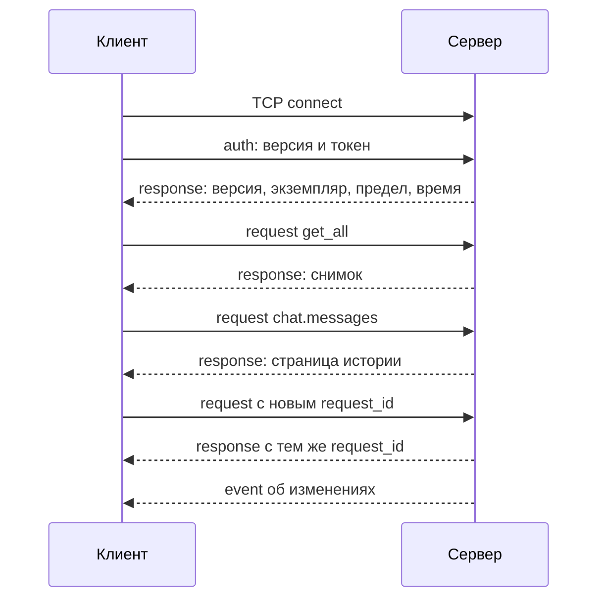

# Протокол клиента и сервера: версия 1

**Статус: контракт принят решениями 45–47; сервер связан с предметными сервисами по решению 49.**
Конверты, параметры, предметная сериализация и накопитель кадров проверены тестами
([ProtocolCodec](modules/ProtocolCodec.md)). [TcpServer](modules/TcpServer.md) обслуживает
сессии по решению 48. [ServerRuntime](modules/ServerRuntime.md) подключает
apps/server, SQLite и обработчики каталога. Настоящие модель/внешние сервисы
в связке и пользовательские клиенты пока не проверены. Старые клиенты не поддерживаются.

История и профиль общие, каждое устройство самостоятельно выбирает открытый чат.
Приветствия и вечерний опрос направляются в постоянную беседу «Основной».
Записи после обрыва связи автоматически не повторяются; список задач из одной
команды создаётся атомарно. Эти правила и технические рамки ниже согласованы
2026-11-08. Сервер использует отдельный ChatService с явным chat_id для операции,
без сохранения общего выбора.

## Назначение и границы

Один личный сервер владеет данными, историей чатов, профилем, настройками модели
и выполнением операций. Desktop и mobile передают действия и отображают результат.
Клиент не отправляет готовый System, историю для LLM, адрес модели или SQL.
Системный промпт, контекст, поиск, проверки и подтверждения формирует сервер.

Транспорт по решению 3 — TCP, JSON-объекты по строкам, первое сообщение auth,
доступ через Tailscale. Порт задаётся настройками сервера; 8765 — предложенное
обычное значение, не прошитый личный адрес. Собственного TLS в этом контракте нет.
Токен находится в настройках, не в репозитории, ошибках, снимках или событиях.

Flutter-клиент и старый Qt-клиент с их прежними сообщениями не поддерживаются.
Новая версия 1 не означает совместимость со старым неверсионированным протоколом.

## Кодирование и рамки сообщений

- UTF-8 без BOM, один JSON-объект и один байт LF в конце. Внутри строк переводы
  строки представлены JSON-экранированием. JSON — по [RFC 8259](https://www.rfc-editor.org/rfc/rfc8259).
- TCP не сохраняет границы сообщений: одна запись может приходить частями,
  несколько записей — одним блоком. Получатель накапливает байты до LF и только
  затем разбирает UTF-8 и JSON. Части многобайтового символа отдельно не декодируются.
- Исходный предел версии 1 — 1 048 576 байт до LF. Он применяется и к
  незавершённой строке, чтобы буфер не рос бесконечно. Сервер объявляет предел
  после auth; клиент с меньшим пределом отказывается от несовместимой сессии.
- Пустая строка, неверный UTF-8/JSON, массив или примитив вместо объекта,
  превышение предела — protocol_error и закрытие соединения. Ничего из такой
  записи не исполняется. EOF с неполной строкой не превращается в команду.
  Буфер принадлежит одному соединению и очищается при обрыве; оставшиеся байты
  не переносятся в новое подключение.
- Обычные запросы с корректным конвертом, но неизвестным методом/параметром,
  получают коррелированный отказ без закрытия сессии.
- Имена полей, типов и методов чувствительны к регистру; поля имеют snake_case.
  Генерируемые объекты имеют уникальные имена полей. Вход разбирается Qt JSON:
  отдельное выявление дубликатов ключей не обещается, последнее значение побеждает.
  Схема после разбора проверяется строго: неизвестные поля, пропуски обязательных
  значений и неверные типы отклоняются. Неизвестные поля не становятся нулями.

Предел кадра не разрешает обрезать сохранённый текст. Слишком большой исходящий
результат даёт response_too_large, данные остаются целыми. Для истории сообщений
используются страницы. Если отдельное сообщение не помещается, нужен больший
согласованный предел; фрагментация одного сообщения в версию 1 не входит.

## Общие значения

| Значение | Представление |
| --- | --- |
| ID записи | Строка десятичных цифр от `"1"` до `"9223372036854775807"`, без знака и ведущих нулей |
| ID запроса | Непустая строка до 64 ASCII-символов: буквы, цифры, `_`, `-`; уникальна в пределах соединения |
| ID экземпляра сервера | Непрозрачная строка, новая после перезапуска процесса |
| Необязательное значение | Явный `null`, если в схеме поля не сказано иное; пустая строка не заменяет отсутствие даты/координат |
| Дата | Корректная календарная строка `YYYY-MM-DD` |
| Время события | `HH:MM`, либо `null` для события без времени |
| Местный момент | `YYYY-MM-DDTHH:MM:SS`, местная шкала сервера по решениям 14 и 33; не UTC и без выдуманного `Z` |
| Зона сервера | IANA-идентификатор из среды/настроек сервера, сообщается после auth; клиент помечает время этой зоной |
| Координаты | Объект `{"latitude":0,"longitude":0}`; конечные числа, −90…90 и −180…180; нули допустимы |
| Отсутствие координат | `null`, никогда `(0, 0)` как условный признак |
| Перечисление | Строковое имя значения core: `Foot`, `Driving`, `Bike`, `Pending` и т. п. |

ID передаются строками, чтобы не терять точность int64 на границах JSON/JavaScript.
Числовые координаты, значения привычек и прогнозы остаются JSON-числами;
NaN и бесконечность не допускаются. Тексты сохраняются полностью, включая
пробелы и переносы; проверки trim не переписывают исходник.

## Соединение и авторизация

В течение 10 секунд после подключения клиент отправляет только auth:

```json
{"type":"auth","version":1,"request_id":"auth-1","token":"<token-from-settings>"}
```

Успех имеет общий формат response:

```json
{"type":"response","request_id":"auth-1","ok":true,"result":{"version":1,"server_instance_id":"instance-example","max_frame_bytes":1048576,"server_time":"2026-11-07T20:00:00","time_zone":"Etc/UTC"}}
```

Неподдерживаемая версия — unsupported_version, неверный токен — unauthorized,
после ответа соединение закрывается. Отсутствие auth вовремя или иной первый
тип — protocol_error и закрытие. До авторизации данные пользователя и события
не отправляются. Повторный auth в авторизованном соединении не меняет пользователя
или состояние: это отказ invalid_request.

После auth клиент запрашивает get_all, затем нужные страницы истории/списки.
После любого переподключения auth выполняется заново; новый server_instance_id
означает, что локальные временные предложения/состояние запросов нельзя считать
действующими. Сохранённые предметные ID переживают перезапуск.

Клиентская политика решения 50 реализована в [TcpClient](modules/TcpClient.md):
максимум пять попыток на цикл, включая первую, с возрастающей ограниченной
задержкой. После Ready счёт сбрасывается; после исчерпания попыток нужно ручное
переподключение. Оно сбрасывает счёт, а явное отключение отменяет таймеры.
Новая сессия автоматически выполняет только auth/get_all; прежние предметные
запросы не воспроизводятся. Ошибки авторизации/совместимости останавливают цикл
до исправления и ручного действия. Эта политика не меняет конверты версии 1.



## Запрос, ответ и событие

После auth каждый запрос содержит ровно type, request_id, method и params:

```json
{"type":"request","request_id":"req-1","method":"task.create","params":{"title":"Купить продукты","due_date":null,"priority":"Normal"}}
```

При сохранении возвращается подтверждённый результат с тем же request_id:

```json
{"type":"response","request_id":"req-1","ok":true,"result":{"task_id":"17"}}
```

У запроса один итоговый response, если соединение сохранилось. Ответы разных
запросов и события могут перемежаться; клиент связывает ответы по request_id,
а не по их положению в TCP-потоке. Промежуточный event не заменяет итоговый ответ.
Неизвестный/повторный request_id ответа не завершает другой ожидающий запрос.
Повтор ID запроса в том же соединении отклоняется без повторного исполнения;
этот учёт временный, не журнал подтверждённых операций на диске.

Вариант ошибки:

```json
{"type":"response","request_id":"req-1","ok":false,"error":{"code":"validation_failed","message":"Укажите корректную дату.","effect":"none","user_message_id":null}}
```

В success нет error, в отказе нет result. `message` — понятный текст без токена,
SQL, адресов внутренних сервисов и технических тел HTTP. Клиент принимает решение
по code и effect, а не по русскому тексту.

`effect` описывает только данную операцию:

- `none` — сервер подтверждает отсутствие её предметных изменений;
- `user_saved` — для чата сохранён исходный User, но ответа Assistant нет;
  user_message_id содержит его ID, нужно прочитать историю и использовать chat.retry;
- `unknown` — сервер не может подтвердить итог; автоматическое повторение записи
  недопустимо, сначала нужно восстановить соединение и перечитать данные.

При ошибке формата, когда request_id нельзя надёжно получить:

```json
{"type":"protocol_error","error":{"code":"invalid_frame","message":"Неверный формат сообщения."}}
```

После protocol_error соединение закрывается. Авторизованный клиент не получает
ложный success только потому, что сервер распознал имя команды.

## Начальный снимок

`get_all`, params `{}`, возвращает:

- `server_time`, `time_zone` и `main_chat_id` постоянной беседы «Основной»;
  открытый чат хранится на устройстве, не в снимке;
- `tasks` — полный список Task в порядке TaskService;
- `reminders` — активные напоминания в порядке ReminderService;
- `habits` — привычки с рассчитанным текущим прогрессом;
- `events_today` — вхождения событий на текущую местную дату сервера.

Полные сообщения, дневник, все версии профиля и история расчётов не вкладываются
в каждый снимок: их читают отдельными запросами. get_all не создаёт фактов,
опросов, маршрутов, дневника или сообщений. Это снимок для обновления интерфейса,
а не команда «синхронизировать изменения клиента с базой».

## Каталог методов версии 1

Все параметры в таблице обязательны, если явно не отмечены опциональными.
`id` в описании обозначает предметный ID; в JSON используется указанное полное
имя `task_id`, `chat_id` и т. п., не request_id. При успешной записи результат
содержит ID созданной/изменённой записи либо `{"deleted":true}` для удаления.
Отсутствующая запись для изменения/удаления — not_found, не ложный успех.

| Метод | params | Успешный result |
| --- | --- | --- |
| `get_all` | `{}` | Начальный снимок выше |
| `ping` | `{}` | `{server_time}`; не выполняет предметных действий |
| `task.create` | `{title, due_date, priority}` | `{task_id}` |
| `task.update` | `{task_id, title, due_date, priority}` | `{task_id}`; created_at/done не сбрасываются |
| `task.set_done` | `{task_id, done}` | `{task_id}` |
| `task.delete` | `{task_id}` | `{deleted:true}` |
| `event.create` | `{title, date, time, description, repeat}` | `{event_id}` |
| `event.update` | `{event_id, title, date, time, description, repeat}` | `{event_id}`; меняется исходная серия |
| `event.delete` | `{event_id}` | `{deleted:true}` |
| `calendar.month` | `{year, month}` | `{year, month, days}`; days — числа месяца с вхождениями |
| `calendar.day` | `{date}` | `{date, events}`; вхождения, а не переписанные серии |
| `habit.create` | `{name, target, unit, period}` | `{habit_id}` |
| `habit.log` | `{habit_id, value}` | `{log_id}`; дата берётся из Clock сервера |
| `habit.delete` | `{habit_id}` | `{deleted:true}`; удаляется и журнал |
| `reminder.create` | Один из вариантов ниже | `{reminder_id}` |
| `reminder.delete` | `{reminder_id}` | `{deleted:true}` |
| `reminder.location.prepare` | `{reminder_id, reference}` | `{proposal_id, reminder_id, place, candidates}` |
| `reminder.location.confirm` | `{proposal_id, candidate_index}` | `{reminder_id, coordinates}` |
| `reminder.location.cancel` | `{proposal_id}` | `{cancelled:true}`; неизвестный ID — not_found |
| `chat.list` | `{}` | `{chats, main_chat_id}`; общая библиотека бесед без общего выбора экрана |
| `chat.create` | `{}` | `{chat_id}`; другие устройства получают обновление списка, их открытая беседа не меняется |
| `chat.messages` | `{chat_id, after_message_id, limit}` | `{chat_id, messages, next_after_message_id, has_more}` |
| `chat.send` | `{chat_id, text, search_query}` | `{chat_id, user_message_id, message_id, text, tone, mood_id, profile_fact_ids, search_sources}` |
| `chat.retry` | `{chat_id, expected_user_message_id, search_query}` | Тот же результат, без второго User |
| `profile.get` | `{}` | `{facts}` со всеми версиями и источниками |
| `profile.remember` | `{text, tags, always_include}` | `{fact_id}`; ручные повторы сохраняются |
| `mood.history` | `{days}` | `{entries}` по правилам MoodService |
| `mood.record` | `{score, note}` | `{mood_id}`; только явное действие пользователя |
| `route.build` | `{origin, destination, reference, mode}` | `{calculation_id, distance_meters, duration_seconds, approximate, steps, text}` |
| `route.history` | `{}` | `{recent, statistics}`; последние пять, статистика расчётов |
| `weather.get` | `{coordinates}` | Типизированные показатели WeatherForecast и `{text}` сводки |
| `location.update` | `{coordinates}` | `{checked:true}`; проверка близости геонапоминаний по переданной точке |
| `command.execute` | `{text, chat_id, reference}` | `{handled, reply, created_ids}` либо предметный отказ |

`chat.messages.after_message_id` — null для начала, иначе ID последнего уже
полученного сообщения. Страница идёт по ID по возрастанию; допустимый limit
от 1 до 100. Сервер может вернуть меньше целых сообщений из-за предела кадра,
но не обрезает text. При has_more=true next_after_message_id обязательно
продвигается. Пустая завершающая страница имеет has_more=false.

`search_query=null` означает обработку без поиска; непустая строка — явный поиск.
Пустая строка не заменяет null. Для chat.retry требуются ID именно последнего
User в указанном чате и повторная передача режима/фразы; несовпадение — conflict.
Клиент не пересылает предыдущие сообщения или System вместо text.

Для `route.build` origin — объект координат либо непустое название,
destination — непустое название. При origin-координатах reference=null:
опорная точка уже задана началом. При двух названиях reference содержит явные
координаты для выбора ближайших кандидатов обоих мест. Обязательный
calculation_id возвращает ID записи истории; NavigationService возвращает его
после успешного сохранения расчёта.

`command.execute` вызывает CommandParser на сервере. reference может быть null;
для команды маршрута тогда возвращается location_required, без фиктивной точки.
При handled=false изменений, записи чата и автоматического вызова LLM нет:
клиент явно решает, отправлять ли текст через chat.send. Для распознанной команды
сервер подтверждает только успешно выполненную операцию. Для составной команды
списка задач используется одна транзакция: все задачи либо ни одной, по решению 47.
По решению 49 успешная распознанная команда сохраняет полный исходный User,
подтверждение Assistant и предметные изменения одной транзакцией в указанном
chat_id. Отклонённая команда не оставляет ни сообщений, ни частичных предметных
изменений. Все пункты списка проверяются до записи; короткие пункты не пропускаются
с сохранением остальных. Внешний расчёт маршрута выполняется до транзакции;
кэш кандидатов может обновиться независимо от её результата. При неизвестном
результате записи после обрыва автоматического повтора нет.

## Напоминания и выбор места

Варианты params для reminder.create:

- Timed: `{kind:"Timed", title, due_at}`;
- Recurring: `{kind:"Recurring", title, interval_minutes}`; первый срок определяет
  ReminderService по текущему серверному времени;
- Place: `{kind:"Place", title, place}`; координаты не подставляются из нулей
  и не выбираются автоматически. Назначаются отдельным подтверждением.

Предложение содержит упорядоченные `{name, coordinates}`. candidate_index —
целое число от нуля, относящееся к внутреннему списку сервера. confirm не принимает
произвольные координаты вместо индекса. Предложения привязаны к авторизованному
соединению; серверный адаптер должен исключить подтверждение чужого предложения.
При разрыве соединения его предложения отменяются. Перезапуск сервера их не сохраняет.
Изменившееся напоминание — stale_proposal, повторный поиск нужен заново.

`location.update` используется только после согласия пользователя на передачу
геолокации. Отказ/отключение этой функции не создаёт координаты по умолчанию.
Маршруты и погода получают координаты в собственных запросах: молчаливой
подстановки старой позиции телефона в этом проекте контракта нет.

## Предметные объекты

Это wire-представление существующих типов core, без Qt-типов и внутренних полей БД.
Указанные ниже поля обязательны в результатах; возможное отсутствие значения — null.

| Объект | Поля |
| --- | --- |
| Task | `id, title, due_date, priority, done, created_at` |
| Event | `id, title, date, time, description, repeat` |
| Вхождение события | `event` (исходная серия), `occurrence_date` |
| Habit | `id, name, target, unit, period` |
| Прогресс привычки | `habit, progress`; сумма отметок за текущий период без ограничения целью |
| Reminder Timed | `id, kind, title, due_at, status` |
| Reminder Recurring | `id, kind, title, due_at, interval_minutes` |
| Reminder Place | `id, kind, title, place, coordinates, status` |
| Chat | `id, title` |
| ChatMessage | `id, chat_id, role, text, created_at` |
| MoodEntry | `id, recorded_at, score, note` |
| UserProfileFact | `id, text, tags, always_include, source, replaces_fact_id, superseded_by_fact_id` |
| ProfileFactSource | `chat_id, message_id, mood_id` |
| WebSearchResult | `title, url, snippet`; список только текущей операции, ссылки также в сохранённом text |
| RouteCalculation | `id, created_at, origin_name, destination_name, origin, destination, mode, distance_meters, duration_seconds, approximate` |
| RouteStep | `type, modifier, street, distance_meters, exit_number` |

Значения перечислений: priority — Low/Normal/High; repeat — None/Daily/Weekly/Monthly;
period — Day/Week; status — Pending/Fired/Missed; role — User/Assistant;
score/tone — Negative/Neutral/Positive, tone может быть null; mode — Foot/Bike/Driving.
profile.source=null означает ручной факт без источника. Источники и ссылки версий
не назначаются клиентом через profile.remember.

WeatherForecast содержит `temperature_celsius`, `apparent_temperature_celsius`,
`weather_code`, `wind_speed_kilometers_per_hour`, `maximum_temperature_celsius`,
`minimum_temperature_celsius`, `precipitation_probability_percent`; последние три
значения могут быть null, минимум/максимум отсутствуют только вместе.
RouteCalculationStatistics содержит `routed_count`, `approximate_count`,
`planned_distance_meters`, `planned_duration_seconds`.
Метры, секунды, °C
и км/ч передаются числами, а не строками вроде «1.5 км». Русский text —
дополнительное представление сервера, не замена типизированных данных.

## События сервера

События получают только авторизованные соединения. Они содержат server_instance_id
и непрозрачный event_id, уникальный внутри этого экземпляра процесса.

```json
{"type":"event","server_instance_id":"instance-example","event_id":"event-1","name":"state.changed","data":{"scopes":["tasks","reminders"]}}
```

| name | data и действие клиента |
| --- | --- |
| `state.changed` | `scopes` из tasks/reminders/events/habits/profile/moods/routes/chats/messages; перечитать затронутые данные |
| `chat.changed` | `{chat_id}`; перечитать сообщения, дедупликация по предметным ID |
| `assistant.message` | `{chat_id, message_id}`; сохранённое приветствие/вечерний опрос, текст читается из истории |
| `reminder.due` | `{reminder_id, title}`; показ уведомления, дедупликация по экземпляру и event_id |
| `event.warning` | `{event_id, occurrence_date, kind, text}`; вид предупреждения по EventWarningService |

Изменения объявляются после успешной записи. При откате событие успеха не
отправляется. События могут прийти раньше/позже response другой операции,
поэтому не используются как её подтверждение. Это не гарантированная доставка:
после обрыва клиент восстанавливает данные через get_all и чтение истории.
Никаких обещаний exactly-once для уведомлений или фоновой очереди воспроизведения
эта версия не делает; core также пока не даёт такой гарантии.

## Каталог ошибок

| code | Значение |
| --- | --- |
| `unauthorized` | Нет подходящей авторизации |
| `unsupported_version` | Сервер не поддерживает указанную версию |
| `invalid_frame` | Невозможен разбор/превышен размер кадра; соединение закрывается |
| `invalid_request` | Неверный конверт/тип параметра/неизвестное поле |
| `unknown_method` | Нет такого метода версии 1 |
| `validation_failed` | Предметный отказ core с понятной причиной |
| `not_found` | Нет предметной записи, места, маршрута или материалов поиска; method задаёт контекст |
| `conflict` | Чат/последний User не соответствует ожидаемому состоянию |
| `stale_proposal` | Предложение точки устарело или принадлежит другой сессии |
| `busy` | Операция сейчас не может безопасно начаться; ничего не записано |
| `location_required` | Операции нужны явные координаты |
| `search_unavailable` / `search_invalid_response` | Поиск не дал пригодного результата, LLM не подставляется |
| `llm_unavailable` / `llm_invalid_response` | Ошибка модели без частичного ответа |
| `context_budget_exceeded` | Полный обязательный контекст не помещается |
| `storage_error` | Отказ записи/чтения; effect определяет допустимый следующий шаг |
| `response_too_large` | Результат целиком не помещается в кадр; текст не обрезан |

Бюджет кодовых точек контекста, лимит генерации и модель задаются JSON-настройками
сервера. Клиент не увеличивает их произвольными полями запроса. Точный контроль
токенов и качество настоящей модели в этой связке ещё не проверены.

## Согласованные правила взаимодействия

### 1. Выбор текущего чата на устройствах

**Принято решением 46:** список бесед, сообщения и профиль памяти общие;
выбор открытой беседы независим для каждого устройства. На ПК можно открыть
«Работа», на телефоне — «Самочувствие». Ответ телефона сохраняется в
«Самочувствие», экран ПК продолжает показывать «Работа». При открытии
«Самочувствие» на ПК видны те же сообщения. Если оба экрана показывают одну
беседу, новые сообщения этой беседы отображаются на обоих устройствах.

Смена экрана — локальное действие клиента: chat.select и chat.selected в
новом протоколе не нужны. В chat.messages/send/retry/command.execute передаётся
chat_id. Существование этого чата и ожидаемый User для повтора проверяются
сервером; выбор другой беседы на соседнем устройстве не вызывает conflict.
Итоговый ответ всегда относится к ID исходной беседы, даже если пользователь
уже открыл другую. Изменение списка бесед или получение сообщения не должны
автоматически переключать экран. Способ локального сохранения выбора и
первое открытие экрана будут уточняться при реализации клиентов.

Сервер создаёт ChatService для явного chat_id без чтения/записи общего выбора.
Занятый обработчик отклоняет новую изменяющую/сетевую операцию как busy до записи;
локальное переключение экрана и чтение другой беседы не должны зависеть от
смены общего серверного выбора. Синхронный LLM не должен останавливать проверки
сроков и сетевое обслуживание. По решению 48 транспорт передаёт запрос сигналом
и принимает завершение отдельным методом; слот должен быстро вернуть управление.
По решению 49 HTTP/LLM выполняются постоянным рабочим потоком без SQLite,
а предметные результаты сохраняет владелец базы. Пока синхронная связка ожидает
рабочий ответ, локальный цикл событий обслуживает чтение и проверки сроков.
Приветствие/опрос откладываются до завершения текущей предметной операции.

### 2. Обрыв после изменяющего запроса

**Принято решением 47 — записи автоматически не повторяются:** request_id связывает ответ
внутри соединения, но не является постоянным ключом идемпотентности. При обрыве
после отправки пользователь видит «результат неизвестен». Клиент заново получает
состояние/историю, затем предлагает осознанное следующее действие.
При тайм-ауте command.execute не отправляется автоматически тот же text в chat.send.
Для оставшегося последнего User используется chat.retry с его ID и режимом поиска.

Постоянный журнал операций и дедупликация после перезапуска в эту версию
не входят. Они потребовали бы дополнительной схемы и согласования атомарности
с User/ответом. Поэтому протокол не обещает безопасного автоматического повтора
любого изменяющего запроса после потери ответа.

### 3. Список задач из одной текстовой команды

**Принято решением 47 — атомарная запись:** если CommandParser распознал список,
сначала проверить все элементы, затем создать их в одной общей транзакции.
При отказе любого элемента или фиксации не остаётся половины списка.
Созданные ID и подтверждение возвращаются после commit; при подтверждённом
откате effect=none. Ошибка отката — effect=unknown, без обещания безопасного повтора.
Откат касается только новых задач этой команды; ранее сохранённые задачи
остаются в базе. Частичный успех списка не возвращается. Обрыв сети после commit
не откатывает задачи: клиент восстанавливает состояние по правилу выше.

### 4. Куда направлять проактивные сообщения

**Принято решением 47 — одна постоянная беседа «Основной»:** при первом подключении
этой функции сервер создаёт её один раз и сохраняет ID. После перезапуска
используется тот же ID; по одному имени беседа каждый раз не создаётся.
Она видна в общей библиотеке на обоих устройствах и не подменяет их локальный
выбор открытой беседы. Приветствия и вечерний опрос сохраняются именно в ней.

Если сейчас открыт другой чат, клиент показывает уведомление о новом сообщении,
но сам не переключает экран. Нажатие на уведомление открывает «Основной» только
на том устройстве, где нажали. Ответ в другой беседе не считается ответом на
вечерний опрос: ожидание остаётся привязано к ID беседы и сообщения по решению 38.
Профиль памяти остаётся общим, а темы других бесед не ограничиваются.

До начала обслуживания клиентов приложение должно восстановить или создать
«Основной» и сохранить её ID. Он передаётся как main_chat_id в get_all и chat.list;
определять служебную беседу только по названию нельзя. Ссылка хранится в
server_state миграции 13 и атомарно создаётся через SqliteChatRepository::ensureMainChat.
Формат события assistant.message уже содержит конкретные chat_id/message_id;
получение события само по себе не переключает экран устройства.

## Реализация и оставшиеся проверки

Контракт согласован. Типы/JSON-кодек с проверками строк, ID, дат, перечислений,
параметров и рамок сообщений реализованы в infra. TCP-сессии, авторизация, учёт ID,
ответы и события реализованы в TcpServer. ServerRuntime подключает каталог
методов, SQLite и HTTP-исполнитель по решению 49. Реализованы ID расчёта и User,
права TCP-сессии на предложения адресов, атомарные команды и постоянный основной чат.
Независимый [ProtocolTestClient](modules/ProtocolTestClient.md) проверяет собранный
msa_server отдельным процессом: потерю подтверждения, завершение после обрыва,
повтор с сохранённым User, EOF, права сессий на ответы и восстановление после
перезапуска. Производственный TcpClient реализует асинхронную клиентскую сессию
и ограниченное восстановление по решению 50; подключение к клиентским приложениям
и предметные адаптеры данных ещё впереди. Сборка и локальные тесты успешны.
Настоящие модель/поставщики, Tailscale и пользовательские экраны ещё не проверены.

Сверены разрешённые syncserver.h/.cpp и android_client/lib/sync_service.dart.
Из старой схемы сохраняются возможности, а не её конверты, молчаливые отказы,
нулевые координаты и подстановка готового промпта клиентом. Импорт базы, старые
клиентские токены/адреса и Flutter-совместимость в этот шаг не входят.

